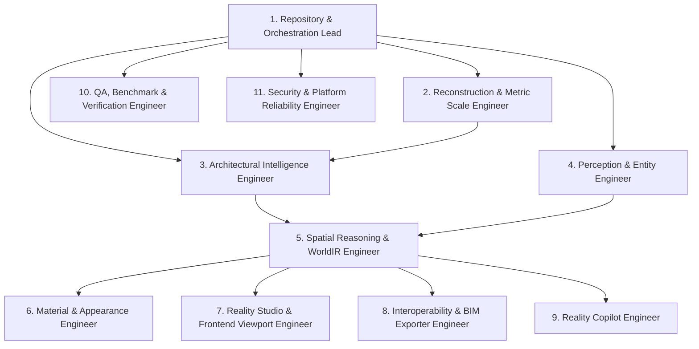

> **SUPERSEDED (2026-11-10).** Current status lives in [docs/STATUS.md](docs/STATUS.md); current plan in docs/blueprint/34_MASTER_PLAN.md. Kept for history.

# Reality Engine — Coding Agent Assignments
## Subsystem Ownership, File Boundaries, Cross-Agent Contracts, and Acceptance Criteria

> **Document ID**: `RE-AGNT-007`  
> **Status**: APPROVED GOVERNANCE SPECIFICATION  
> **Baseline**: `origin/main` @ `6db0f86`  

---

## 1. Governance Principles & Architectural Boundaries

1. **Strict Ownership Boundaries**: Each agent owns specific repository paths. An agent must not modify files owned by another agent without coordinating through approved abstract interfaces.
2. **Contract Preservation**: Under no circumstances may an agent change the serialization contract of `WorldIR` (`world_ir/schema_v1.py`) or `WorldStore` without architectural review.
3. **Evidence-First Verification**: An agent's task is complete only when accompanied by passing unit tests, integration pipeline tests, and benchmark metrics.

---

## 2. Agent Role Matrix & Responsibilities

---

## 3. Detailed Agent Specifications

### Agent 1: Repository & Orchestration Lead
* **Primary Responsibility**: Autonomous pipeline coordination, top-level architecture integrity, CI/CD pipeline, and dependency management.
* **Owned Files & Directories**:
  - `engine/orchestrator/universal_pipeline.py`
  - `.github/workflows/ci.yml`
  - `pyproject.toml`, `setup.py`, `package.json`
  - `docs/TECHNOLOGY_REGISTRY.md`, `docs/CAPABILITY_MATRIX.md`
* **Input Contracts**: Raw multi-modal evidence packages (`EvidencePackage`).
* **Output Contracts**: Fully orchestrated end-to-end reconstruction runs resulting in validated `WorldIR`.
* **Acceptance Criteria**: Single-command execution of entire pipeline from folder of images to exported files with $<30\text{s}$ runtime budget for 100 images.

---

### Agent 2: Reconstruction & Metric Scale Engineer
* **Primary Responsibility**: Feature matching, bundle adjustment, camera pose estimation, metric scale recovery, and multi-view dense point cloud generation.
* **Owned Files & Directories**:
  - `reconstruction/matching/` (`lightglue_matcher.py`)
  - `reconstruction/scale/` (`metric_anchor.py`)
  - `reconstruction/mvs/` (`dense_cloud.py`, `point_cloud_ops.py`)
  - `reconstruction/backend/` (`colmap_backend.py`, `interface.py`)
  - `reconstruction/batch.py`
* **Input Contracts**: `List[EvidenceItem]` with EXIF metadata, decoded images, and GPS coordinates.
* **Output Contracts**: `ReconstructionResult` containing camera poses $\mathbf{R}, \mathbf{t}$, verified dense 3D points $\mathbf{X}_k$, and metric scale factor $\lambda$.
* **Acceptance Criteria**: Metric scale error $\le 1.5\%$; reprojection error $< 1.0\text{ px}$; 100% test pass on `tests/test_dense_point_cloud.py`.

---

### Agent 3: Architectural Intelligence Engineer
* **Primary Responsibility**: Plane detection, wall classification, non-Manhattan room boundary solving, door/window cutout carving, and building topology graphs.
* **Owned Files & Directories**:
  - `perception/geometry/` (`planes.py`, `orientation.py`)
  - `perception/architecture/` (`scene.py`, `openings.py`)
  - `evidence/promote_rooms.py`, `evidence/promote_planes.py`
  - `engine/compiler/topology_graph.py`
* **Input Contracts**: Reconstructed dense point clouds and camera poses.
* **Output Contracts**: Typed architectural entities (`ROOM`, `WALL`, `FLOOR`, `CEILING`, `DOOR`, `WINDOW`, `STAIRS`) with closed polygonal boundary rings.
* **Acceptance Criteria**: 100% closed room polygons; zero topological intersections; room area error $\le 2.0\%$ on golden benchmark suites.

---

### Agent 4: Perception & Entity Intelligence Engineer
* **Primary Responsibility**: Hierarchical entity ontology, high-resolution patch inspection for fine fixtures (sockets, switches, plumbing), and cross-view Hungarian tracking.
* **Owned Files & Directories**:
  - `perception/entities/` (`taxonomy.py`)
  - `perception/fixtures/` (`patch_extractor.py`, `detector.py`)
  - `perception/instances/` (`association.py`, `interface.py`)
  - `perception/environment/` (`outdoor.py`)
* **Input Contracts**: Orthorectified wall patches, raw images, and 3D surface planes.
* **Output Contracts**: Identified 3D physical entities with oriented bounding boxes, taxonomy class IDs, and supporting evidence references.
* **Acceptance Criteria**: $\ge 90\%$ precision on fine fixtures (sockets/switches); $\ge 98\%$ tracking identity accuracy across multi-view photos.

---

### Agent 5: Spatial Reasoning & WorldIR Engineer
* **Primary Responsibility**: Bilateral relationship inference, cross-entity validation gates, competing hypothesis reconciliation, and immutable WorldStore persistence.
* **Owned Files & Directories**:
  - `perception/spatial_reasoning.py`
  - `world_ir/world_v1.py`, `world_ir/schema_v1.py`
  - `world_ir/store.py`, `world_ir/validation.py`
  - `world_ir/conflict.py`, `world_ir/diff.py`
* **Input Contracts**: Reconstructed architectural entities and detected physical fixtures.
* **Output Contracts**: Canonical, validated `WorldIR` containing bilateral relationships (`ATTACHED_TO`, `RESTS_ON`, `CONTAINS`), serialized atomically to `WorldStore`.
* **Acceptance Criteria**: Zero invalid physical relationships; deterministic JSON serialization; 100% pass on `tests/test_spatial_reasoning.py` and `tests/test_consistency_validation.py`.

---

### Agent 6: Material, Appearance & Texture Engineer
* **Primary Responsibility**: Surface material classification, PBR parameter extraction (albedo, roughness, metallic), UV unwrapping, and photo texture projection.
* **Owned Files & Directories**:
  - `perception/materials/` (`classifier.py`, `appearance.py`)
  - `engine/render/textures/` (`projection.py`, `uv_unwrap.py`)
* **Input Contracts**: Surface geometry (meshes and planes) and multi-view photographs.
* **Output Contracts**: PBR material definitions (`Material`) and content-addressed texture atlases (`artifact://<sha256>`).
* **Acceptance Criteria**: Macro F1-score $\ge 90\%$ across 12 standard material classes; artifact digest validation matching SHA-256 integrity.

---

### Agent 7: Reality Studio & Frontend Viewport Engineer
* **Primary Responsibility**: Three.js WebGL/WebGPU 3D viewport, precision editing gizmos, outliner hierarchy, real-time 3D measurements, and undo/redo history.
* **Owned Files & Directories**:
  - `frontend/src/components/studio/` (`ThreeViewport.tsx`, `InspectorPanel.tsx`, `OutlinerPanel.tsx`, `ExportModal.tsx`)
  - `frontend/src/lib/studio/` (`three-scene.ts`, `measure-model.ts`, `history-stack.ts`)
  - `frontend/tests/contract/`
* **Input Contracts**: REST API `/api/worlds/{id}` returning WorldIR JSON and artifact URIs.
* **Output Contracts**: Interactive 60 FPS viewport, user geometry edits, and measurement outputs.
* **Acceptance Criteria**: 100% contract test pass rate (308/308 frontend tests); zero memory leaks across scene reloads.

---

### Agent 8: Interoperability & BIM Exporter Engineer
* **Primary Responsibility**: Industry-standard CAD, BIM, game engine, and mesh exporters.
* **Owned Files & Directories**:
  - `exporters/ifc_bridge.py`
  - `exporters/usd/` (`exporter.py`)
  - `exporters/gltf/` (`exporter.py`)
  - `exporters/mesh/` (`obj.py`, `ply.py`, `stl.py`)
  - `exporters/floorplan.py`
  - `exporters/{godot,unreal,habitat,cityjson,citygml}/`
* **Input Contracts**: Canonical `WorldIR` and `ArtifactStore`.
* **Output Contracts**: Spec-compliant binary and text export files (IFC4, USDA, glTF, GLB, OBJ, DXF, SVG, PDF).
* **Acceptance Criteria**: Successful parse and validation in IfcOpenShell, Blender, and standard CAD viewers; 100% pass on `tests/test_core_exports.py`.

---

### Agent 9: Reality Copilot Engineer
* **Primary Responsibility**: Grounded natural-language query and mutation engine operating directly over SceneGraph and WorldIR.
* **Owned Files & Directories**:
  - `assistant/copilot_engine.py`
  - `assistant/query_translator.py`
  - `apps/api/routes_assistant.py`
* **Input Contracts**: Natural-language text queries from user and active `WorldIR` state.
* **Output Contracts**: Grounded factual answers and validated typed mutation commands (`MoveEntityCommand`).
* **Acceptance Criteria**: 100% factual accuracy on spatial questions; zero fabricated dimensions or hallucinations.

---

### Agent 10: QA, Benchmark & Scientific Verification Engineer
* **Primary Responsibility**: Continuous automated benchmark evaluation across 12 physical domains, regression testing, and scientific validation.
* **Owned Files & Directories**:
  - `benchmarks/golden_datasets.py`
  - `benchmarks/spatial_index_bench.py`, `benchmarks/pipeline_measurement.py`
  - `tests/test_golden_datasets.py`, `tests/test_golden_loop.py`
* **Input Contracts**: Full pipeline execution outputs across benchmark datasets.
* **Output Contracts**: Machine-readable JSON benchmark run records, regression alarms, and capability maturity certificates (L0–L5).
* **Acceptance Criteria**: Automated verification of 10/10 permanent benchmark suites in CI under $<60\text{s}$.

---

### Agent 11: Security & Platform Reliability Engineer
* **Primary Responsibility**: OWASP Top 10 API security, path traversal prevention, worker process sandboxing, rate limiting, and Docker deployment.
* **Owned Files & Directories**:
  - `apps/api/auth.py`, `apps/api/main.py`
  - `apps/api/storage.py`, `apps/api/db.py`, `apps/api/jobs.py`
  - `tests/test_security_audit.py`, `tests/test_api_auth.py`
  - `Dockerfile`, `docker-compose.yml`
* **Input Contracts**: External HTTP client requests and uploaded evidence payloads.
* **Output Contracts**: Hardened, authenticated, rate-limited, containerized API services.
* **Acceptance Criteria**: 100% pass on `tests/test_security_audit.py`; zero CWE-22 traversal vectors; zero hardcoded credentials.
