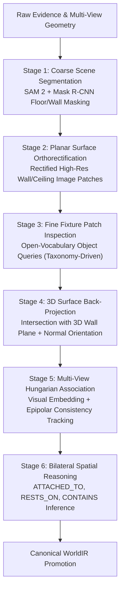

# Reality Engine — Entity Intelligence Master Plan
## Universal Hierarchical Ontology, Fine Fixture Detection, and Attribute Extraction

> **Document ID**: `RE-ENT-004`  
> **Status**: APPROVED ONTOLOGY SPECIFICATION  
> **Baseline**: `origin/main` @ `6db0f86`  

---

## 1. Vision: Comprehensive Real-World Entity Understanding

A true digital twin cannot stop at coarse room boundaries and floor planes. A functional, intelligent digital world must understand the fine-grained physical objects that humans interact with every day:
- **Electrical**: Electrical sockets, light switches, breaker panels, ceiling fans, ambient lighting.
- **Plumbing**: Water faucets, sinks, toilets, drainage valves, shower fixtures.
- **Mechanical & HVAC**: Air conditioning vents, radiators, thermostats, ductwork.
- **Furniture & Appliances**: Seating, tables, storage, kitchen appliances.
- **Civil Infrastructure**: Roads, sidewalks, curbs, trees, lampposts, manhole covers.
- **Architectural Details**: Door handles, hinges, locks, baseboards, crown mouldings.

Every entity is represented not as a disconnected bounding box, but as a first-class, evidence-grounded object in `WorldIR` possessing persistent identity, geometric extents, physical relationships, and material properties.

---

## 2. Universal Hierarchical Entity Ontology

The ontology expands the 114 registered classes in `perception/entities/taxonomy.py` into an extensible, typed taxonomy across 8 major domains:

```mermaid
graph TD
    Root["Universal Physical Entity"] --> Arch["1. Architecture & Envelope"]
    Root --> Elec["2. Electrical & Lighting"]
    Root --> Plumb["3. Plumbing & Sanitary"]
    Root --> Furn["4. Furniture & Appliances"]
    Root --> Mech["5. HVAC & Mechanical"]
    Root --> Infra["6. Exterior & Infrastructure"]
    Root --> Veg["7. Landscape & Vegetation"]
    Root --> Det["8. Architectural Details & Finishes"]

    Arch --> A1["Building / Storey / Room"]
    Arch --> A2["Wall / Floor / Ceiling / Roof"]
    Arch --> A3["Door / Window / Skylight"]
    Arch --> A4["Stair / Railing / Column / Beam"]

    Elec --> E1["Switchboard / Module Plate"]
    Elec --> E2["Socket / Switch / Dimmer / USB"]
    Elec --> E3["Lighting Fixture / Ceiling Fan"]
    Elec --> E4["Electrical Panel / Circuit Breaker"]

    Plumb --> P1["Faucet / Tap / Sink / Basin"]
    Plumb --> P2["Toilet / Bidet / Urinal"]
    Plumb --> P3["Shower Head / Enclosure / Bathtub"]
    Plumb --> P4["Supply Pipe / Drain / Shutoff Valve"]

    Furn --> F1["Table / Desk / Counter"]
    Furn --> F2["Chair / Sofa / Armchair / Stool"]
    Furn --> F3["Bed / Mattress / Wardrobe / Cabinet"]
    Furn --> F4["Refrigerator / Oven / Microwave / Washer"]

    Infra --> I1["Road Surface / Road Marking"]
    Infra --> I2["Curb / Sidewalk / Footpath"]
    Infra --> I3["Lamppost / Street Sign / Traffic Signal"]
    Infra --> I4["Manhole Cover / Utility Pole / Bollard"]
```

---

## 3. Detailed Domain Specifications & Properties

### 3.1 Domain 1: Architecture & Building Envelope
* **Entities**:
  - `building`, `building.storey`, `room`, `room.corridor`, `room.kitchen`, `room.bathroom`, `room.bedroom`, `room.living`.
  - `envelope.wall`, `envelope.floor`, `envelope.ceiling`, `envelope.roof`.
  - `opening.door`, `opening.door.leaf`, `opening.door.frame`, `opening.window`, `opening.window.frame`, `opening.window.glazing`, `opening.opening`.
  - `structural.column`, `structural.beam`, `structural.arch`, `circulation.stairs`, `circulation.railing`.
* **Geometry Strategy**: Parametric solids (extruded polygons, boundary slabs) + negative CSG boolean cutouts for openings.
* **Priors**: Wall thickness $0.10\text{m} - 0.45\text{m}$; door height $2.00\text{m} - 2.40\text{m}$; door width $0.70\text{m} - 1.00\text{m}$.

### 3.2 Domain 2: Electrical Infrastructure & Lighting
* **Entities**:
  - `electrical.switchboard`: Modular faceplate ($86\text{mm}\times 86\text{mm}$ standard 1-gang up to $86\text{mm}\times 240\text{mm}$ 6-gang).
  - `electrical.switchboard.module.socket`: Power socket (Type A, B, C, D, G, M), elevation $0.30\text{m} \pm 0.05\text{m}$ (low) or $1.05\text{m} \pm 0.10\text{m}$ (countertop).
  - `electrical.switchboard.module.switch`: Rocker switch, toggle switch, push button, elevation $1.20\text{m} \pm 0.10\text{m}$ above finished floor.
  - `electrical.switchboard.module.dimmer`: Rotary control knob / slider.
  - `electrical.switchboard.module.usb`: USB-A / USB-C charging outlet.
  - `electrical.switchboard.module.data`: RJ45 Ethernet, RJ11 telephone, coaxial TV outlet.
  - `electrical.lighting.ceiling`: Flush-mount downlight, chandelier, pendant lamp.
  - `electrical.lighting.wall`: Sconce, vanity strip.
  - `electrical.fan.ceiling`: Ceiling fan with blades and downrod.
  - `electrical.panel`: Distribution board, main circuit breaker enclosure ($0.3\text{m} - 1.2\text{m}$).
* **Geometry Strategy**: Hybrid parametric faceplate box with texture-mapped module slots.

### 3.3 Domain 3: Plumbing & Sanitary Fixtures
* **Entities**:
  - `plumbing.sink.washbasin`: Bathroom vanity washbasin ($0.4\text{m} - 0.9\text{m}$).
  - `plumbing.sink.kitchen`: Undermount / drop-in kitchen sink ($0.4\text{m} - 1.2\text{m}$).
  - `plumbing.tap.faucet`: Mixer tap, pillar tap, gooseneck spout ($0.1\text{m} - 0.4\text{m}$).
  - `plumbing.toilet.commode`: Wall-hung or floor-mounted water closet ($0.4\text{m} - 0.7\text{m}$).
  - `plumbing.shower.head`: Fixed overhead rose, handheld wand.
  - `plumbing.shower.enclosure`: Glass cubicle, shower tray ($0.8\text{m} - 1.5\text{m}$).
  - `plumbing.bathtub`: Acrylic/enameled soaking tub ($1.2\text{m} - 1.9\text{m}$).
  - `plumbing.valve`: Stopcock, angle valve, isolation valve ($0.05\text{m} - 0.2\text{m}$).
  - `plumbing.drain`: Floor drain grate, shower channel.
* **Geometry Strategy**: Pre-modeled parametric meshes with dimension-fitted bounding envelopes.

### 3.4 Domain 4: Furniture & Major Appliances
* **Entities**:
  - `furniture.seating.chair`, `furniture.seating.armchair`, `furniture.seating.sofa`, `furniture.seating.stool`.
  - `furniture.table.dining`, `furniture.table.coffee`, `furniture.table.desk`.
  - `furniture.sleeping.bed`, `furniture.sleeping.mattress`.
  - `furniture.storage.cabinet`, `furniture.storage.wardrobe`, `furniture.storage.bookshelf`.
  - `furniture.kitchen.counter`, `furniture.kitchen.island`.
  - `appliance.refrigerator`, `appliance.oven`, `appliance.microwave`, `appliance.dishwasher`, `appliance.washing_machine`.
* **Geometry Strategy**: Oriented minimum bounding boxes (OMBB) with classified semantic archetype meshes.

### 3.5 Domain 5: Mechanical & HVAC
* **Entities**:
  - `hvac.unit.ac_split_indoor`: High-wall ductless indoor unit ($0.7\text{m} - 1.2\text{m}$).
  - `hvac.unit.ac_outdoor`: External condenser unit ($0.6\text{m} - 1.1\text{m}$).
  - `hvac.terminal.vent`: Return air grille, supply diffuser ($0.15\text{m} - 0.6\text{m}$).
  - `hvac.terminal.radiator`: Hydronic / electric panel radiator ($0.4\text{m} - 1.8\text{m}$).
  - `hvac.control.thermostat`: Digital wall controller ($0.08\text{m} - 0.15\text{m}$).
* **Geometry Strategy**: Parametric box enclosures with surface face louvers.

### 3.6 Domain 6: Exterior, Civil & Infrastructure
* **Entities**:
  - `road.carriageway`: Asphalt vehicular roadway.
  - `road.marking`: White/yellow centerlines, lane boundaries, pedestrian crossings.
  - `road.curb`: Concrete curb stone separating roadway and sidewalk ($0.15\text{m}$ step height).
  - `road.sidewalk`: Paved pedestrian walkway.
  - `street.lamppost`: Street lighting pole and luminaire ($3.0\text{m} - 12.0\text{m}$).
  - `street.sign`: Traffic sign, street name placard ($0.4\text{m} - 1.2\text{m}$).
  - `street.barrier`: Bollard, pedestrian guardrail, crash barrier.
  - `utility.manhole`: Cast-iron sewer / storm drain cover ($0.5\text{m} - 0.8\text{m}$).
  - `utility.pole`: Electrical transmission / telecom utility pole.
* **Geometry Strategy**: Spline-extruded continuous road/curb corridors + parametric street furniture primitives.

### 3.7 Domain 7: Landscape & Vegetation
* **Entities**:
  - `vegetation.tree`: Tree entity possessing separated `tree.trunk` (vertical cylinder) and `tree.canopy` (ellipsoidal envelope).
  - `vegetation.shrub`: Bush, hedge, ornamental shrub ($0.3\text{m} - 2.5\text{m}$).
  - `vegetation.lawn`: Planar grass surface.
  - `vegetation.planter`: Planter box, landscaping bed.
* **Geometry Strategy**: Procedural trunk cylinder + convex hull canopy mesh.

### 3.8 Domain 8: Architectural Details & Finishes
* **Entities**:
  - `finish.skirting`: Baseboard along wall-floor perimeter ($0.06\text{m} - 0.15\text{m}$ height).
  - `finish.cornice`: Crown moulding along wall-ceiling junction ($0.05\text{m} - 0.20\text{m}$).
  - `opening.door.handle`: Lever handle, door knob ($0.05\text{m} - 0.15\text{m}$).
  - `opening.door.lock`: Keyhole, deadbolt cylinder.
  - `opening.door.hinge`: Butt hinge, pivot hinge.
  - `finish.mirror`: Wall-mounted reflective mirror.
  - `finish.artwork`: Framed painting, wall print.
* **Geometry Strategy**: Extruded 2D profile paths along wall edges; detailed local meshes for hardware.

---

## 4. Multi-Stage Entity Extraction Pipeline

### 4.1 Stage 1: Coarse Scene Segmentation
Full-frame segmentation using SAM 2 and Mask R-CNN extracts coarse masks for rooms, walls, floors, ceilings, and large furniture items.

### 4.2 Stage 2: Planar Surface Orthorectification
For each detected wall plane $\mathbf{\pi} = (\mathbf{n}, d)$, all registered camera views observing the wall are gathered. High-resolution orthorectified image patches are extracted by computing the homography between camera image coordinates and wall surface coordinates.

### 4.3 Stage 3: Fine Fixture Patch Inspection
High-resolution patches are evaluated against specialized open-vocabulary detectors executing queries from `taxonomy.py` (`"electrical socket"`, `"light switch"`, `"door handle"`, `"water tap"`). This eliminates false negatives caused by downsampling large photos.

### 4.4 Stage 4: 3D Surface Back-Projection & Sizing
Detected 2D bounding boxes on orthorectified patches map directly to 3D metric coordinates on the wall surface. Dimensions are verified against the taxonomy's `size_m` priors:
- If a detected socket measures $0.85\text{m}$ across, it is flagged as an invalid false detection and rejected.
- Valid detections are converted to 3D oriented boxes with normal $\mathbf{n}_{\text{wall}}$.

### 4.5 Stage 5: Multi-View Association & Identity Persistence
Objects observed across multiple camera stations are unified into persistent entities:
1. Feature embeddings are extracted using a lightweight visual backbone.
2. 3D spatial distances between projected candidate centroids are computed.
3. Bipartite matching via the Hungarian algorithm fuses observations into a single canonical entity.
4. Distinguishes physically separate but identical objects: two identical sockets $2\text{m}$ apart remain separate entities with distinct IDs (`socket-001`, `socket-002`).

### 4.6 Stage 6: Bilateral Spatial Reasoning & Promotion
The spatial reasoning engine (`perception/spatial_reasoning.py`) analyzes the spatial topology:
- Binds electrical sockets and switches to their supporting wall via `ATTACHED_TO`.
- Aggregates modular switches into a parent switchboard via `CONTAINS`.
- Assigns all fixtures inside the containing room boundary via `CONTAINS`.
- Promotes the complete entity hierarchy to `WorldIR`.
