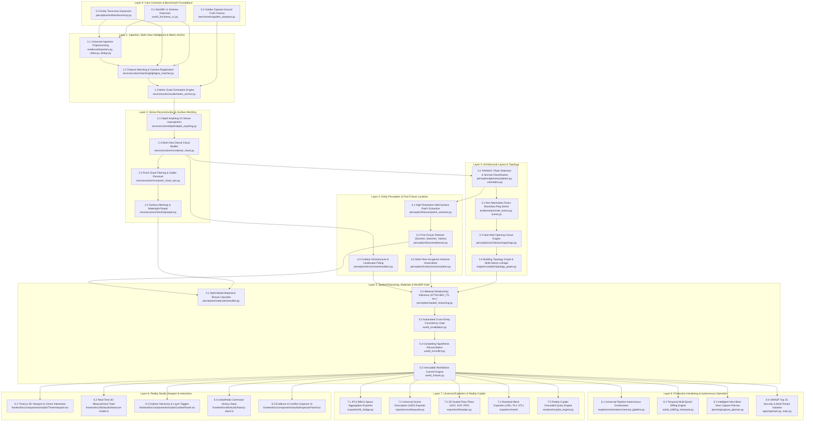

> **SUPERSEDED (2026-11-10).** Current status lives in [docs/STATUS.md](docs/STATUS.md); current plan in docs/blueprint/34_MASTER_PLAN.md. Kept for history.

# Reality Engine — Implementation Dependency Graph
## Execution Sequencing, Critical Path Analysis, and Parallelization Lanes

> **Document ID**: `RE-DEP-006`  
> **Status**: APPROVED EXECUTION SPECIFICATION  
> **Baseline**: `origin/main` @ `6db0f86`  

---

## 1. Executive Sequencing Philosophy

Reality Engine follows a strict **Foundation-First Execution Discipline**:
- High-level architectural reasoning and semantic fixture localizers cannot operate reliably if camera poses and metric scale are uncalibrated.
- Mesh generation cannot be evaluated if point cloud filtering and depth consistency are unstable.
- Every layer produces typed, schema-validated contracts consumed by downstream modules.

---

## 2. Global Dependency DAG (Directed Acyclic Graph)

---

## 3. Critical Path Analysis

The critical path determines the minimum sequence of dependent tasks that govern project delivery:

$$\text{Critical Path} = \mathbf{L0.1} \to \mathbf{L1.2} \to \mathbf{L1.3} \to \mathbf{L2.2} \to \mathbf{L3.1} \to \mathbf{L3.2} \to \mathbf{L4.2} \to \mathbf{L5.2} \to \mathbf{L5.5} \to \mathbf{L7.1}$$

1. **L0.1 Schema Definition**: Unifies `EntityType` and `RelationshipKind` contracts.
2. **L1.2 Multi-View Registration**: Produces verified camera poses from unorganized photos.
3. **L1.3 Metric Scale Anchor**: Constrains relative poses to true physical meters.
4. **L2.2 Dense Cloud Builder**: Unprojects multi-view depth maps into dense point clouds.
5. **L3.1 Plane Detection**: Fits planar wall, floor, and ceiling surfaces.
6. **L3.2 Room Boundary Solver**: Solves closed topological cycles of room boundary walls.
7. **L4.2 Fixture Detector**: Identifies electrical, plumbing, and mechanical fixtures.
8. **L5.2 Spatial Reasoning**: Binds fixtures to walls via `ATTACHED_TO` relationships.
9. **L5.5 WorldStore Commit**: Atomically persists the complete validated WorldIR.
10. **L7.1 IFC BIM Export**: Exports verified architectural digital twins to industry CAD/BIM tools.

---

## 4. Parallelization Workstream Lanes

Once Layer 0 and Layer 1 are stabilized, development can proceed concurrently across 4 independent lanes without blocking dependencies:

### Lane A: Architectural & Reconstruction Track (Geometric Core)
* **Scope**: L2.1 $\to$ L2.2 $\to$ L2.4 $\to$ L3.1 $\to$ L3.2 $\to$ L3.3 $\to$ L3.4
* **Team**: Reconstruction Engineer + Architectural Intelligence Engineer
* **Files**: `reconstruction/`, `perception/geometry/`, `perception/architecture/`

### Lane B: Entity Perception & Material Track (Semantic Core)
* **Scope**: L4.1 $\to$ L4.2 $\to$ L4.3 $\to$ L4.4 $\to$ L5.1 $\to$ L5.2
* **Team**: Perception Engineer + Material & Texture Engineer
* **Files**: `perception/fixtures/`, `perception/instances/`, `perception/materials/`

### Lane C: Reality Studio & Interaction Track (Frontend & Presentation)
* **Scope**: L6.1 $\to$ L6.2 $\to$ L6.3 $\to$ L6.4 $\to$ L6.5 $\to$ L7.5
* **Team**: Frontend Engineer + Reality Copilot Engineer
* **Files**: `frontend/src/components/studio/`, `frontend/src/lib/studio/`, `assistant/`

### Lane D: Exporters, Platform & Security Track (Infrastructure & Delivery)
* **Scope**: L7.1 $\to$ L7.2 $\to$ L7.3 $\to$ L7.4 $\to$ L8.1 $\to$ L8.2 $\to$ L8.4
* **Team**: Exporters Lead + Platform Reliability Engineer
* **Files**: `exporters/`, `apps/api/`, `engine/orchestrator/`, `benchmarks/`
