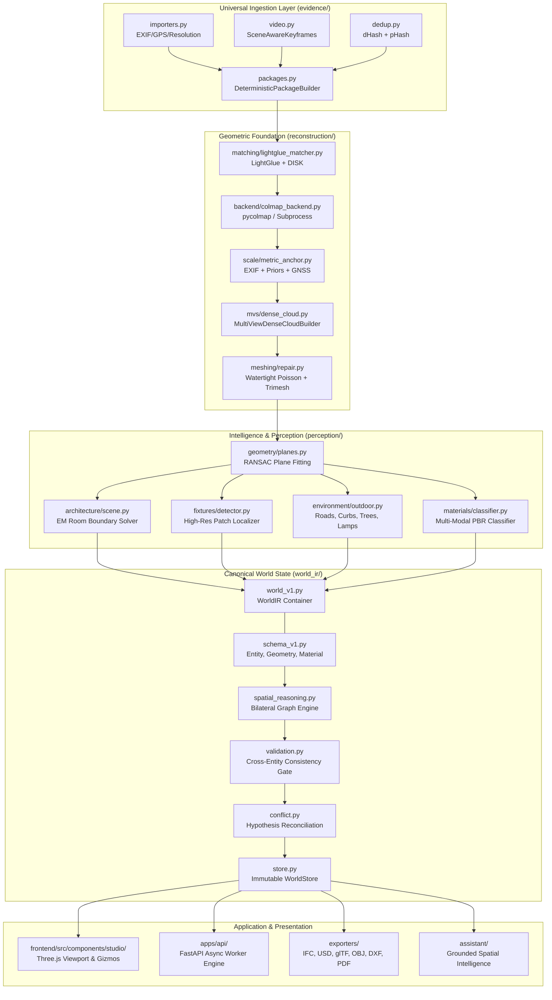

# Reality Engine — Architecture Evolution
## Structural Design, Subsystem Contracts, and Boundary Architecture

> **Document ID**: `RE-ARCH-002`  
> **Status**: APPROVED ARCHITECTURAL SPECIFICATION  
> **Baseline**: `origin/main` @ `6db0f86`  

---

## 1. Architectural Philosophy: The Autonomous System

The central principle of Reality Engine is **Results Over Technologies**. The architecture must never leak internal algorithmic complexity to users, API consumers, or frontend UI components.

### 1.1 Architectural Invariants
1. **Unidirectional Dependency Flow**:
   ```
   [evidence] -> [reconstruction] -> [perception] -> [engine/compiler] -> [world_ir] -> [world_store] -> [exporters & studio]
   ```
   Under no circumstances may `world_ir`, `reconstruction`, or `perception` import from `apps/api`, `apps/cli`, or `frontend`.
2. **Evidence-Backed Geometry**:
   Every entity, vertex, and measurement in `WorldIR` must maintain explicit provenance linking back to raw evidence IDs or derived observation sets. Zero fabricated dimensions or synthetic geometry may be promoted as reconstructed truth.
3. **Strict Interface Encapsulation**:
   AI models, external binaries (COLMAP, FFmpeg), and computational libraries (Open3D, Trimesh, Kornia) are isolated behind abstract Python interfaces (`IDepthBackend`, `ISegmentationBackend`, `IFeatureMatchingBackend`, `IReconstructionBackend`).

---

## 2. End-to-End System Architecture



---

## 3. Subsystem Breakdown & Evolution Specifications

### 3.1 Autonomous Pipeline Orchestrator (`engine/orchestrator/universal_pipeline.py`)
Currently, pipeline execution requires manual sequencing of individual CLI or API steps. The new `UniversalPipelineOrchestrator` provides complete, single-call autonomous execution:
- **Input Evaluation**: Automatically inspects evidence package contents (photo count, video resolution, GPS availability, point cloud density).
- **Execution Strategy Selection**:
  - *Fast Preview Mode*: Monocular depth + sparse feature graph ($\le 15\text{s}$).
  - *Full Metric Mode*: LightGlue bundle adjustment + multi-view dense cloud fusion + architectural room solving.
  - *Civil / Site Mode*: GNSS anchor alignment + outdoor road/curb fitting + Open3D terrain decimation.
- **Dynamic Resource Adaptation**: Profiles available GPU VRAM and system RAM, adjusting batch sizes and voxel resolutions automatically.
- **Automatic Failure Recovery**: If dense MVS fails due to textureless regions, the pipeline gracefully falls back to plane-based geometry without terminating the overall reconstruction.

### 3.2 Metric Scale Anchoring (`reconstruction/scale/metric_anchor.py`)
Reconstructions from monocular photographs often suffer from arbitrary projective scale factor $\lambda$. The new metric anchor subsystem fuses three independent physical constraints:
1. **Sensor & Focal Intrinsics**: EXIF focal length and 35mm equivalent sensor sizing computing initial metric baseline.
2. **Object Dimensional Priors**: Standard physical dimensions of identified entities:
   - Modular switchboard plate height: $86\text{mm} \pm 2\text{mm}$.
   - Interior door passage height: $2040\text{mm} \pm 20\text{mm}$.
   - Standard wall electrical socket elevation: $300\text{mm} \pm 50\text{mm}$ above finished floor.
3. **GNSS / RTK Baseline**: Haversine distance between dual GPS-tagged capture stations.
*Scale reconciliation is computed via robust RANSAC estimation over the scale constraints, rejecting outliers and stamping metric confidence on `WorldIR.metadata["scale"]`.*

### 3.3 Multi-View Dense Cloud Builder (`reconstruction/mvs/dense_cloud.py`)
Upgrades the initial implementation to full multi-view ray unprojection with co-visibility depth consistency gating:
- For every camera pair $(C_i, C_j)$ with visual overlap $> 30\%$, monocular depth predictions $D_i(u, v)$ are unprojected into 3D world space.
- A 3D point $\mathbf{X}$ is verified if and only if reprojecting $\mathbf{X}$ into camera $C_j$ yields:
  $$\| \pi_j(\mathbf{X}) - (u', v') \|_2 < 1.5\text{ px} \quad \text{and} \quad \frac{|D_j(u', v') - d_j(\mathbf{X})|}{d_j(\mathbf{X})} < 0.05$$
- Verified points receive color radiance averaging, normal estimation via local plane fitting, and statistical outlier filtering (`point_cloud_ops.py`).

### 3.4 Fine-Grained Fixture Localizer (`perception/fixtures/detector.py`)
Electrical, plumbing, and mechanical fixtures are too small to be accurately resolved by full-room segmentation models. The architecture introduces a two-tier **Patch-Inspection Engine**:
1. **Surface Crop Extraction**: Orthorectified high-resolution image patches are cropped around detected planar walls and ceilings.
2. **Specialized Open-Vocabulary Detector**: High-resolution patches are evaluated against the registered taxonomy queries in `perception/entities/taxonomy.py`:
   - Electrical: `"power socket"`, `"light switch"`, `"switchboard"`, `"breaker panel"`.
   - Plumbing: `"water faucet"`, `"shutoff valve"`, `"sink drain"`, `"shower head"`.
   - Mechanical: `"HVAC vent"`, `"thermostat"`, `"radiator"`.
3. **3D Wall-Surface Projection**: 2D bounding boxes in patch coordinates are back-projected directly onto the containing wall plane, establishing exact 3D coordinates, orientation normal $\mathbf{n}_{\text{wall}}$, and bounding dimensions.

### 3.5 Architectural Topology & Non-Manhattan Geometry (`perception/architecture/scene.py`)
The existing architectural scene builder is generalized from orthogonal Manhattan assumptions to arbitrary real-world layouts:
- **Arbitrary Angle Wall Adjacency**: Clusters wall normal vectors using spherical mean-shift clustering rather than rigid Cartesian binning.
- **Closed Polygon Boundary Solver**: Computes minimum-weight planar graph cycles from intersecting wall-floor half-spaces, accurately resolving angled bay windows, chamfered corridor corners, and diagonal room partitions.
- **Host-Wall Opening Carving**: Doors and windows are strictly modeled as volumetric negative extrusions hosted inside their containing wall slab, ensuring exported IFC and glTF models have clean structural openings.

### 3.6 Spatial Reasoning & Bilateral Relationship Graph (`perception/spatial_reasoning.py`)
Maintains an evidence-grounded spatial graph connecting entities:
- **`ATTACHED_TO`**: Fixtures mounted on vertical walls or horizontal ceilings within tolerance ($\le 0.20\text{m}$).
- **`RESTS_ON`**: Furniture, appliances, and street infrastructure positioned above floor/pavement surfaces with vertical contact normal ($\le 0.15\text{m}$).
- **`CONTAINS`**: Volumetric spatial inclusion (room containing furniture; switchboard plate containing modular switches).
- **`SUPPORTS`**: Bilateral structural support pairs enforcing vertical load-bearing integrity.
- **Cross-Entity Consistency Validation**: An automated validation pass (`world_ir/validation.py`) enforces physical plausibility:
  - No furniture item may pierce through a solid floor slab.
  - No door or window may exist without an associated host wall.
  - Every room must possess at least one walkable floor entity.

### 3.7 Reality Studio 3D Viewport (`frontend/src/components/studio/`)
The frontend viewer is upgraded into a full interactive spatial editor:
- **Three.js Scene Graph Synchronization**: Efficiently maps `WorldIR` entities to Three.js `InstancedMesh` and grouped `Object3D` hierarchies.
- **Interactive Transform Controls**: Three-axis translation and rotation gizmos with real-time collision testing against room boundary planes.
- **Undo / Redo Command History**: Every user modification triggers a reversible typed action (`history-stack.ts`) preserving dirty-state tracking.
- **Real-Time 3D Measurement Tools**: Interactive ray-casting measurement tools for Euclidean distance, surface-projected distance, polygonal area, and 3-point angle measurement.
- **Confidence & Conflict Heatmaps**: Shader-based vertex color modulation displaying reconstruction uncertainty and competing hypothesis boundaries.

---

## 4. Universal Exporter Architecture

All exporters read canonical `WorldIR` data structures and serialize directly to target formats through isolated adapter modules:

| Format / Target | Implementation Module | Architectural Capabilities Preserved |
|---|---|---|
| **glTF 2.0 / GLB** | `exporters/gltf/exporter.py` | Full node hierarchy, PBR metallic-roughness materials, binary GLB container. |
| **IFC4 (BIM)** | `exporters/ifc_bridge.py` | `IfcBuildingStorey` aggregation, `IfcSpace` boundaries, `IfcWallStandardCase`, `IfcDoor`, `IfcWindow`. |
| **USD / USDA** | `exporters/usd/exporter.py` | Stage prim hierarchy, UsdShade material bindings, mesh normals/UVs, camera prims. |
| **Standard Meshes** | `exporters/mesh/{obj,ply,stl}.py` | Wavefront OBJ with MTL, binary/ASCII PLY, binary/ASCII STL. |
| **CAD & Drawings** | `exporters/floorplan.py` | 1:50 scaled SVG floor plans, ASCII DXF (R12), multi-page room report PDF with net wall area schedules. |
| **Game Engines** | `exporters/{godot,unreal,habitat}/` | Godot 4 `.tscn` scenes, Unreal Editor Python scripts, Habitat simulator bundles. |

---

## 5. Security Architecture & Threat Boundaries

The application enforces a multi-tier defense-in-depth model aligned with OWASP Top 10 API Security:
1. **HTTP Security Response Headers**:
   - `X-Content-Type-Options: nosniff`
   - `X-Frame-Options: DENY`
   - `Referrer-Policy: strict-origin-when-cross-origin`
   - `X-XSS-Protection: 1; mode=block`
2. **CWE-22 Path Traversal Prevention**:
   - Content-addressed artifact storage strictly requires 64-character lowercase hexadecimal hashes (`^[0-9a-f]{64}$`).
   - File resolution verifies path containment via `Path.resolve().relative_to(STORAGE_ROOT)`.
3. **Timing-Safe Authentication**:
   - Constant-time comparison of Bearer tokens via `hmac.compare_digest`.
   - Unauthenticated requests fail closed for all non-loopback addresses.
4. **Header Injection Hardening**:
   - Download filenames are sanitized via `_safe_filename()`, stripping CRLF (`\r\n`), quotes, and directory separators before reflection into `Content-Disposition`.
