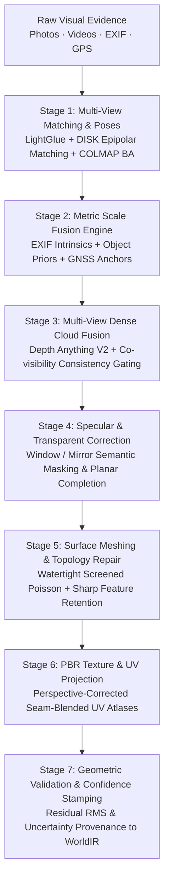

# Reality Engine — Reconstruction Accuracy & Fidelity Roadmap
## Metric Scale Recovery, Surface Reconstruction, Specular Handling, and Geometric Validation

> **Document ID**: `RE-ACC-005`  
> **Status**: APPROVED TECHNICAL ROADMAP  
> **Baseline**: `origin/main` @ `6db0f86`  

---

## 1. Core Principle: Visual Realism Is Not Geometric Accuracy

A central failure mode in contemporary 3D reconstruction is equating photorealistic rendering (e.g., radiance fields, neural splats, texture projection) with true geometric accuracy.

In Reality Engine:
- **Visual realism and geometric accuracy are independently measured.**
- A model with photorealistic textures that misplaces a wall by 10 centimeters or fabricates a door frame will be rejected by the validation gate.
- Reconstructed geometry must directly support physical measurement, structural simulation, CAD/BIM interoperability, and architectural floor plan extraction.

```
+---------------------------------------------------------------------------------------+
|                                    QUALITY SEPARATION                                 |
+---------------------------------------------------+-----------------------------------+
|             GEOMETRIC METRIC ACCURACY             |           VISUAL REALISM          |
+---------------------------------------------------+-----------------------------------+
| - Absolute dimensional error (mm)                 | - Texture sharpness and fidelity  |
| - Chamfer distance to ground truth (mm)           | - Multi-view color consistency    |
| - Surface normal angular deviation (deg)          | - PBR material plausibility       |
| - Topological closedness and planarity (mm)       | - Specular reflection synthesis   |
| - Scale factor consistency (fractional error)     | - PSNR, SSIM, LPIPS metrics       |
+---------------------------------------------------+-----------------------------------+
```

---

## 2. Multi-Stage Precision Reconstruction Architecture



---

## 3. Engineering Workstreams for Reconstruction Fidelity

### 3.1 Stage 1: Robust Feature Matching & Camera Registration
* **Challenge**: Feature matching fails in featureless interior walls, repetitive corridors, and extreme viewpoint angle changes.
* **Architecture**:
  - Integration of `LightGlueMatcher` using DISK features (via Kornia, Apache 2.0). LightGlue prunes unmatchable points adaptively, providing 4x speedup over SuperGlue with higher inlier ratios.
  - Epipolar geometric verification: fundamental matrix estimation with MAGSAC++ ($0.75\text{ px}$ threshold), rejecting false correspondences across visual repetitions.
  - Camera intrinsic calibration refinement optimizing radial distortion coefficients $(k_1, k_2, p_1, p_2)$ alongside focal lengths.

### 3.2 Stage 2: Metric Scale Fusion Engine
* **Challenge**: Monocular photogrammetry determines relative camera geometry up to an unknown projective scale factor $\lambda$.
* **Architecture**:
  - **3-Way Constraint Formulation**:
    $$\min_{\lambda} \sum_{i} w_i \left( \lambda \cdot d_{\text{reconstructed}}^{(i)} - d_{\text{prior}}^{(i)} \right)^2$$
  - *Constraint 1*: Focal length and physical sensor dimension from camera EXIF tables.
  - *Constraint 2*: Known dimensional priors of detected fixtures:
    - Standard electrical switchboard plate: $86\text{mm} \times 86\text{mm}$.
    - Standard interior door passage: $2040\text{mm}$ height.
    - Standard interior counter height: $850\text{mm} - 900\text{mm}$.
  - *Constraint 3*: Real-world GNSS / RTK baseline vectors for exterior multi-session captures.
  - *RANSAC Scale Estimator*: Discards inconsistent dimensional priors (e.g. non-standard custom doors) and stamps the metric scale confidence on `world.metadata["scale"]`.

### 3.3 Stage 3: Multi-View Dense Cloud Generation with Depth Consistency Gating
* **Challenge**: Raw monocular depth maps suffer from edge bleeding, scale drift, and boundary flickering.
* **Architecture**:
  - Integration of **Depth Anything V2 Small** for dense metric depth map inference.
  - **Co-visibility Depth Consistency Filter**: For camera $C_A$ predicting depth $D_A(u, v)$, the unprojected 3D point $\mathbf{X}$ is verified by projecting into adjacent cameras $\{C_B\}$ observing the same region:
    $$\Delta_{\text{reproj}} = \| \pi_B(\mathbf{X}) - (u_B, v_B) \|_2 < 1.5\text{ px}$$
    $$\Delta_{\text{depth}} = \frac{|D_B(u_B, v_B) - d_B(\mathbf{X})|}{d_B(\mathbf{X})} < 0.04$$
  - Requires verification by at least 2 distinct camera views before a 3D point is accepted.
  - Statistical Outlier Removal (SOR) via SciPy KDTree ($k=20$, standard deviation multiplier $\alpha=1.5$) removes floating particulate noise.

### 3.4 Stage 4: Specular, Transparent & Reflective Surface Handling
* **Challenge**: Mirrors and glass partitions violate multi-view Lambertian assumptions, producing false geometry behind mirrors or missing window glass entirely.
* **Architecture**:
  - **Semantic Transparency Masking**: Windows, glass shower cubicles, and mirrors are classified by SAM 2 / Mask R-CNN.
  - **Mirrors**: Identified mirror planes have their virtual reflected point clouds purged. A planar mirror entity is inserted with `material.roughness = 0.0` and `metallic = 1.0`.
  - **Window Glazing**: Glass panes are filled using planar boundary interpolation across the window frame opening, guaranteeing clean, flat architectural glass geometry.

### 3.5 Stage 5: Surface Meshing & Topological Repair
* **Challenge**: Raw Poisson meshing rounds off sharp architectural corners, producing bulbous walls and non-manifold edges.
* **Architecture**:
  - **Screened Poisson Surface Reconstruction (SPSR)** with boundary Neumann constraints and octree depth 10.
  - **Sharp Architectural Feature Preservation**: Point cloud normals along planar intersections (wall-to-wall corners, wall-to-ceiling boundaries) are constrained to maintain orthogonality.
  - **Mesh Watertight Cleaning via Trimesh**:
    - Automatic removal of non-manifold edges and degenerate zero-area faces.
    - Hole-filling on unobserved planar surfaces (e.g. top of wardrobes, underneath base cabinets).
    - Planar polygon decimation: reduces flat wall triangle counts by $> 85\%$ while preserving vertex density along boundaries.

### 3.6 Stage 6: PBR Texture & UV Projection
* **Challenge**: Reprojecting photos onto meshes causes seam artifacts, ghosting from moving objects, and lighting bake-in.
* **Architecture**:
  - **Optimal Camera View Selection**: For each planar face, selects the camera view with normal vector closest to the surface normal ($\max \mathbf{n}_{\text{surface}} \cdot \mathbf{v}_{\text{camera}}$) and maximum resolution coverage.
  - **Seam Blending**: Multi-band Poisson image blending along UV island boundaries eliminates exposure deltas between photos.
  - **PBR Parameter Separation**: Inferred albedo maps are decoupled from scene shading; surface roughness and metallic parameters are assigned according to the material classification engine (`perception/materials/classifier.py`).

---

## 4. Geometric Quality Verification Gates

| Metric | Target (Indoor Architecture) | Target (Outdoor Infrastructure) | Test Harness File |
|---|---|---|---|
| **Chamfer Distance (CD)** | $\le 15\text{mm}$ | $\le 50\text{mm}$ | `benchmarks/golden_datasets.py` |
| **F-Score @ 10mm** | $\ge 90.0\%$ | $\ge 80.0\%$ | `tests/test_golden_datasets.py` |
| **Normal Consistency** | Mean deviation $\le 6.0^\circ$ | Mean deviation $\le 12.0^\circ$ | `tests/test_dense_point_cloud.py` |
| **Dimensional Error** | $\le 0.5\%$ of span | $\le 1.0\%$ of span | `tests/test_golden_datasets.py` |
| **Scale Drift** | $\le 0.25\%$ per $50\text{m}$ | $\le 0.5\%$ per $100\text{m}$ | `benchmarks/real_data_city_scale_bench.py` |
| **Planarity Deviation** | $\le 8\text{mm}$ RMS | $\le 25\text{mm}$ RMS | `tests/test_architectural_perception.py` |
