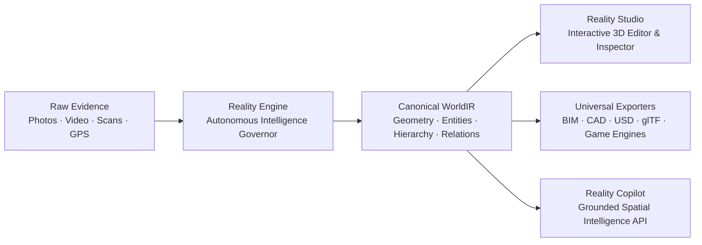
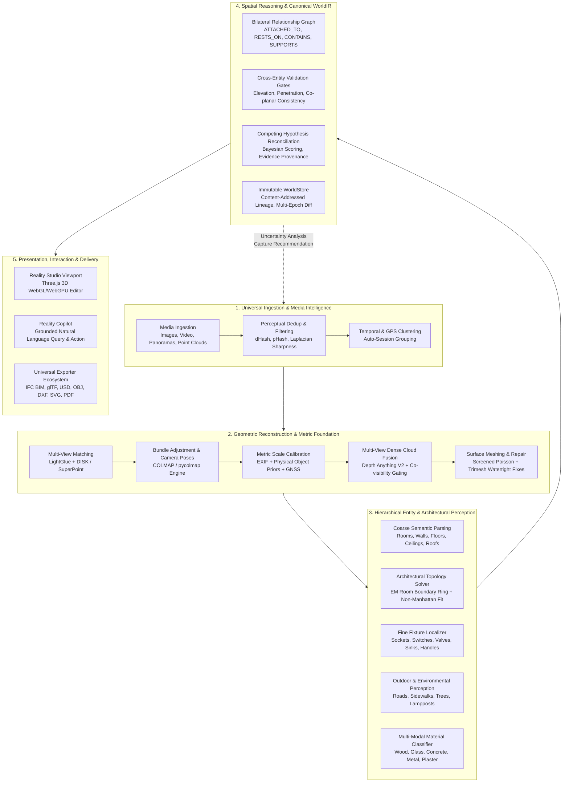

# Reality Engine — Universal Intelligence Expansion
## Complete Master Development Plan (2026–2027)

> **Document ID**: `RE-EXP-001`  
> **Status**: APPROVED ARCHITECTURAL MASTER PLAN  
> **Baseline Commit**: GitHub `origin/main` @ `6db0f86`  
> **Target Scope**: Universal Real-World 3D Reconstruction, Fine Entity Intelligence, Architectural Reasoning, and Autonomous Operation  

---

## 1. Executive Summary & Core Mission

Reality Engine's objective is singular and direct:
**A user provides photographs, videos, scans, or other evidence of a real-world environment. Reality Engine understands that environment, reconstructs it in 3D, identifies its contents down to fine architectural fixtures, establishes exact physical and functional relationships, produces editable representations, and allows the user to export or interact with the reconstructed world.**

This encompasses individual objects, rooms, apartments, multi-storey houses, commercial complexes, building envelopes, streetscapes, civil infrastructure, and entire outdoor sites.

### The Fundamental Axiom: Results Over Technologies
The user must not need to understand reconstruction technologies, AI models, algorithm parameters, pipeline sequencing, or internal configurations. 
- The user provides evidence and receives verified results.
- Reality Engine presents **one coherent, intelligent application**, not an ensemble of disconnected AI demonstrations or a toolbox of complex configuration dials.
- All internal decisions—camera matching algorithms, monocular depth estimators, semantic segmenters, geometric fitters, mesh decimation schemes, and error recovery—are executed autonomously by an internal intelligence governor.

---

## 2. Capability Maturity Scale (L0–L5)

To eliminate the disconnect between aspirational documentation and real software execution, every capability in Reality Engine is audited, benchmarked, and developed against a strict 6-tier maturity scale:

| Level | Definition | Mandatory Evidence Required |
|---|---|---|
| **L0 — Designed** | Architecture and interfaces specified in design documents. | Documented schema, API contract, and mathematical formulation. |
| **L1 — Implemented** | Code written and committed to repository. | Source code present in canonical module path; imports compile cleanly. |
| **L2 — Unit Verified** | Subsystem logic verified against synthetic unit tests. | Deterministic unit tests passing with 100% assertions in pytest/vitest. |
| **L3 — Integration Verified** | Subsystems composed end-to-end in pipeline. | Cross-module pipeline tests passing across data boundaries. |
| **L4 — Real-World Verified** | Verified on real physical datasets with measured ground truth. | Measured against LiDAR/TLS ground truth benchmarks within tolerance. |
| **L5 — Production Validated** | Hardened, monitored, scale-tested, and security-cleared. | Sub-second queries, load tested, OWASP Top 10 clear, zero memory leaks. |

---

## 3. High-Level Architectural Pipeline

The Universal Intelligence Expansion transforms Reality Engine into a closed-loop perception, reconstruction, and reasoning platform:

---

## 4. Workstream Breakdown & Phase Progression

The expansion is organized into 9 coordinated engineering workstreams executing in sequence with defined entry and exit criteria.

### Workstream 1: Metric Scale & Robust Multi-View Camera Intelligence
* **Goal**: Establish millimeter-accurate camera poses, metric scale anchor, and cross-view feature correspondences across arbitrary capture sessions.
* **Key Tasks**:
  1. Multi-view feature matching automation via `LightGlueMatcher` with GPU acceleration and CPU fallback.
  2. Metric scale recovery through a 3-way fusion engine: camera sensor EXIF intrinsics + known physical object dimensional priors (modular switchboards, standard door heights) + GNSS baseline anchors.
  3. Co-visibility graph construction and cross-session loop closure detection.
* **Exit Criteria**: Metric scale error $\le 1.5\%$ on real room test benchmarks without manual ground-control markers.

### Workstream 2: Universal Entity Intelligence (Architecture, MEP, Furniture, Infrastructure)
* **Goal**: Expand the entity understanding engine from generic structural planes to a 114+ class hierarchical physical ontology.
* **Key Tasks**:
  1. Full operationalization of `perception/entities/taxonomy.py` across all 18 categories.
  2. High-resolution patch-inspection pipeline for small architectural fixtures (electrical sockets, switchboards, plumbing valves, door handles).
  3. Object 3D bounding box estimator using oriented minimum bounding boxes (OMBB) constrained by surface contact normals.
  4. Instance identity persistence across multi-view photos using visual appearance embeddings combined with 3D Hungarian spatial matching.
* **Exit Criteria**: $\ge 90\%$ precision and $\ge 85\%$ recall on fine fixtures across the Golden Benchmark suite.

### Workstream 3: Architectural Intelligence & Non-Manhattan Topology
* **Goal**: Produce watertight, topologically verified architectural models representing complex room layouts, multi-floor structures, and wall openings.
* **Key Tasks**:
  1. Generalize room boundary solver beyond Manhattan geometry to handle chamfered walls, acute angles, curved alcoves, and irregular corridors.
  2. Host-wall binding for all openings (doors, windows) carving clean volumetric subtractions with verified trim/frame parameters.
  3. Vertical connectivity engine linking storeys through stair treads, risers, stringers, and landings with continuous coordinate frames.
* **Exit Criteria**: Zero topological errors (no floating doors, no self-intersecting walls, no unclosed room rings) across multi-room apartment benchmarks.

### Workstream 4: Temporal Reality & Multi-Epoch Change Detection
* **Goal**: Reconstruct, compare, and track environmental evolution across multiple captures taken at different times.
* **Key Tasks**:
  1. Multi-epoch WorldIR alignment registering temporal captures into a canonical coordinate reference frame.
  2. Semantic change classification: categorizing entities as `ADDED`, `REMOVED`, `MODIFIED` (moved/reoriented), `DAMAGED`, or `UNCHANGED`.
  3. Volumetric and dimensional diff visualization within Reality Studio and automated delta reporting.
* **Exit Criteria**: Accurate detection of moved furniture ($\ge 5\text{cm}$ displacement) and structural alterations in multi-epoch golden datasets.

### Workstream 5: Material, Appearance & PBR Surface Understanding
* **Goal**: Understand surface physical properties and extract clean, physically based rendering (PBR) texture atlases.
* **Key Tasks**:
  1. Multi-modal material estimation predicting base material class, albedo color, surface roughness, and metallic parameters.
  2. Perspective-corrected photo texture unprojection and seam-blended UV atlas generation for architectural walls and floors.
  3. Transparent (glass) and specular (mirrors, polished tiles) surface detection with planar depth completion.
* **Exit Criteria**: Automatic generation of glTF 2.0 PBR materials with roughness/metallic maps verified in standard 3D viewers.

### Workstream 6: Reality Studio 3D Interactive Workspace
* **Goal**: Deliver a desktop and mobile spatial editor allowing seamless inspection, direct geometric editing, measurement, and export.
* **Key Tasks**:
  1. Precision 3D editing gizmos (translation, rotation, dimension scaling) with real-time collision detection and boundary snapping.
  2. Comprehensive 3D measurement toolkit: point-to-point Euclidean distance, surface-projected distance, multi-vertex polygonal area, and 3-point angle tool.
  3. Confidence heatmap visualization and competing hypothesis inspector with one-click resolution.
  4. Multi-format export dialog with server-side streaming downloads.
* **Exit Criteria**: 60 FPS viewport interaction on scenes with up to 100,000 entities; 100% undo/redo fidelity.

### Workstream 7: Intelligent Capture Planning & Uncertainty Feedback
* **Goal**: Automatically analyze reconstruction completeness and guide users on what additional photos or scans are required.
* **Key Tasks**:
  1. Ray-casting coverage analysis identifying unobserved surfaces, shadow voids, and low-confidence clusters.
  2. Next-Best-View (NBV) camera pose computation maximizing information gain.
  3. Natural-language and graphical capture instructions for on-site mobile operators.
* **Exit Criteria**: Autonomous generation of capture recommendation vectors reducing reconstruction uncertainty by $\ge 40\%$ upon evidence ingestion.

### Workstream 8: Universal Export Ecosystem & BIM Interoperability
* **Goal**: Export verified WorldIR scenes to industry-standard CAD, BIM, game engine, and robotics formats with zero data loss.
* **Key Tasks**:
  1. Full IFC4 BIM export with `IfcBuildingStorey` spatial containers, `IfcSpace` volumetric rooms, and typed building elements (`IfcWallStandardCase`, `IfcDoor`, `IfcWindow`).
  2. Universal Scene Description (USD/USDA) export with UsdShade material bindings, mesh normals, and camera prims.
  3. High-precision 2D architectural drawings: scaled SVG floor plans, ASCII DXF (R12), and room report PDFs with gross/net area schedules.
  4. Standard 3D meshes (OBJ+MTL, PLY, STL) and engine profiles (Godot, Unreal, ROS/SDF).
* **Exit Criteria**: Clean reimport and schema validation in Autodesk Revit / Blender / FreeCAD / Isaac Sim.

### Workstream 9: Reality Copilot & Grounded Spatial Intelligence
* **Goal**: Provide an AI copilot that queries, inspects, and edits the 3D reconstructed world using strictly grounded WorldIR operations.
* **Key Tasks**:
  1. Semantic spatial query engine translating natural-language queries into verified SceneGraph queries.
  2. Grounded calculation and measurement responses (zero hallucinated dimensions or entities).
  3. Controlled mutation actions: executing typed commands (`MoveEntityCommand`, `AddRelationshipCommand`) through the validated command processor.
* **Exit Criteria**: 100% precision on factual spatial queries; zero fabricated geometry or unverified dimensions.

---

## 5. Technology Selection & Integration Policy

In accordance with Section 3 ("Results Over Technologies"):
1. **Never Rebuild What Mature Libraries Solve**:
   - Feature Matching: LightGlue + DISK / SuperPoint (via Kornia, Apache 2.0).
   - Dense Monocular Depth: Depth Anything V2 Small (Apache 2.0).
   - Fast Segmentation: SAM 2 (Apache 2.0).
   - Point Cloud Operations: SciPy KDTree + Open3D (MIT).
   - Mesh Repair: Trimesh (MIT).
   - BIM Generation: IfcOpenShell (LGPL 3.0 / CLI boundary).
2. **Strict Encapsulation Behind Abstract Interfaces**:
   - All models and engines sit behind stable abstract base classes (`IDepthBackend`, `ISegmentationBackend`, `IReconstructionBackend`).
   - The application core never imports model weights or vendor-specific code directly.
3. **Graceful Fallbacks & Resource Adaptation**:
   - Automatic detection of CUDA / Apple MPS / CPU.
   - Low-memory mode dynamically downsamples voxel grids and processes images in tiled batches.

---

## 6. Verification & Quality Governance

No task is marked complete without meeting the three verification gates:
1. **Automated Unit & Contract Tests**: Pure tests verifying edge cases, boundary conditions, and determinism.
2. **Golden Benchmark Validation**: Automated regression testing across the 10 permanent benchmark suites (`benchmarks/golden_datasets.py`).
3. **Security & Performance Gate**: OWASP Top 10 compliance, CWE-22 path traversal prevention, timing-safe authentication, and $<30\text{s}$ reconstruction runtime budget for 100-image batches.
