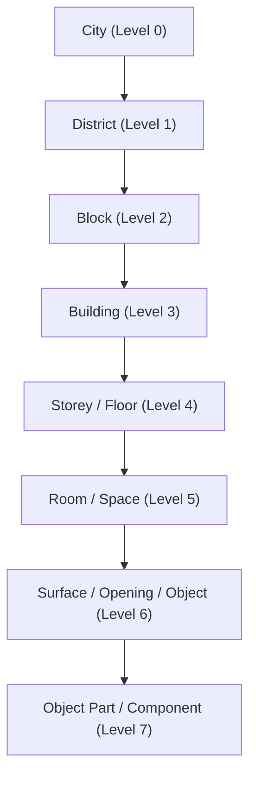

# Reality Engine — Universal Perception and World Reconstruction Architecture

## 1. System Vision & Spatial Hierarchy

Reality Engine's Universal Perception and World Reconstruction Architecture reconstructs multi-scale environments with physical accuracy, strict provenance, and semantic understanding.

The system supports a hierarchical spatial representation across 8 discrete containment levels:



### Scale Specifications
- **City / District / Block**: Georeferenced WGS-84 / UTM coordinate anchors, terrain topography, road networks, urban infrastructure (street lamps, traffic lights, hydrants).
- **Building / Storey**: Architectural boundary representations, structural grids, exterior façades, inter-storey stairwells, vertical shafts, and elevation splits.
- **Room / Space**: Watertight boundary planes (walls, ceiling, floor), door and window openings, ceiling height calibration, and room adjacency topology.
- **Surface / Opening / Object**: Individual furniture, appliances, MEP fixtures, structural columns, beams.
- **Object Part**: Component decomposition (e.g. chair seat/legs/backrest, table top/drawers, appliance doors/knobs, fixture faceplates/valves).

---

## 2. Mandatory Sequential Maximum-Fidelity Execution Policy

Reality Engine operates under a strict **Sequential Maximum-Fidelity Execution Policy**:

```
LOAD MODEL → INFERENCE ON ORIGINAL EVIDENCE → SAVE RAW OUTPUT → VALIDATE → NORMALISE → RECORD ERRORS → RELEASE GPU RESOURCES → NEXT MODEL
```

### Inviolable Guarantees
1. **Single Active Model**: Only one deep learning model or heavy SfM solver occupies GPU/system compute at any time.
2. **Access to Original Evidence**: Every model processes the original uncompressed source photographs and capture metadata. A model never receives solely a degraded prior model's output.
3. **Explicit Failure & No Silent Downgrades**: A missing or failing model is recorded with an explicit error status. The engine never silently falls back to a weaker model without tagging the result as `PARTIAL`.
4. **VRAM Resource Release**: After raw output persistence, `torch.cuda.empty_cache()` and garbage collection are executed before loading the subsequent engine.

---

## 3. Append-Only Shared Evidence Matrix

Large tensors, depth maps, dense point clouds, and high-polygon meshes are strictly prohibited from being inlined into JSON metadata.

The **Shared Evidence Matrix (`engine/multiengine/evidence_matrix.py`)** enforces:
- **Append-Only Index**: Stored in `evidence_matrix.jsonl` with deterministic SHA-256 content hashes.
- **Offloaded Artifact Storage**: Files are saved to `evidence_artifacts/<evidence_id>/<filename>` and referenced via immutable URIs.
- **Tamper Verification**: `EvidenceMatrixStore.verify_immutable()` verifies SHA-256 hashes of all records and physical artifact files on disk to prevent unauthorized modification or silent data corruption.

---

## 4. Universal Object & Part Ontology

The universal ontology (`world/ontology/universal_object_ontology.py`) defines 6 major object categories, component part hierarchies, typical metric dimensions, and valid physical relationships:

1. **Furniture**: `chair`, `table`, `sofa`, `bed`, `cabinet`, `bookshelf`.
   - *Parts*: `seat`, `backrest`, `legs`, `armrests`, `cushion`, `top`, `drawer`, `shelf`, `frame`.
2. **Appliances**: `refrigerator`, `oven`, `microwave`, `dishwasher`, `washing_machine`.
   - *Parts*: `housing`, `door`, `handle`, `window`, `control_knobs`, `display`, `drum_door`, `rack`.
3. **Fixtures (MEP)**: `electrical_socket`, `light_switch`, `lighting_fixture`, `sink`, `toilet`, `hvac_vent`.
   - *Parts*: `faceplate`, `receptacle`, `toggle_rocker`, `basin`, `faucet`, `drain`, `bowl`, `tank`, `seat`, `grille`.
4. **Building Elements**: `wall`, `floor`, `ceiling`, `door`, `window`, `stairs`.
   - *Parts*: `frame`, `leaf`, `handle`, `hinges`, `sash`, `pane`, `sill`, `tread`, `riser`, `stringer`, `handrail`.
5. **Everyday Objects**: `laptop`, `monitor`, `bottle`.
6. **Urban Infrastructure**: `building_facade`, `road`, `footpath`, `street_lamp`, `traffic_light`.

### Spatial Relationship Semantics
- `supports`: One object physically supports another (e.g. floor supports chair; table supports laptop).
- `attached_to`: Rigidly fastened to a structural plane (e.g. socket on wall; luminaire on ceiling).
- `contained_in`: Located inside a container object (e.g. milk in refrigerator; book in cabinet).
- `part_of`: Topological subcomponent relationship (e.g. chair leg part of chair).
- `connects`: Navigational portal between adjacent spaces (e.g. door connects corridor and room).

---

## 5. The 14-Stage Multi-Engine Fusion Architecture

The **Universal Fusion Pipeline (`engine/multiengine/universal_fusion.py`)** executes 14 sequential stages:

| Stage | Name | Purpose & Enforcement |
|---|---|---|
| **01** | Input & Camera Validation | Validates image resolutions, pinhole intrinsics, and distortion parameters. |
| **02** | Coordinate Frame Alignment | Aligns model-specific coordinate spaces into canonical metric world frame using `FrameGraph`. |
| **03** | Cross-View Correspondence | Extracts and matches features (SuperPoint, LightGlue, RoMa) across multiple viewpoints. |
| **04** | Entity Identity Association | Re-identifies objects across views via geometric proximity and appearance embeddings. |
| **05** | Geometric Consistency | Integrates depth maps and dense point clouds, rejecting ungrounded floating geometry. |
| **06** | Reprojection Checking | Evaluates 3D models by reprojecting into 2D camera planes (target RMSE < 1.0 px). |
| **07** | Semantic Ontology Mapping | Resolves open-vocabulary tags to canonical classes in `UniversalObjectOntology`. |
| **08** | Uncertainty Calibration | Groups engines into model families and applies correlation discounting ($1/\sqrt{N}$). |
| **09** | Conflict Detection | Discovers geometric collisions, scale discrepancies, or categorical disputes. |
| **10** | Correlation-Aware Fusion | Fuses like physical quantities using inverse-variance consensus without voting. |
| **11** | Canonical Hierarchy Generation | Constructs the complete `SpatialHierarchyTree` from Room down to Object Parts. |
| **12** | WorldIR Validation | Validates schema constraints, relationships, and geometric containment invariants. |
| **13** | Quality Gates & Fidelity Scoring | Evaluates reconstruction metrics against tolerance thresholds (area, wall RMSE, F1). |
| **14** | Active Capture Requests | Generates targeted camera poses for unobserved surfaces or unresolved conflicts. |

### Fundamental Statistical Fusion Law
Disparate sensory modalities (e.g. a depth map, a semantic mask, and a class confidence) are **never averaged**. Only statistically compatible measurements of the same quantity (e.g. planar surface equations, 4x4 coordinate transforms, bounding box dimensions) are fused, and only after correlation discounting across shared model families.

---

## 6. Verification and Benchmarking

The architecture is measured against the physical ground-truth dataset in `benchmarks/measured_rooms/`:
- **Wall length and height RMSE**: < 20 mm.
- **Ceiling height error**: < 25 mm.
- **Fine-grained object detection F1**: > 0.90.
- **Component part association accuracy**: > 0.90.
- **Hierarchy acyclicity and monotonic containment**: 100% verified.
