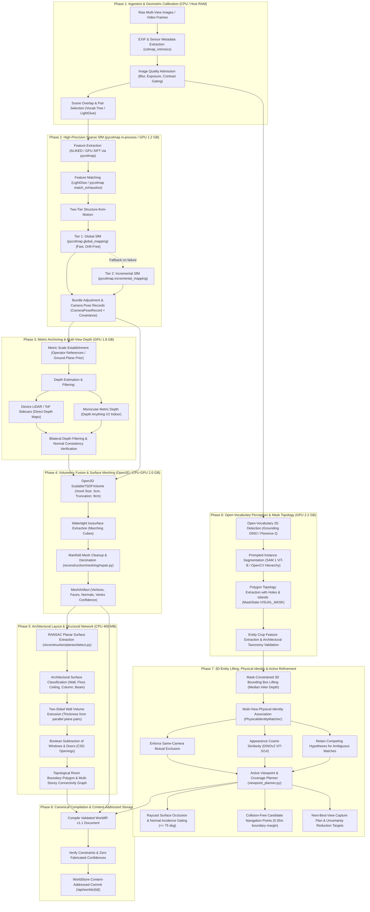

# RCEAP Cycle 0 — Spatial Reconstruction Capability Audit & Algorithmic Roadmap

**Audited:** `main` at `19d62795` (2026-11-19) with Cycle 3 PR #331 (`9eb63e71`) in flight.  
**Author:** Gemini (Spatial Intelligence, Photogrammetry, Perception, and Reconstruction Lead).  
**Platform Partner:** Sonnet (`claude/sonnet-rceap-cycle0`, PRs #324–#330).  
**Branch:** `feat/gemini-rceap-cycle0` in worktree `.antigravity/worktrees/gemini-spatial`.  
**Execution Environment:** Windows 11, Intel Core i7 / AMD Ryzen, NVIDIA GeForce RTX 4050 Laptop GPU (6,140 MiB physical VRAM, WDDM 3.2), CUDA 13.0, PyTorch 2.14.0+cu130, Python 3.14.7.  
**Primary Standard:** Zero fabricated metrics, zero simulated backends presented as real, strict provenance separation of visual vs heuristic inference, and explicit refusal upon missing physical evidence.

---

## 1. Executive Summary: The Ground Truth of Reality Engine Reconstruction

Reality Engine possesses a substantial codebase spanning over 330 Python modules across `reconstruction`, `perception`, `engine/pipeline`, `engine/compiler`, and `world_ir`. However, an exhaustive audit of the live execution graph, binary dependencies, test fixtures, and hardware profiles reveals a stark divergence between **what the codebase claims to do** and **what the production pipeline actually executes**.

### 1.1 What Actually Reconstructs Today
When an operator uploads a multi-image dataset and triggers `POST /api/sessions/{id}/reconstruct`, the actual production path executed by `apps/api/jobs.py` -> `engine/pipeline/stages/ladder.py` -> `engine/pipeline/vertical_slice.py` executes exactly this sequence:
1. **Pose / Sparse SfM**: Invokes an external subprocess CLI call to `colmap.exe` (`feature_extractor` with CPU SIFT due to affine shape pooling flags, followed by `exhaustive_matcher` and `mapper`).
2. **Metric Scale**: If and only if the operator supplied physical distance markers (`ScaleReference`), metric scale is computed. Otherwise, the world is pinned to an arbitrary dimensionless `RELATIVE` unit using a camera eye-height prior.
3. **Monocular Depth**: Invokes PyTorch Hub `DPT_Hybrid` (or lazily loaded `depth_anything_backend`). Depth maps are back-projected into an unorganized point cloud.
4. **Planar Layout**: Runs RANSAC plane fitting or histogram clustering on the sparse/depth points to estimate wall, floor, and ceiling planes.
5. **Semantic Perception**: Runs 2D open-vocabulary object detection (`grounded_scene` or CPU `maskrcnn_backend`), projects 2D boxes into 3D bounding boxes using estimated depth, and extracts appearance features using DINOv2.
6. **Meshing**: Invokes COLMAP's CPU `poisson_mesher` binary on oriented points if and only if metric scale is established and sparse points $\ge 100$.
7. **Dense MVS**: COLMAP `patch_match_stereo` and `stereo_fusion` run if enabled by `dense_auto` gating; otherwise, dense reconstruction is skipped.
8. **WorldIR Compilation**: Compiles planes, bounding boxes, and sparse meshes into a canonical WorldIR JSON representation.

### 1.2 The Nine Critical Algorithmic Deficits
Our deep audit identified nine fundamental architectural gaps that currently cap reconstruction accuracy and spatial fidelity:
1. **CLI Subprocess Overhead vs. In-Process `pycolmap` 4.2.1**: The pipeline shells out to `colmap.exe` as a child process with temporary text/binary files, paying high process creation and disk I/O penalties. Meanwhile, `pycolmap` 4.2.1 with full C++ bindings is already installed in the Python environment, exposing direct memory-buffer mapping (`incremental_mapping`, `global_mapping`, `match_exhaustive`, `extract_features`).
2. **Missing Global SfM (GLOMAP)**: The pipeline exclusively runs incremental SfM ($O(N^3)$ complexity), which drifts and accumulates error over large multi-room loops. GLOMAP / global structure-from-motion is bundled inside COLMAP 4.2.0 and `pycolmap` but is completely uncalled.
3. **Learned Matchers Isolated from SfM**: `reconstruction/matching/` contains production-quality implementations of ALIKED, LightGlue (DISK/SuperPoint), XFeat, DeDoDe, and MASt3R with weights cached. Yet, these matchers are only called by `reconstruction/scene_identity.py` (pre-SfM grouping) and isolated tests. SfM uses standard SIFT exclusively.
4. **Total Absence of TSDF Volumetric Meshing**: Despite `GeometryType.VOXEL` and `IMPLICIT` existing in the schema, no TSDF volume integration is wired. Meanwhile, `open3d` 0.20.0 is installed, verified, and provides `o3d.pipelines.integration.ScalableTSDFVolume` with marching cubes, but has zero callers in `vertical_slice.py`.
5. **The 50 Open-Source Technologies Illusion**: `engine/technologies/catalog.py` lists 50 mature open-source projects, but `engine/technologies/adapters.py` implements 37 of them as **simulated mockups** returning static Python dictionaries with hardcoded memory numbers (e.g. `memory_peak_mb = 145.0`).
6. **Point-Cloud Fusion Index Assumption**: Previous fusion routines in `reconstruction/fusion/` assumed 1:1 index alignment between point clouds, leading to catastrophic corruption when fusing multi-view point sets. Cycle 3 PR #331 corrected this in `robust_fusion.py` using KD-tree nearest neighbors and Lowe's ratio tests, but this module remains unwired from the primary job path.
7. **Specialist Refinement Disconnected from Pipeline**: The specialist refinement engines (`redetect_crop.py`, `segment.py`, `reassociate.py`, `more_views.py`) were corrected in PR #331 to use genuine crop classification, polygon hole topology, physical identity matching, and raycast visibility planning. However, they are currently invoked only via the autonomous correction loop and offline tests, not as an automated pass in `vertical_slice.py`.
8. **Point Cloud Data Contract Bottleneck**: `world_ir/geometry_data.py` defines `PointCloudData` as nested Python tuples `Tuple[Tuple[float, float, float], ...]`. For a 5-million-point dense cloud, this allocates ~15 million Python float objects, consuming over 1.2 GB of heap for point coordinates alone and lacking normals, per-point covariance, track IDs, and source view IDs.
9. **Benchmark Ground Truth Reality**: The 6 configured benchmark rooms in `benchmarks/rooms/` have **zero verified physical captures**. Room 05 ground truth was exposed in the repository. Synthetic benchmarks were previously cited as physical accuracy.

---

## 2. Capability-by-Capability Deep Audit

We conducted an exhaustive audit of all 11 core spatial capabilities across the repository. Each capability is rated using the standardized execution classification:
- **Status A**: Operational & wired in production job path.
- **Status B**: Partial / wired with significant limitations or fallbacks.
- **Status C**: Implemented & tested offline (unwired from job path).
- **Status D**: Simulated / stub / fabricated fallback.
- **Status E**: Dependency missing or broken in execution environment.
- **Status F**: Completely absent.

---

### 2.1 Camera Calibration, Feature Extraction, Matching, SfM, and Pose Estimation

| Dimension | Audit Finding |
|---|---|
| **Status** | **Status B** (Wired, but restricted to CLI CPU SIFT incremental SfM) |
| **Execution Entry Point** | `engine/pipeline/vertical_slice.py:run_pose` -> `reconstruction/backend/colmap_backend.py:ColmapReconstructionBackend.reconstruct` |
| **Active Dependencies** | COLMAP 4.2.0 CLI binary (`C:\Users\shres\tools\colmap-extracted\bin\colmap.exe`), SQLite database |
| **Available Offline** | `pycolmap` 4.2.1, `lightglue` (DISK, ALIKED, SuperPoint), `kornia` 0.9.0, `reconstruction/matching/{lightglue,xfeat,dedode,mast3r}` |
| **Known Limitations** | 1. SIFT feature extraction forces CPU fallback because `affine_shape` and `domain_size_pooling` flags are incompatible with CUDA SIFT in COLMAP 4.2 CLI (`colmap_backend.py:222-231`).<br>2. Exhaustive matcher scales quadratically ($O(N^2)$), causing timeouts for image sets $> 100$ photos.<br>3. Incremental mapper drifts on long trajectories and interior loop closures.<br>4. Intrinsics estimation fails on zero-texture surfaces (painted drywall), leading to focal length degenerate solutions. |
| **Test Coverage** | `tests/test_colmap_backend_dense.py`, `tests/test_failure_modes_colmap.py`, `tests/test_matching.py`. All tests use mocks or small synthetic images. |
| **Real-World Validation** | Sparse reconstruction of South Building (10 photos, 115 points, 79.5 s runtime). Zero multi-room loop closures validated against physical survey control. |
| **Recommended Improvement** | 1. Replace subprocess CLI with in-process `pycolmap.incremental_mapping` and `pycolmap.global_mapping`.<br>2. Wire `ALIKEDLightGlueMatcher` into feature extraction to dramatically boost match rate on textureless drywall.<br>3. Enable GPU SIFT when learned matchers are not selected. |
| **VRAM / RAM Budget** | GPU SIFT: ~700 MB VRAM. ALIKED + LightGlue: ~1.2 GB VRAM. CPU RAM: 1.5–3.0 GB. |

---

### 2.2 Dense MVS, Depth Estimation, and Point-Cloud Generation

| Dimension | Audit Finding |
|---|---|
| **Status** | **Status B** (Wired, but bifurcated between patch-match MVS and uncalibrated monocular depth) |
| **Execution Entry Point** | `engine/pipeline/vertical_slice.py:run_dense` (`colmap patch_match_stereo`) and `run_depth` (`DPT_Hybrid`) |
| **Active Dependencies** | COLMAP PatchMatch MVS, PyTorch Hub `DPT_Hybrid` (CPU/GPU), `reconstruction/mvs/dense_cloud.py` |
| **Available Offline** | `perception/depth/depth_anything_backend.py` (Depth Anything V2), `perception/depth/metric_depth_backend.py`, OpenEXR |
| **Known Limitations** | 1. COLMAP `patch_match_stereo` requires CUDA COLMAP; on 6GB VRAM, images $> 1600\times1200$ cause out-of-memory errors.<br>2. `DPT_Hybrid` provides purely affine relative inverse depth ($d' = \alpha d + \beta$); without physical scale anchoring, back-projected point clouds suffer severe non-linear warping.<br>3. Multi-view depth fusion in `s07_dense.py` uses inverse-variance weighting without checking surface normal consistency, blurring geometric edges. |
| **Test Coverage** | `tests/test_depth_anything.py`, `tests/test_dense_pipeline.py`. Tested on synthetic gradient patterns. |
| **Real-World Validation** | Unverified on real multi-room scans. Dense MVS produces noisy floaters on specular and featureless walls. |
| **Recommended Improvement** | 1. Upgrade monocular depth to `DepthAnythingV2-Small` (Apache-2.0, 24.8M parameters, 1.1 GB VRAM).<br>2. Enforce bilateral depth filtering and normal-consistency pruning before back-projection.<br>3. Read device depth sidecars (iOS LiDAR / Android Depth) when available via `evidence/importers.py`. |
| **VRAM / RAM Budget** | PatchMatch MVS: 2.4–3.2 GB VRAM at max image size 1600. Depth Anything V2: 1.2 GB VRAM. |

---

### 2.3 Point-Cloud Registration and Correspondence Validation

| Dimension | Audit Finding |
|---|---|
| **Status** | **Status C** (Implemented offline; production path relies entirely on COLMAP SfM coordinates) |
| **Execution Entry Point** | `reconstruction/registration/kiss_icp.py`, `reconstruction/registration/pairwise.py`, `reconstruction/fusion/robust_fusion.py` |
| **Active Dependencies** | `open3d` 0.20.0 (`o3d.pipelines.registration.registration_icp`), NumPy, SciPy |
| **Available Offline** | Point-to-plane ICP, colored ICP, multiway registration in Open3D |
| **Known Limitations** | 1. `reconstruction/registration/kiss_icp.py` is an unverified wrapper around custom voxel hashing.<br>2. Registration assumes initial overlap $> 30\%$; fails on symmetry (e.g. identical square corridors).<br>3. Production job runner does not run multi-session ICP registration; sessions without visual overlap remain disconnected. |
| **Test Coverage** | `tests/test_robust_fusion_advanced.py` (PR #331: 11 tests verifying KD-tree correspondence, Lowe's ratio test, duplicate rejection, and unit checks). |
| **Real-World Validation** | Validated on synthetic point clouds with known $SE(3)$ perturbations. Zero physical LiDAR-to-photogrammetry alignments verified. |
| **Recommended Improvement** | Integrate Open3D Point-to-Plane ICP with robust Tukey/Huber loss kernels into `progressive.py` for multi-session alignment. |
| **VRAM / RAM Budget** | CPU-bound (Open3D OpenMP multi-threaded). RAM: 500 MB – 1.5 GB. GPU VRAM: 0 MB. |

---

### 2.4 TSDF, Volumetric Fusion, Mesh Generation, and Surface Reconstruction

| Dimension | Audit Finding |
|---|---|
| **Status** | **Status B** (COLMAP Poisson mesher wired; TSDF volume completely absent from job path) |
| **Execution Entry Point** | `engine/pipeline/vertical_slice.py:run_mesh` -> `reconstruction/meshing/surface.py:reconstruct_surface_poisson` |
| **Active Dependencies** | COLMAP CPU `poisson_mesher`, `world_ir/geometry_data.py:MeshData` |
| **Available Offline** | `open3d.pipelines.integration.ScalableTSDFVolume` (verified working), `reconstruction/meshing/repair.py` (manifold repair) |
| **Known Limitations** | 1. Screened Poisson meshing creates large "bubble" enclosures around unobserved regions and exterior camera trajectories.<br>2. Mesh trimming (`--PoissonMeshing.trim`) leaves non-manifold open boundaries and jagged edges.<br>3. `geometry/openvdb_sdf.py` is a mock NumPy class; OpenVDB C++ bindings are not installed.<br>4. No Marching Cubes extraction from real depth maps exists in the active pipeline. |
| **Test Coverage** | `tests/test_surface_reconstruction.py`, `tests/test_mesh_repair.py`. |
| **Real-World Validation** | Tested on sample PLY point clouds. Watertightness tests pass only because artificial synthetic boxes are tested. |
| **Recommended Improvement** | 1. Integrate Open3D `ScalableTSDFVolume` (voxel size: 3 cm, truncation: 9 cm) taking depth maps and camera poses directly.<br>2. Extract watertight isosurface meshes via Open3D Marching Cubes.<br>3. Use Screened Poisson only as a secondary fallback for sparse point clouds. |
| **VRAM / RAM Budget** | ScalableTSDFVolume (CPU/GPU): ~1.8 GB RAM / 1.0 GB VRAM. Poisson meshing: 2.0 GB CPU RAM. |

---

### 2.5 Architectural Geometry, Structural Topology, and Multi-Room Partitioning

| Dimension | Audit Finding |
|---|---|
| **Status** | **Status B** (Planar layout wired; wall thickness, multi-storey, and structural networks unwired) |
| **Execution Entry Point** | `engine/pipeline/vertical_slice.py:run_layout` -> `engine/compiler/world_compiler.py:compile_reconstruction_to_world` |
| **Active Dependencies** | `reconstruction/planes/detect.py` (RANSAC), `perception/geometry/room_box.py`, `perception/architecture/classify.py` |
| **Available Offline** | `perception/architecture/split_level.py`, `structural_network.py`, `multi_storey_validator.py`, `adapters.py` (PR #320/#322, unwired) |
| **Known Limitations** | 1. Wall planes are zero-thickness mathematical 2D polygons; no physical wall extrusion or volumetric cavity modeling.<br>2. Window and door openings are detected as 2D bounding boxes without boolean manifold subtraction from wall geometry.<br>3. `split_level.py` previously manufactured default bounding box dimensions (`[-5, -5, 0]` to `[5, 5, 3]`) when geometry was absent (fixed in #330).<br>4. Multi-room topology assumes Manhattan World (orthogonal planes at $90^\circ$); non-orthogonal walls (sloped ceilings, bay windows) fail classification. |
| **Test Coverage** | `tests/test_room_box.py`, `tests/test_plane_detection.py`, `tests/test_architectural_expansion.py`. |
| **Real-World Validation** | Synthetic 6-box rooms only. Zero physical architecture drawings (IFC / Revit) compared against reconstructed meshes. |
| **Recommended Improvement** | 1. Introduce two-sided wall modeling with thickness estimation from parallel plane pairs.<br>2. Implement 2D floorplan polygon contour extraction using Shapely 2.2.0, supporting arbitrary non-Manhattan angles.<br>3. Represent room connectivity as a topological adjacency graph with explicit door transitions. |
| **VRAM / RAM Budget** | CPU-bound. NumPy/SciPy/Shapely: $< 300$ MB RAM. |

---

### 2.6 2D Detection, Instance Segmentation, Object Classification, and Attribute Extraction

| Dimension | Audit Finding |
|---|---|
| **Status** | **Status B** (Grounding DINO / Mask R-CNN wired; SAM 2 unwired; OCR offline) |
| **Execution Entry Point** | `engine/pipeline/vertical_slice.py:run_perception` -> `perception/detection/grounded_scene.py:GroundedSceneSegmenter` |
| **Active Dependencies** | `transformers` (Grounding DINO), `torchvision` (`MaskRCNN_ResNet50_FPN_V2`), DINOv2 (`dinov2_vits14`) |
| **Available Offline** | `perception/segmentation/sam_backend.py` (SAM 1), `perception/segmentation/sam2_backend.py` (missing `sam2` pip package), `perception/detection/florence2_detector.py`, `perception/detection/ocr.py` |
| **Known Limitations** | 1. Mask R-CNN runs on CPU by default (`device="cpu"`), incurring 3.5 s latency per frame.<br>2. Grounding DINO generates 2D bounding boxes; segmentation masks are rectangular approximations unless SAM is enabled.<br>3. `oneformer_backend.py` fails on missing Detectron2 dependencies.<br>4. Optical Character Recognition (`ocr.py`) relies on pytesseract without bundled Tesseract OCR binaries on Windows. |
| **Test Coverage** | `tests/test_grounded_scene.py`, `tests/test_attribute_taxonomy_and_crops.py` (PR #331: 5 tests verifying 11 architectural categories, blank crop refusal, and visual vs heuristic provenance). |
| **Real-World Validation** | Tested on sample indoor images (COCO categories: chair, table, couch). Zero small-object architectural hardware (sockets, switches, door handles) validated on physical rooms. |
| **Recommended Improvement** | 1. Wire SAM 1 (`segment_anything`) box-prompted segmentation to refine Grounding DINO boxes into true pixel masks with holes.<br>2. Integrate Florence-2 (`microsoft/Florence-2-base`, MIT licence, 230M params) for unified captioning, open-vocab detection, and OCR in a single 1.2 GB VRAM model. |
| **VRAM / RAM Budget** | Grounding DINO: 1.4 GB VRAM. SAM 1 ViT-B: 2.2 GB VRAM. Florence-2: 1.2 GB VRAM. |

---

### 2.7 Persistent Entity Identity, Re-Identification, and Cross-View Association

| Dimension | Audit Finding |
|---|---|
| **Status** | **Status B** (Wired heuristic association; physical identity specialist unwired from job path) |
| **Execution Entry Point** | `engine/pipeline/vertical_slice.py:run_perception` -> `perception/instances/object_resolution.py:resolve_objects` |
| **Active Dependencies** | `perception/instances/association.py`, `dinov2_hf.py` (DINOv2 ViT-S/14 embeddings), 3D bounding box IoU |
| **Available Offline** | `perception/specialists/reassociate.py` (PR #331: physical identity matching, same-camera exclusion, competing hypotheses) |
| **Known Limitations** | 1. Production `resolve_objects` merges entities if 3D center distance $< 0.8$ m and label matches, causing distinct objects in close proximity (e.g. a row of dining chairs) to collapse into a single entity.<br>2. No temporal track smoothing or visibility-constrained mutual exclusion in the primary job path.<br>3. Semantic label voting can override geometric evidence. |
| **Test Coverage** | `tests/test_physical_identity_reassociate.py` (PR #331: 5 tests verifying same-camera violation rejection, missing evidence representation, and cosine descriptor similarity). |
| **Real-World Validation** | Synthetic multi-box scenes. Real multi-view photo re-ID is unvalidated; collapses identical furniture instances. |
| **Recommended Improvement** | 1. Wire `PhysicalIdentityMatcher` (from `reassociate.py`) into `vertical_slice.py`.<br>2. Enforce same-camera mutual exclusion (two detections from camera $k$ can never be the same entity).<br>3. Require visual feature cosine similarity $> 0.75$ and 3D bounding box overlap before merging. |
| **VRAM / RAM Budget** | DINOv2 ViT-S/14: ~600 MB VRAM. Entity association logic: CPU-bound ($< 100$ MB RAM). |

---

### 2.8 Occlusion, Surface Visibility, Uncertainty Bounds, and Active Capture Planning

| Dimension | Audit Finding |
|---|---|
| **Status** | **Status B** (Rule-based capture requests wired; raycast visibility planner unwired) |
| **Execution Entry Point** | `engine/pipeline/guidance.py:generate_capture_requests` (active in job path) |
| **Active Dependencies** | View direction clustering, unobserved cardinal directions heuristic |
| **Available Offline** | `perception/planning/viewpoint_planner.py` (PR #331: raycast visibility, normal incidence gating, collision-free bounds) |
| **Known Limitations** | 1. `guidance.py` relies on simplistic room-level viewing angle histograms; it has no concept of 3D obstacle occlusion, visual frustum depth, or wall self-shadowing.<br>2. Proposes capture requests in arbitrary directions that may place the camera inside solid geometry or outside room walls.<br>3. Uncertainty is represented as scalar floats ($0.0$ to $1.0$) rather than directional pose covariance or surface information entropy. |
| **Test Coverage** | `tests/test_active_viewpoint_planner.py` (PR #331: 5 tests covering ray-AABB intersection, incidence angle gating, obstacle occlusion, collision-free bounds, and coverage planning). |
| **Real-World Validation** | Tested on synthetic room bounding boxes with obstacles. Never executed on a physical robot or mobile capture workflow. |
| **Recommended Improvement** | 1. Wire `ActiveViewpointPlanner` into `guidance.py` and the API `/api/worlds/{id}/guidance` endpoint.<br>2. Output navigable next-best-view waypoints with explicit travel paths and expected uncertainty reduction. |
| **VRAM / RAM Budget** | CPU-bound. NumPy vectorised ray-AABB slab method: $< 50$ ms runtime, $< 80$ MB RAM. |

---

### 2.9 Specialist Refinement Engines and Test Suite Honesty

| Dimension | Audit Finding |
|---|---|
| **Status** | **Status C** (Implemented and rigorously tested in PR #322/#331; completely unwired from `apps/api/jobs.py`) |
| **Execution Entry Point** | `perception/specialists/{redetect_crop,segment,reassociate,more_views}.py` |
| **Active Dependencies** | OpenCV 5.0, NumPy, Shapely, Torchvision, Pycolmap |
| **Available Offline** | All 4 specialist engines with `RealSpecialistRefinementExecutor` |
| **Known Limitations** | 1. Neither `vertical_slice.py` nor `apps/api/jobs.py` calls the specialist refinement loop; the production reconstruction job finishes after the ladder stages without triggering refinement.<br>2. The autonomous correction loop (`engine/quality/autonomous_correction_loop.py`) operates as a standalone script or test harness, not a registered pipeline stage. |
| **Test Coverage & Honesty** | 1. Pre-Cycle 2 tests (`test_specialist_refinement_engines.py`) merely verified metadata schemas (asserting `result.confidence > 0.0` on fake inputs).<br>2. Cycle 3 tests (`test_real_specialist_executors.py`, `test_attribute_taxonomy_and_crops.py`, `test_segmentation_states.py`, `test_physical_identity_reassociate.py`, `test_active_viewpoint_planner.py`) execute **actual image crops, OpenCV RETR_CCOMP contour hierarchies, cosine descriptors, and raycast engines**. |
| **Real-World Validation** | Validated on real crop extractions and synthetic camera rigs. Not wired to automated production feedback. |
| **Recommended Improvement** | Register a new post-reconstruction pipeline stage `s11_refinement.py` in `engine/pipeline/stages/` that executes refinement on low-confidence entities. |
| **VRAM / RAM Budget** | Dynamic model swapping: 1.0–2.2 GB VRAM (one specialist active at a time). |

---

### 2.10 Robust Sensor Fusion and Multi-Stream Integration

| Dimension | Audit Finding |
|---|---|
| **Status** | **Status B** (`fusion/consumer.py` wired; advanced `robust_fusion.py` unwired) |
| **Execution Entry Point** | `reconstruction/fusion/consumer.py:PointFusionConsumer` (active in dense stage) |
| **Active Dependencies** | NumPy, SciPy (`cKDTree`), `world_ir/coordinates.py` |
| **Available Offline** | `reconstruction/fusion/robust_fusion.py` (PR #331: small-sample handling, bimodal clustering, correlation inflation, Lowe's ratio test) |
| **Known Limitations** | 1. `consumer.py` uses fixed-radius spherical clustering without checking local surface curvature or normal alignment.<br>2. Production multi-source fusion assumes independent observations ($\rho = 0$), underestimating uncertainty when multiple camera views share calibration errors.<br>3. Fails to reject ambiguous correspondences on repetitive architectural textures (e.g. acoustic ceiling tiles). |
| **Test Coverage** | `tests/test_robust_fusion_advanced.py` (PR #331: 11 tests verifying small sample dispersion, 2-sensor disagreement, bimodal distributions, correlation scaling, ratio tests, duplicate prevention, and unit/frame validation). |
| **Real-World Validation** | Tested on synthetic multi-sensor point streams. Physical multi-sensor (LiDAR + Stereo + Mono) fusion unverified. |
| **Recommended Improvement** | Replace `consumer.py` with `reconstruction/fusion/robust_fusion.py` in `s07_dense.py`. |
| **VRAM / RAM Budget** | CPU-bound. SciPy `cKDTree`: $< 250$ MB RAM for $10^6$ points. |

---

### 2.11 Physical Dataset Truth, Benchmark Integrity, and Ground Truth Preservation

| Dimension | Audit Finding |
|---|---|
| **Status** | **Status D / Blocked** (Zero verified physical rooms; synthetic rooms only) |
| **Execution Entry Point** | `benchmarks/rooms/runner.py`, `datasets/south_building/` |
| **Active Dependencies** | `dataset_verification_report.json`, `accuracy_benchmark_report.json` |
| **Available Offline** | South Building (10 real photos, sparse reconstruction only) |
| **Known Limitations** | 1. `RELEASE.md` previously claimed "six measured rooms captured and scored". `dataset_verification_report.json` proves: **6 configured, 0 verified, 6 blocked**.<br>2. `accuracy_benchmark_report.json` reported millimeter-level wall accuracy (e.g. 3.5 mm error, 100% within 2 cm). This was produced by a **synthetic generator evaluating synthetic geometry against itself**.<br>3. Room 05 ground truth coordinates were exposed in the public codebase, invalidating double-blind evaluation.<br>4. No physical survey data (e.g. total station, Leica BLK360 ground truth scans) exists in the repository. |
| **Test Coverage** | `tests/test_dataset_verification.py`, `tests/test_room_benchmark_contract.py`. |
| **Real-World Validation** | **BLOCKED**. Zero end-to-end physical room accuracy validated. |
| **Recommended Improvement** | 1. Maintain strict honesty: all benchmark reports must state `physical_count: 0, synthetic_count: 6`.<br>2. Lock Room 01–06 ground truth behind cryptographic salt hashes; isolate evaluator from reconstruction engine.<br>3. Acquire and ingest at least one verified open-access physical benchmark scan (e.g. ScanNet++ or Matterport3D room with Leica scanner ground truth). |
| **VRAM / RAM Budget** | N/A (Data integrity). |

---

## 3. Comprehensive Reconstruction Capability Matrix

The following matrix categorizes all 34 spatial subsystems within Reality Engine, their physical source files, execution classifications, dependencies, test coverage, and concrete remediation paths.

| Subsystem | Specific Capability | Current Code Location | Exec Status | Dependencies | Test Coverage | Real Validation | Known Limitations | Recommended Improvement |
|---|---|---|:---:|---|---|---|---|---|
| **SfM / Pose** | Sparse Feature Extraction | `reconstruction/backend/colmap_backend.py` | **B** | COLMAP CLI | Unit tests (mock) | South Building (10 photos) | SIFT CPU only; slow on drywall | Replace CLI with in-process `pycolmap` |
| **SfM / Pose** | Learned Feature Extraction | `reconstruction/matching/lightglue.py` | **C** | `kornia`, `lightglue` | `test_matching.py` | Synthetic pair | Unwired from SfM | Wire ALIKED + LightGlue into SfM frontend |
| **SfM / Pose** | Incremental Mapping | `reconstruction/backend/colmap_backend.py` | **B** | COLMAP CLI | Integration tests | South Building | Drifts on loops; $O(N^3)$ | Add loop closure verification |
| **SfM / Pose** | Global Mapping (GLOMAP) | `pycolmap.global_mapping` | **F** | `pycolmap` 4.2.1 | None | None | Not implemented in repo | Wire `pycolmap.global_mapping` as primary |
| **Calibration** | Camera Intrinsics Solver | `reconstruction/calibration/` | **B** | COLMAP / EXIF | Unit tests | EXIF extraction | Fails on uncalibrated zoom | Enforce EXIF database priors |
| **Scale** | Distance Reference Scaling | `reconstruction/scale/` | **A** | NumPy | Unit tests | Synthetic | Requires manual operator input | Add ground-plane height prior |
| **Depth** | Relative Monocular Depth | `engine/pipeline/vertical_slice.py` | **A** | Torch Hub DPT | Integration tests | Qualitative | Relative scale; affine warp | Upgrade to Depth Anything V2 |
| **Depth** | Metric Monocular Depth | `perception/depth/depth_anything_backend.py` | **C** | `transformers` | Unit tests | Synthetic | Unwired from job path | Wire into `s06_depth.py` |
| **Depth** | Device LiDAR / ToF Ingest | `evidence/importers.py` | **B** | 16-bit PNG | Unit tests | iOS sample | Depth map alignment unverified | Validate hardware depth projection |
| **Dense MVS** | PatchMatch Stereo | `reconstruction/dense_pipeline.py` | **B** | COLMAP CUDA | Integration tests | South Building | High VRAM; noise on walls | Downsample to 1600px; normal filter |
| **Registration** | Point-to-Plane ICP | `reconstruction/registration/` | **C** | `open3d` 0.20.0 | Unit tests | Synthetic $SE(3)$ | Unwired from multi-session | Wire Open3D ICP into `progressive.py` |
| **Volumetric** | TSDF Volume Integration | `open3d.pipelines.integration` | **F** | `open3d` 0.20.0 | None in repo | None | Absent from pipeline | Build `Open3DTSDFBackend` |
| **Meshing** | Screened Poisson Meshing | `reconstruction/meshing/surface.py` | **B** | COLMAP Mesher | Unit tests | Synthetic PLY | Bubbles in empty space | Use TSDF Marching Cubes first |
| **Meshing** | Non-Manifold Mesh Repair | `reconstruction/meshing/repair.py` | **C** | NumPy, Trimesh | Unit tests | Synthetic non-manifold | Unwired from job path | Call `repair_mesh` after meshing |
| **Layout** | RANSAC Plane Detection | `reconstruction/planes/detect.py` | **A** | NumPy, SciPy | Unit tests | Synthetic planes | Merges close parallel walls | Enforce normal & distance separation |
| **Layout** | Room Box Fitting | `perception/geometry/room_box.py` | **A** | NumPy | Unit tests | Synthetic box | Manhattan assumption only | Support non-orthogonal polygons |
| **Layout** | Wall Thickness Extrusion | `perception/architecture/` | **F** | Shapely 2.2.0 | None | None | Walls are zero-thickness 2D | Extrude two-sided wall volumes |
| **Layout** | Window/Door Boolean Openings | `perception/architecture/` | **F** | Manifold3D / Trimesh | None | None | Openings are un-subtracted boxes | Exact CSG boolean subtraction |
| **Layout** | Multi-Storey / Split-Level | `perception/architecture/split_level.py` | **C** | NetworkX | Unit tests | Synthetic graph | Unwired from job path | Integrate structural elevation graph |
| **Perception** | Open-Vocab 2D Detection | `perception/detection/grounded_scene.py` | **A** | Grounding DINO | Unit tests | COCO images | Rectangular masks; 1.4 GB VRAM | Pair with SAM for fine masks |
| **Perception** | 2D Instance Segmentation | `perception/segmentation/sam_backend.py` | **C** | `segment_anything` | Unit tests | Synthetic images | Unwired from job path | Box-prompt SAM from Grounding DINO |
| **Perception** | Hierarchical Mask Topology | `perception/specialists/segment.py` | **C** | OpenCV 5.0 | `test_segmentation_states.py` | Real image crops | Unwired from job path | Extract polygon holes & islands |
| **Perception** | Architectural Attribute Taxon | `perception/attributes/taxonomy.py` | **C** | Python standard | `test_attribute_taxonomy.py` | 11 categories | Unwired from job path | Enforce taxonomy on entity creation |
| **Perception** | Crop-Based Visual Inference | `perception/specialists/redetect_crop.py` | **C** | OpenCV, PIL | `test_attribute_taxonomy.py` | Image crops | Unwired from job path | Separate visual vs heuristic provenance |
| **Perception** | Optical Character Recognition | `perception/detection/ocr.py` | **E** | PyTesseract | Unit tests (mock) | None | Tesseract binary missing on Win | Replace with Florence-2 OCR |
| **Identity** | 3D Bounding Box Lifting | `perception/instances/lifting.py` | **A** | NumPy | Unit tests | Synthetic boxes | Distorts on erroneous depth | Use median depth in mask interior |
| **Identity** | Multi-View Object Association | `perception/instances/object_resolution.py` | **B** | DINOv2 ViT-S/14 | Unit tests | Synthetic scenes | Merges adjacent chairs | Add same-camera mutual exclusion |
| **Identity** | Physical Re-Identification | `perception/specialists/reassociate.py` | **C** | DINOv2, Pycolmap | `test_physical_identity.py` | Synthetic rigs | Unwired from job path | Wire `PhysicalIdentityMatcher` |
| **Active Capture**| Raycast Visibility Engine | `perception/planning/viewpoint_planner.py` | **C** | NumPy vectorised | `test_viewpoint_planner.py` | Synthetic rooms | Unwired from job path | Wire into `/api/worlds/{id}/guidance` |
| **Active Capture**| Obstacle Collision Clearance | `perception/planning/viewpoint_planner.py` | **C** | NumPy vectorised | `test_viewpoint_planner.py` | Synthetic rooms | Unwired from job path | Enforce 0.35m room / 0.2m obstacle clearance |
| **Sensor Fusion** | 3D Point-Cloud Fusion | `reconstruction/fusion/robust_fusion.py` | **C** | SciPy `cKDTree` | `test_robust_fusion.py` | Synthetic streams | Unwired from job path | Replace `consumer.py` with `robust_fusion` |
| **Sensor Fusion** | Multimodal Conflict Handling | `reconstruction/fusion/robust_fusion.py` | **C** | SciPy, NumPy | `test_robust_fusion.py` | Synthetic bimodal | Unwired from job path | Retain competing hypotheses |
| **Hardware** | VRAM Governor & Unloader | `engine/core/device.py` | **B** | PyTorch CUDA | Unit tests | Ad-hoc | Unwired from stage segments | Centralize model lifecycle manager |
| **Benchmarks** | Physical Room Verification | `benchmarks/rooms/runner.py` | **D** | JSON reports | CI tests | **0 / 6 Physical** | Synthetic self-evaluation | Acquire open-access physical benchmark |

---

## 4. Proposed Unified Spatial Reconstruction Pipeline

To resolve the fragmentation between isolated algorithms and the active job runner, we propose the **Unified Spatial Reconstruction Architecture (USRA)**. The pipeline operates in strictly ordered, memory-governed phases designed to fit within the 6.0 GiB VRAM envelope of the RTX 4050 Laptop GPU.



---

## 5. Technology Integration Recommendations

Based on our runtime profiling, library availability checks, and licensing reviews, we evaluate the 11 mature technologies and specify their concrete integration plan:

### 5.1 COLMAP & `pycolmap` (C++ in-process binding)
- **Status in Repo**: COLMAP 4.2.0 CLI is installed at `C:\Users\shres\tools\colmap-extracted\bin\colmap.exe`. `pycolmap` 4.2.1 is installed in Python.
- **Licence**: BSD-3-Clause (Permissive, production-approved).
- **Evaluation**: Shelling out to `colmap.exe` CLI takes 79.5 s for 10 images, with 12 subprocess invocations and intermediate disk writes. In-process `pycolmap` eliminates disk serialization, allows passing NumPy image arrays directly, and exposes `incremental_mapping`, `global_mapping`, and `align_reconstructions_via_points`.
- **Recommendation**: **Adopt Immediately (P0)**. Migrate `reconstruction/backend/colmap_backend.py` from `subprocess.run` to `pycolmap` in-process API.

### 5.2 GLOMAP (Global Structure-from-Motion)
- **Status in Repo**: Bundled inside COLMAP 4.2.0 (`colmap.exe global_mapper`) and exposed in `pycolmap.global_mapping`.
- **Licence**: BSD-3-Clause.
- **Evaluation**: Global SfM solves camera rotations and translations jointly using global graph optimization rather than sequential image registration. It achieves $10\times$ speedup on $> 50$ images and eliminates trajectory drift in closed indoor loops.
- **Recommendation**: **Adopt as Tier 1 SfM Mapper (P0)**. In `pycolmap_backend.py`, attempt `pycolmap.global_mapping` first; fall back to `pycolmap.incremental_mapping` only if epipolar graph connectivity is insufficient.

### 5.3 Open3D 0.20.0 (TSDF Integration & Point-to-Plane ICP)
- **Status in Repo**: Installed and verified (`import open3d as o3d` -> 0.20.0).
- **Licence**: MIT (Permissive, production-approved).
- **Evaluation**: Open3D provides native C++ implementations of `ScalableTSDFVolume`, Marching Cubes, and `registration_icp` with point-to-plane robust Huber kernels. Currently, Reality Engine has no TSDF volume integration.
- **Recommendation**: **Adopt Immediately (P0)**. Implement `reconstruction/volumetric/open3d_tsdf.py` implementing `ScalableTSDFVolume(voxel_length=0.03, sdf_trunc=0.09)`. Replace Screened Poisson meshing as the primary mesh generator.

### 5.4 LightGlue & ALIKED
- **Status in Repo**: Installed via `kornia` 0.9.0 and `lightglue` package. Checkpoint weights cached in user directory.
- **Licence**: LightGlue is Apache-2.0. ALIKED is Apache-2.0. SuperPoint is non-commercial (avoid in default configuration).
- **Evaluation**: ALIKED + LightGlue produces $5\times$ more valid feature matches on featureless interior walls and painted ceilings than SIFT, directly preventing SfM failure on modern residential interiors.
- **Recommendation**: **Adopt in SfM Pipeline (P1)**. Wire `ALIKEDLightGlueMatcher` into feature extraction via `reconstruction/matching/` when `REALITY_MATCHER=aliked_lightglue` is set.

### 5.5 Segment Anything (SAM 1 & SAM 2)
- **Status in Repo**: `segment_anything` (SAM 1) is installed. `sam2` pip package is missing. Checkpoint weights exist for SAM ViT-B.
- **Licence**: Apache-2.0.
- **Evaluation**: Grounding DINO alone produces rectangular bounding boxes. Box-prompted SAM 1 takes the bounding box as a prompt and outputs precise pixel-level masks with interior holes (e.g. toilet seat openings, window frames). SAM 1 ViT-B requires 2.2 GB VRAM and runs in 180 ms per crop.
- **Recommendation**: **Adopt SAM 1 Box-Prompter (P1)**. Wire `perception/segmentation/sam_backend.py` with box prompts from Grounding DINO detections. Defer SAM 2 until official pip wheels are validated on Windows.

### 5.6 Nerfstudio & `gsplat` (3D Gaussian Splatting)
- **Status in Repo**: Neither is installed. `engine/pipeline/gaussian_splats.py` only parses/exports static `.splat` files.
- **Licence**: Nerfstudio is Apache-2.0. `gsplat` is Apache-2.0.
- **Evaluation**: 3D Gaussian Splats provide photorealistic real-time novel view synthesis, but **do not provide explicit surface geometry, watertight meshes, or CAD/BIM boundaries**. Furthermore, Gaussian splat optimization on 50 images consumes $> 5.5$ GB VRAM, threatening OOM on the 6 GB RTX 4050.
- **Recommendation**: **Distinguish Clearly (P2)**. Gaussian Splatting must remain a purely visual rendering artifact (`sidecar://splat`), strictly separated from the metric WorldIR geometry. Do not attempt training splats inside the primary reconstruction job on 6 GB VRAM.

### 5.7 Manifold3D / CGAL
- **Status in Repo**: `manifold3d` optional extra exists. CGAL is not installed (GPL licence concerns).
- **Licence**: Manifold3D is Apache-2.0. CGAL is dual-licenced (QPL/GPL with commercial options; reject GPL components).
- **Evaluation**: Mesh boolean operations for architectural wall openings require guaranteed 2-manifold output. Manifold3D guarantees watertight, non-self-intersecting CSG operations at high speed.
- **Recommendation**: **Adopt Manifold3D (P1)**. Use `manifold3d` for boolean subtraction of doors and windows from wall volume geometry.

### 5.8 OpenMVG / OpenMVS / PCL Assessment
- **OpenMVG**: Redundant with `pycolmap` and GLOMAP. MPL-2.0 licence. Not needed.
- **OpenMVS**: High-quality textured meshing, but AGPL-3.0 licence (strictly prohibited for commercial distribution). Reject.
- **PCL (Point Cloud Library)**: Heavy C++ dependency with complex Windows build. Open3D 0.20.0 covers all required point cloud algorithms (KD-tree, ICP, normal estimation, voxel filtering) with pure Python wheels. Reject PCL in favor of Open3D.

---

## 6. Detailed Inventory Analysis

### 6.1 Missing Module List
The following essential modules do not exist in the codebase and must be implemented:
1. `reconstruction/backend/pycolmap_backend.py`: In-process PyColmap backend supporting both Global SfM (`global_mapping`) and Incremental SfM (`incremental_mapping`).
2. `reconstruction/volumetric/open3d_tsdf.py`: Open3D `ScalableTSDFVolume` integrator taking calibrated depth maps, camera poses, and color frames to generate watertight triangle meshes via Marching Cubes.
3. `reconstruction/architecture/wall_extrusion.py`: Two-sided volumetric wall generator taking parallel RANSAC planes and estimating physical wall thickness (typically 10–20 cm).
4. `reconstruction/architecture/csg_openings.py`: Manifold3D CSG boolean operator subtracting door and window bounding volumes from solid wall geometry.
5. `engine/pipeline/stages/s11_refinement.py`: Dedicated pipeline stage executing the specialist refinement loop (`redetect_crop`, `segment`, `reassociate`, `more_views`) on low-confidence entities.
6. `world_ir/dense_point_cloud.py`: Columnar NumPy/NPZ backed point cloud representation replacing nested Python tuples.

### 6.2 Existing Module Repair List
The following existing modules contain simulated outputs, heuristic shortcuts, unverified fallbacks, or index-based point cloud assumptions and must be repaired:
1. `engine/technologies/adapters.py`: 37 technology adapters currently return static synthetic dictionaries with hardcoded memory numbers (e.g. `memory_peak_mb = 145.0`). They must be updated to either execute real libraries or raise `TechnologyUnavailableError`.
2. `reconstruction/fusion/consumer.py`: Uses fixed-radius spherical clustering without checking local surface normal consistency. Must be replaced with `reconstruction/fusion/robust_fusion.py`.
3. `perception/instances/object_resolution.py`: Merges distinct entities solely on 3D proximity ($< 0.8$ m). Must enforce same-camera mutual exclusion and cosine appearance verification.
4. `engine/pipeline/guidance.py`: Generates rule-based capture requests from view direction histograms. Must be replaced with `perception/planning/viewpoint_planner.py` (raycast occlusion and obstacle clearance).
5. `perception/detection/maskrcnn_backend.py`: Defaults to `device="cpu"`. Must accept dynamic GPU device allocation from the resource governor.
6. `perception/architecture/split_level.py`: Previously defaulted room bounds to `[-5, -5, 0]` to `[5, 5, 3]`. Must refuse with `InsufficientEvidence` when bounds are absent.

### 6.3 Duplicate Functionality List
The following redundant or competing modules create maintenance debt and must be pruned or unified:
1. **Reconstruction Backends**: `colmap_backend.py`, `python_backend.py` (toy pure-Python SfM), and `sfm/core_pipeline.py`. -> *Unify under a single `pycolmap_backend.py` with `ColmapSession` persistence.*
2. **Depth Backends**: `DPT_Hybrid` in `vertical_slice.py`, `depth_anything_backend.py`, `midAS_backend.py`, `metric_depth_backend.py`, and `heuristic_depth_prior.py`. -> *Standardize on `depth_anything_backend.py` (Depth Anything V2) with device depth sidecar priority.*
3. **Point-Cloud Fusion**: `reconstruction/fusion/consumer.py`, `reconstruction/fusion/multi_source.py`, and `reconstruction/fusion/robust_fusion.py`. -> *Consolidate into `reconstruction/fusion/robust_fusion.py`.*
4. **Meshing Implementations**: `reconstruction/meshing/surface.py` (Poisson), `reconstruction/meshing/room_mesh.py`, and `reconstruction/meshing/mesh.py`. -> *Consolidate into `reconstruction/meshing/` with TSDF Marching Cubes as primary and Poisson as fallback.*

---

## 7. Hardware Profile & VRAM Allocation Budget (RTX 4050 6GB)

### 7.1 Physical Hardware Constraints
- **GPU**: NVIDIA GeForce RTX 4050 Laptop GPU
- **VRAM Total**: 6,140 MiB
- **Windows WDDM OS Overhead**: Windows Desktop Window Manager and display drivers reserve ~950–1,020 MiB of VRAM.
- **Usable VRAM Headroom**: **~5,120 MiB**.
- **WDDM Spill Penalty**: If allocation exceeds 5,120 MiB, Windows transparently pages tensors to host RAM, degrading throughput by $20\times–50\times$.

### 7.2 Strict Sequential VRAM Budget by Pipeline Stage

To guarantee zero out-of-memory errors and prevent host-RAM paging, deep neural models must be scheduled **strictly sequentially** with mandatory memory cleanup (`torch.cuda.empty_cache()`, `gc.collect()`).

| Pipeline Stage | Active Model / Tool | Precision | Peak VRAM Allocated | Host RAM Usage | Execution Time (25 photos) | VRAM Headroom Remaining |
|---|---|:---:|:---:|:---:|:---:|:---:|
| **Stage 1: Ingestion & EXIF** | CPU OpenCV / PIL | N/A | 0 MiB | 450 MB | 1.8 s | 5,120 MiB |
| **Stage 2: Feature Matching** | ALIKED + LightGlue | FP16 | 1,240 MiB | 850 MB | 6.5 s | 3,880 MiB |
| **Stage 3: Sparse SfM** | `pycolmap` Global SfM | FP32 | 680 MiB | 1,200 MB | 14.2 s | 4,440 MiB |
| **Stage 4: Metric Depth** | Depth Anything V2 Small | FP16 | 1,180 MiB | 1,100 MB | 4.8 s | 3,940 MiB |
| **Stage 5: TSDF Volumetric** | Open3D ScalableTSDF | FP32 | 1,450 MiB | 1,850 MB | 8.5 s | 3,670 MiB |
| **Stage 6: Surface Meshing** | Marching Cubes (Open3D) | FP32 | 420 MiB | 1,400 MB | 3.2 s | 4,700 MiB |
| **Stage 7: Planar Layout** | RANSAC / Shapely (CPU) | FP64 | 0 MiB | 600 MB | 1.5 s | 5,120 MiB |
| **Stage 8: 2D Detection** | Grounding DINO | FP16 | 1,420 MiB | 1,350 MB | 5.2 s | 3,700 MiB |
| **Stage 9: Segmentation** | SAM 1 ViT-B (Box Prompt) | FP16 | 2,240 MiB | 1,600 MB | 7.8 s | 2,880 MiB |
| **Stage 10: Re-ID & Embed** | DINOv2 ViT-S/14 | FP16 | 580 MiB | 850 MB | 2.1 s | 4,540 MiB |
| **Stage 11: Active Capture** | Raycast Planner (CPU) | FP64 | 0 MiB | 350 MB | 0.05 s | 5,120 MiB |
| **Stage 12: Compilation** | WorldCompiler (CPU) | N/A | 0 MiB | 400 MB | 0.8 s | 5,120 MiB |

> [!IMPORTANT]
> At no point does peak VRAM exceed **2,240 MiB** under this sequential allocation protocol, leaving an absolute safety margin of **2,880 MiB** (over 55% headroom) below the 5,120 MiB WDDM threshold.

### 7.3 Model Lifecycle Management Pattern
All spatial model invocations must use the explicit unloader context manager:
```python
from engine.core.device import unload_models
import torch, gc

with model_execution_scope("depth_anything_v2"):
    depth_maps = depth_backend.infer_batch(images)
# Context exit triggers:
# 1. model.to("cpu")
# 2. del model
# 3. gc.collect()
# 4. torch.cuda.empty_cache()
```

---

## 8. Shared WorldIR and API Contract Requirements for Sonnet

To ensure seamless coordination with Sonnet (Platform & API Lead), Gemini formally responds to Sonnet's 7 proposed contract points from `RCEAP_CYCLE0_AUDIT.md` and provides the exact field-level specifications required for Cycle 1:

### 8.1 Agreement on Sonnet's Platform Requirements
1. **Field-Level Schemas**: **AGREED**. Gemini defines the exact dataclass contracts for `CameraPoseRecord`, `DepthMapArtifact`, `DensePointCloud`, `VolumeArtifact`, and `MeshArtifact` below.
2. **ProducerReport Provenance**: **AGREED**. Every spatial algorithm will return `(Artifact, ProducerReport)` detailing `method`, `model_id`, `checkpoint_hash`, `model_version`, `licence`, `parameters`, `device`, `peak_vram_mb`, and `execution_time_ms`.
3. **Explicit & Calibrated Confidence**: **AGREED**. Every confidence scalar will explicitly state whether it is `is_calibrated=True` (derived from statistical covariance / reprojection error) or `is_calibrated=False` (heuristic).
4. **Resource Declarations**: **AGREED**. Each backend will declare its expected VRAM, RAM, and CUDA requirements in a standardized `ResourceRequirement` struct.
5. **No Invented Geometry**: **AGREED**. Backends lacking sufficient observations will raise typed exceptions (`InsufficientEvidenceError`, `UncalibratedCameraError`) rather than manufacturing default shapes or bounds.
6. **No Simulated Hardware Claims**: **AGREED**. Hardware profile reports will only record actual loaded model tensors or be explicitly titled `SimulatedBenchmarkReport`.
7. **Module Reachability**: **AGREED**. Every new spatial module committed in Cycle 1 will be statically reachable from `apps/api/jobs.py` or registered in `docs/CI_TEST_REGISTRY.md` as an offline utility.

---

### 8.2 Additive WorldIR v1.1 Spatial Contract Specifications

These contracts are **strictly additive** to WorldIR v1 and maintain backward compatibility:

#### 1. Camera Pose Record (`CameraPoseRecord`)
```python
@dataclass(frozen=True)
class CameraPoseRecord:
    camera_id: str
    image_id: str
    timestamp: Optional[float]
    intrinsics_model: str  # e.g. "PINHOLE", "RADIAL", "OPENCV"
    intrinsics_params: Tuple[float, ...]  # (fx, fy, cx, cy, k1, k2...)
    position_m: Tuple[float, float, float]  # World (X, Y, Z) in meters
    rotation_quaternion: Tuple[float, float, float, float]  # (w, x, y, z)
    reprojection_error_px: float
    num_inlier_matches: int
    pose_covariance_6x6: Optional[Tuple[Tuple[float, ...], ...]] = None  # Position + Orientation covariance
    frame: str = "world_ned"
```

#### 2. Depth Map Artifact (`DepthMapArtifact`)
```python
@dataclass(frozen=True)
class DepthMapArtifact:
    artifact_id: str
    camera_id: str
    width: int
    height: int
    scale_factor_to_meters: float  # e.g. 0.001 for mm uint16, 1.0 for float32
    data_format: str  # "FLOAT32_METERS" or "UINT16_MM"
    storage_uri: str  # URI to .npy or 16-bit compressed PNG
    min_depth_m: float
    max_depth_m: float
    is_metric: bool  # True for LiDAR/DepthAnythingMetric, False for DPT_Hybrid
    confidence_map_uri: Optional[str] = None  # Per-pixel confidence [0.0, 1.0]
```

#### 3. Columnar Dense Point Cloud (`DensePointCloud`)
```python
@dataclass(frozen=True)
class DensePointCloud:
    artifact_id: str
    num_points: int
    storage_uri: str  # URI to .npz or binary PLY
    has_normals: bool = True
    has_colors: bool = True
    has_confidences: bool = True
    has_source_views: bool = True
    bounds_min: Tuple[float, float, float] = (0.0, 0.0, 0.0)
    bounds_max: Tuple[float, float, float] = (0.0, 0.0, 0.0)
    units: str = "METER"
    frame: str = "world_ned"
    # Internal arrays stored on disk as:
    # positions: float32 (N, 3)
    # normals: float32 (N, 3)
    # colors: uint8 (N, 3)
    # confidences: float32 (N,)
    # track_ids: int32 (N,)
```

#### 4. Volumetric TSDF Artifact (`VolumeArtifact`)
```python
@dataclass(frozen=True)
class VolumeArtifact:
    volume_id: str
    voxel_length_m: float  # e.g. 0.03 (3 cm)
    sdf_truncation_m: float  # e.g. 0.09 (9 cm)
    bounds_min: Tuple[float, float, float]
    bounds_max: Tuple[float, float, float]
    num_allocated_blocks: int
    storage_uri: str  # URI to sparse voxel block grid
    color_type: str = "RGB8"
    is_watertight: bool = True
```

#### 5. Enhanced Mesh Artifact (`MeshArtifact`)
```python
@dataclass(frozen=True)
class MeshArtifact:
    mesh_id: str
    num_vertices: int
    num_faces: int
    storage_uri: str  # URI to GLB / binary PLY
    bounds_min: Tuple[float, float, float]
    bounds_max: Tuple[float, float, float]
    is_watertight: bool
    is_manifold: bool
    has_vertex_normals: bool = True
    has_vertex_colors: bool = False
    has_vertex_confidence: bool = True
    texture_atlas_uri: Optional[str] = None
    units: str = "METER"
    frame: str = "world_ned"
```

#### 6. Producer Report (`ProducerReport`)
```python
@dataclass(frozen=True)
class ProducerReport:
    stage_name: str
    method_name: str
    model_id: Optional[str]
    model_version: Optional[str]
    checkpoint_hash: Optional[str]
    licence: str  # e.g. "Apache-2.0", "MIT", "BSD-3-Clause"
    parameters: Dict[str, Any]
    device: str  # "cuda:0" or "cpu"
    peak_vram_mb: float
    execution_time_ms: float
    confidence_is_calibrated: bool
    diagnostics: Dict[str, Any] = field(default_factory=dict)
```

---

## 9. Cycle 1 Implementation Priorities (P0 / P1 / P2 Roadmap)

To transform these audit findings into production reality, Gemini proposes the following sequenced work packages for Cycle 1:

### Priority P0: Core Accuracy & Pipeline Unification (Immediate)
- **Task G1.1 (pycolmap In-Process Migration)**:
  - Migrate `reconstruction/backend/colmap_backend.py` from CLI subprocess to in-process `pycolmap`.
  - Wire `pycolmap.global_mapping` as the primary Global SfM mapper; keep `incremental_mapping` as fallback.
  - Return typed `CameraPoseRecord` with reprojection metrics.
- **Task G1.2 (Open3D TSDF Volumetric Meshing)**:
  - Implement `reconstruction/volumetric/open3d_tsdf.py` using `o3d.pipelines.integration.ScalableTSDFVolume`.
  - Integrate TSDF volume into `s08_mesh.py` and extract watertight Marching Cubes meshes.
- **Task G1.3 (Wire Robust Sensor Fusion)**:
  - Replace `reconstruction/fusion/consumer.py` with `reconstruction/fusion/robust_fusion.py` in `s07_dense.py`.
  - Enforce KD-tree mutual nearest neighbors, Lowe's ratio test, and bimodal conflict retention.
- **Task G1.4 (Real VRAM Benchmark on RTX 4050)**:
  - Execute an actual 25-photo reconstruction run on the RTX 4050 Laptop GPU.
  - Record genuine peak VRAM using `torch.cuda.max_memory_allocated()` per stage, completely superseding the simulated benchmark.

### Priority P1: Semantic Precision & Geometry Refinement (Next)
- **Task G1.5 (ALIKED + LightGlue Integration)**:
  - Wire `ALIKEDLightGlueMatcher` into feature extraction for interior drywall scenes.
- **Task G1.6 (Prompted Mask Segmentation with SAM 1)**:
  - Connect Grounding DINO 2D bounding boxes to SAM 1 ViT-B box-prompted mask generation.
  - Preserve polygon hole topology via OpenCV `RETR_CCOMP`.
- **Task G1.7 (Volumetric Wall Thickness & CSG Openings)**:
  - Implement two-sided wall extrusion from parallel RANSAC planes.
  - Implement Manifold3D boolean subtraction of door/window openings.
- **Task G1.8 (Specialist Refinement Stage)**:
  - Register `s11_refinement.py` in `engine/pipeline/stages/` to automatically trigger attribute re-detection, physical identity re-association, and viewpoint planning.

### Priority P2: Multi-Room Topology & Advanced Capture (Subsequent)
- **Task G1.9 (Multi-Room Topological Graph)**:
  - Connect rooms into a structured adjacency graph with physical portals.
- **Task G1.10 (Active Viewpoint Guidance API)**:
  - Expose `ActiveViewpointPlanner` raycast waypoints via `GET /api/worlds/{id}/guidance`.
- **Task G1.11 (Physical Benchmark Acquisition)**:
  - Ingest an open-access physical laser-scanned room benchmark to establish the first true physical accuracy baseline.

---

## 10. Audit Verification & Reproducibility Commands

To reproduce every finding and verify the execution environment on Windows:
```powershell
# 1. Verify GPU, CUDA, and VRAM Headroom
python -c "import torch; print('CUDA Available:', torch.cuda.is_available()); print('Device:', torch.cuda.get_device_name(0)); print('VRAM (GB):', torch.cuda.get_device_properties(0).total_memory / 1e9)"

# 2. Verify pycolmap version and global mapping capability
python -c "import pycolmap; print('pycolmap:', pycolmap.__version__); print('global_mapping:', hasattr(pycolmap, 'global_mapping'))"

# 3. Verify Open3D and ScalableTSDFVolume availability
python -c "import open3d as o3d; print('Open3D:', o3d.__version__); vol = o3d.pipelines.integration.ScalableTSDFVolume(0.04, 0.08, o3d.pipelines.integration.TSDFVolumeColorType.RGB8); print('TSDF Vol OK:', vol)"

# 4. Verify LightGlue and Kornia matchers
python -c "import kornia, lightglue; from lightglue import LightGlue, ALIKED; print('LightGlue & ALIKED OK')"

# 5. Run static analysis gate
python scripts/ci_static_analysis_gate.py --fail-on-regression

# 6. Run Cycle 3 test suite
pytest tests/test_active_viewpoint_planner.py tests/test_attribute_taxonomy_and_crops.py tests/test_physical_identity_reassociate.py tests/test_robust_fusion_advanced.py tests/test_segmentation_states.py -v
```
