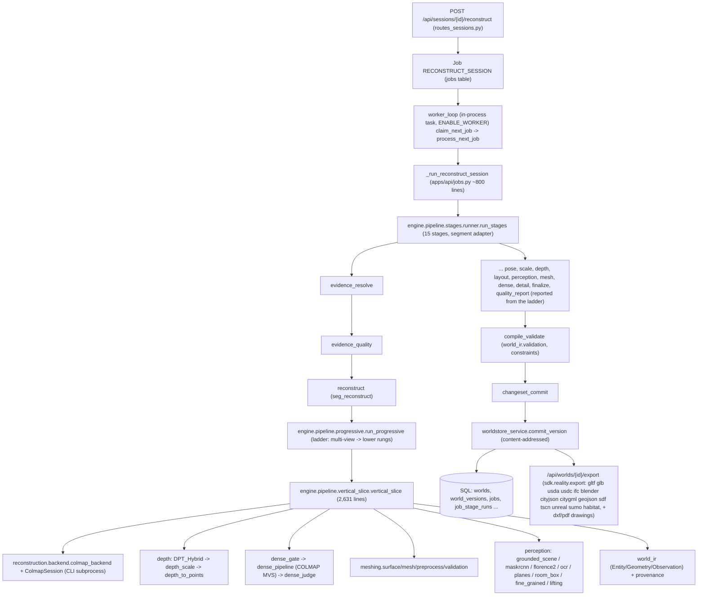

# RCEAP Cycle 0 — Reconstruction capability audit and platform readiness

Audited: `main` at `19d62795` (2026-11-19), branch `claude/sonnet-rceap-cycle0`. Author: Sonnet 5.5 (platform).
Every number below was read from the repository, the GitHub API, a CI log, or a command run for this audit; each section says which. Where something was not checked it says **not verified**. Nothing here is physical validation: no physical ground truth exists (section 12).

## 0. State at audit time

| Item | Observed |
|---|---|
| `main` CI | `CI` run failed on both `0a75d9c5` and `19d62795`: `Full Suite (shard 8/8)`, `tests/test_confidence_defaults.py` -> `perception/architecture/split_level.py:128` builds a `Relationship` without a stated confidence. Fix is open as #330. `E2E` passed. |
| Open PRs | #326 tenancy on body ids, #327 reaper compare-and-swap, #328 session/frontend truth (stacked on #327), #329 RELEASE.md corrections, #330 main-green fix, #331 (Gemini) spatial accuracy / raycast planner. All `UNSTABLE` (CI pending or red for the #330 reason). |
| Branch protection on `main` | none (`gh api .../branches/main/protection` -> 404; rulesets `[]`). |
| Tests collected locally | 5,624 (`pytest tests --collect-only`, 606 files in `tests/`). |

## 1. Capability inventory (what exists, per stage)

Production reconstruction runs one path (section 3). Columns: **Wired** = reachable from `apps.api.main` / `apps.api.jobs` by static import including lazy imports (`scripts/capability_audit.py` graph). *Wired is necessary, not sufficient*: a lazily imported module behind an env flag counts as wired.

| Capability | Implementation(s) in repo | Wired in default path | Notes |
|---|---|---|---|
| Image ingestion / quality | `evidence/importers.py`, `image_check.py`, `dedup.py`, `contribution.py`, `reconstruction/capture_quality.py` | yes | |
| Video ingestion | `evidence/video.py`, `reconstruction/video_frames.py` | **no** (both unreachable from the API) | capability matrix: Video ingestion 0/2 reachable |
| Feature extraction / matching | COLMAP's own (CLI); `reconstruction/matching/{sift,classical,lightglue,mast3r,xfeat,dedode}` behind `IMatcher` | COLMAP only. `matching.classical/lightglue/mast3r/xfeat/dedode` **unreachable** | `matching/__init__` registry exists but nothing in the job path selects a matcher |
| SfM / pose | COLMAP CLI via `reconstruction/backend/colmap_backend.py` + persistent `ColmapSession` per world; `reconstruction/sfm/core_pipeline.py`, `backend/python_backend.py` | COLMAP yes | `backend/registry.py` and `backend/selection.py` (backend selection) are **unreachable**: the job hard-wires COLMAP |
| Intrinsics / calibration | `reconstruction/calibration`, `colmap_intrinsics.py` | yes | |
| Dense MVS | COLMAP patch-match via `dense_pipeline.py`, gated by `engine/pipeline/dense_gate.py`, judged by `dense_judge.py`; `mvs/dense_cloud.py` | yes (`dense_auto`, opt-out `REALITY_DENSE_AUTO=0`) | needs CUDA COLMAP |
| Monocular depth | default `DPT_Hybrid` (torch hub) in `run_progressive`; `perception/depth/{depth_anything_backend,midAS_backend}` | DPT yes; Depth Anything wired lazily; `metric_depth_backend` **unreachable** | scale from depth is relative until anchored (`reconstruction/scale`) |
| Metric scale | operator baselines (`POST /api/worlds/{id}/scale`), `reconstruction/scale/*`, `scene_scale.py` | yes | the only source of metric scale; otherwise world stays RELATIVE |
| Point-cloud fusion | `reconstruction/fusion/consumer.py` | consumer yes; `fusion/robust_fusion.py` (619 LOC, Gemini) **unreachable** | |
| TSDF / volumetric fusion | **none**. Only `GeometryType.VOXEL` / `IMPLICIT` enum values | no | grep `tsdf` -> only `scripts/build_open_source_registry.py` |
| Meshing | `reconstruction/meshing/{surface,mesh,preprocess,validation}` | yes; `meshing/room_mesh.py`, `repair.py` (694), `lod.py` **unreachable** | non-convex room mesher (#320) not used by the job |
| Texturing | `reconstruction/texturing/projection.py`, `engine/render/textures/projection.py` | **unreachable** (both) | |
| Gaussian splatting | `engine/pipeline/gaussian_splats.py` | route reachable | ingest/convert/decimate/serialise `.splat`/PLY only; **no training/optimisation code** (no `gsplat`/`train`) |
| Segmentation | `perception/segmentation/{sam_backend,sam2_backend,oneformer_backend}` | all **unreachable** | detection is Grounding DINO / Mask R-CNN / Florence-2 (reachable) |
| Detection / open-vocab | `perception/detection/{grounded_scene,grounded_small,maskrcnn_backend,florence2_detector,ocr,attribute_pass}` | yes | default `grounded`; `REALITY_OPEN_VOCAB=0` -> Mask R-CNN (CPU by default, `MaskRCNNDetector(device="cpu")`) |
| Instance identity / re-ID | `perception/instances/{lifting,association,object_resolution,dinov2_hf}` | yes; `instances/dinov2_reid`, `global_association`, `track_backend`, `object_geometry`, `bounding` **unreachable** | |
| Semantic / architectural | `perception/architecture/*`, `perception/geometry/{planes,room_box}` | layout_evidence yes; `architecture/{scene,adapters,landmark,segments,split_level,multi_storey_validator,structural_network,accuracy_report}` **unreachable** (Gemini #320/#322) | |
| Specialist refinement (re-detect, more-views, reassociate, segment) | `perception/specialists/*` | **unreachable** | merged in #322 with executors; no caller in the job |
| Active reconstruction | `engine/pipeline/guidance.py`, `capture_requests` (rule-based: gaps in viewing directions, unregistered images, truncation, roles never observed) | yes | no next-best-view planner on `main` (#331 in flight) |
| Registration of new sessions | `engine/pipeline/progressive.py`, `registration/*`, `world_ir/incremental.py`, `routes_adoptions` | yes | `registration/photo_registration.py` unreachable |
| Temporal | `trajectories/*` | `trajectories.interpolation` (205 LOC, #320) **unreachable** | |

Unreachable-module counts by package (static graph, this audit, `scratchpad/reach.py` over `scripts/capability_audit.build_import_graph`):

| Package | modules | reachable | not reachable |
|---|---|---|---|
| perception | 155 | 105 | 50 |
| engine | 143 | 95 | 48 (incl. 7 `engine.world.*` ECS modules that no test imports) |
| reconstruction | 85 | 68 | 17 |
| apps | 78 | 62 | 16 |
| evidence | 27 | 18 | 9 |
| world_ir | 32 | 27 | 5 (`frame_graph`, `hypotheses` (0 tests), `mask_store`, `quality_state`, `relations`) |
| worldstore | 7 | 3 | 4 (`tiles` 1,014 LOC, `lazy_query`, `health`, `lifecycle`) |
| exporters | 38 | 36 | 2 (`citydb`) |

(`scripts`, `benchmarks`, `synthetic`, `events` are tooling/offline and expected to be unreachable.) The full list with LOC and number of test files importing each module is reproducible with the command in section 13.

## 2. Module integration graph (production)

## 3. Actual execution trace (image to reconstructed output)

Read from `apps/api/jobs.py` (`_run_reconstruct_session_inner`, lines 589-1340) and `engine/pipeline/stages/registry.py`:

1. **Enqueue**: `reconstruct_session` rejects a duplicate queued/running job (409), sets the session `processing`, inserts a `Job`.
2. **Claim**: single in-process async worker (`worker_loop`, started with the app unless `ENABLE_WORKER=false`) -> `claim_next_job` (CAS; `FOR UPDATE SKIP LOCKED` on PostgreSQL) -> lease/heartbeat/fencing (#318/#324).
3. **Handler**: one ~800-line function builds stage *segments* (closures over shared `nonlocal` state) and runs `run_stages` in one worker thread. The profile `interior_survey_standard` has 15 stages (`registry.py`); the coarse ones (`evidence_resolve`, `evidence_quality`, `reconstruct`, `compile_validate`, `changeset_commit`) are real segments, while `pose ... finalize` are *reported from* the ladder after `reconstruct` ran them inside `vertical_slice` (`stage_sink=fine`).
4. **Reconstruct**: COLMAP (CLI) registers images (incrementally into the world's persistent workspace), monocular depth (DPT_Hybrid) is scaled and back-projected, dense MVS only if the sparse model justifies it, then meshing, open-vocab detection (Grounding DINO / Florence-2), plane/room-box layout, fine-grained entity passes, identity/association.
5. **Commit**: world validated, change-set derived against HEAD, version committed to the content-addressed WorldStore + `world_versions` row; `_verify_outcome` re-verifies the version before grading `succeeded`/`partial` (#324).
6. **Output**: exports are produced on demand from WorldIR (`sdk/reality.py`), not during reconstruction.

Observed facts about this path: it is **COLMAP-only** (backend selection is unreachable), **single-job-at-a-time**, and **peak RSS is never recorded** (`StageResult.peak_rss_mb` is `None` in every stage constructor: `registry.py`, `runner.py`, `s04_pose.py`, `s05_scale.py`, `ladder.py`).

## 4. Disconnected, duplicated, partial

Disconnected (exist, tested in isolation, never called by the job): `fusion.robust_fusion`, `meshing.room_mesh/repair/lod`, `texturing.*`, `matching.*` (all learned matchers), `segmentation.*` (SAM/SAM2/OneFormer), `specialists.*`, `architecture.{scene,adapters,landmark,split_level,multi_storey_validator,structural_network,accuracy_report}`, `trajectories.interpolation`, `video_frames`, `world_ir.{frame_graph,hypotheses}`, `worldstore.tiles`, `engine.hardware.{device_manager,model_pool}`, `registration.photo_registration`.

Duplicated or competing: three reconstruction backends (`colmap_backend`, `python_backend`, `sfm/core_pipeline`) with the selector unreachable; two orchestrators (`reconstruction/orchestrator.py` and `engine/pipeline/progressive.py`); several depth backends (DPT_Hybrid default, `depth_anything_backend`, `midAS_backend`, `metric_depth_backend`, `heuristic_depth_prior`); two segmentation stacks (SAM family unwired, Grounding DINO wired).

Partial / known-limited: Gaussian splats (no training), TSDF (absent), video (unwired), small-object detection (low precision, off by default, per `RELEASE.md`), `perception/architecture/split_level.py` invents room bounds when none are recorded (`bounds_min/max` defaults, flagged on #330).

Broken at audit time: `main` shard 8 (section 0).

## 5. WorldIR contract assessment

Read from `world_ir/schema_v1.py`, `world_v1.py`, `geometry_data.py`, `camera.py`, `observations.py`, `provenance/provenance.py`. `WorldIR.schema_version == 1`; only version 1 loads.

| Contract | Present | Gap for reconstruction expansion |
|---|---|---|
| Entity | `id`, `type`, `transform: dict` (untyped), `geometry_ids`, `relationships`, `observations`, `provenance`, `confidence`, `confidence_vector` (11 axes), `uncertainty`, `statement_state` | `transform` is an untyped dict; no covariance on pose |
| Geometry | `type` (mesh, pointcloud, plane, box, sphere, cylinder, capsule, terrain, voxel, implicit, unknown), `data_uri` + `data_hash`, bounds, `lod_level`, `quality_metrics: dict` | no typed fields for point-cloud attributes, TSDF params, mesh per-vertex attributes, or units/frames beyond `MeshData.units/frame` |
| Point cloud data | `PointCloudData`: `Tuple[Tuple[float,float,float]]` + optional RGB, float64 | **no normals, per-point confidence/covariance, track ids, or source-view ids**; stored as Python tuples (memory cost grows with tens of millions of points; **not measured here**) |
| Mesh data | vertices, faces, optional normals/UVs, `units`, `frame` | no per-vertex confidence/semantics, no texture atlas reference |
| Cameras | `CameraIntrinsics`, `CameraExtrinsics`, `PinholeCamera`; `world_ir/frame_graph.py` (unreachable) | no first-class *camera pose entity with uncertainty*, no feature tracks / reprojection-error record, no depth-map entity |
| Observation / identity | `Observation` ledger with `DepthSource`, `AssociationDecision`, `AssociationState`, embedding + mask stores | masks via `mask_store` (unwired in the job path) |
| Provenance | enum `OBSERVED/RECONSTRUCTED/ESTIMATED/INFERRED/GENERATED/UNKNOWN/CONFLICT`; `ProvenanceGraph` | the enum names the *kind*, not the **method/model/version**; method identity lives in `custom_properties` / artifacts by convention |
| Uncertainty | `Uncertainty` (confidence in [0,1]), `ConfidenceVector` (scalar axes) | scalar only: no covariance, no distribution, no calibrated-or-not flag (S5-06 says "uncalibrated uncertainty") |
| Defaults | `Uncertainty` default is `0.0` ("never certain by default") **but** `Entity.confidence` and `Geometry.confidence` default to `0.5` | **contradiction**: an unstated confidence reads as 50%. The producer rule (`test_confidence_defaults`) catches constructors, not dataclass field defaults |
| Versioning | `schema_version: 1`, Alembic 0001-0006 for the DB, `world_versions` content-addressed | no schema migration path for WorldIR v2 documents |

## 6. Missing interfaces for the expansion

Required and **absent** today (no module defines them): a typed **camera-pose-with-covariance** record and **feature-track/reprojection** record (SfM); a **depth-map** artifact contract with per-pixel confidence (MVS/mono); a **dense point-cloud** contract with normals, per-point confidence and source views (`PointCloudData` cannot carry them); a **TSDF/voxel volume** artifact (`VOXEL`/`IMPLICIT` have no payload spec); **mesh-with-attributes** (per-vertex confidence/semantics) and a **texture atlas** reference; a **mask/instance layer** contract wired into WorldIR (the store exists but is unwired); a **method/model identity** record on provenance; a **next-best-view / capture-plan** contract (`capture_requests` are rule outputs, not a planner interface); a **resource request** contract (VRAM/RAM per stage) that a scheduler can honour.

Present and reusable: `IMatcher` (`reconstruction/matching/interface.py`), `IDepthBackend` (`perception/depth/interface.py`), `reconstruction/backend/interface.py` (+ `dense_registry`), the stage `StageSpec/StageResult` protocol, `ArtifactStoreInterface`.

## 7. Persistence, jobs, memory, error recovery

* **DB**: 30 SQLAlchemy models, Alembic 0001-0006. Local runs use SQLite; PostgreSQL is the target and is **not validated** by any test in CI (SQLite only; the backup/restore PostgreSQL drill is **not done**).
* **Jobs**: leases, fencing, CAS reaper, graded outcomes and session-status settling are merged or in #327/#328. One in-process worker; no work-stealing, no separate worker process in the default start.
* **Durability of stages**: `DbCheckpointStore`/`DurableJobCheckpointStore` resume succeeded stages when artifact hashes verify.
* **Memory**: no process-level instrumentation (`peak_rss_mb=None` everywhere). Models are unloaded by hand after use (`unload_furniture_model`, `unload_open_vocab_furniture`, `unload_layout_models`); the `engine/hardware/device_manager.py` and `model_pool.py` that would govern this are **unreachable**. Python object overhead of `PointCloudData` is a risk at scale (section 5).
* **Error recovery**: a stage failure raises the original exception into job grading (`failure_kind`, `retryable`); the COLMAP session is discarded on any exception so a failed run cannot poison the committed workspace; the session now settles to `failed`/`created` with the job verdict (#328).

## 8. Frontend reconstruction workflow (read: `RoomConstructionModal.tsx`, `lib/api/*`, proxies)

* The modal's progress steps are keyed by stage names the backend never emits (`sfm`, `scale`, `depth`, `planes`, `compiling`, `worldir`, `worldstore`); the backend emits `checking_reconstruction_backend`, `resolving_evidence`, `analyzing_evidence`, `building_rough_model|refining|reconstructing`, `committing_version`. Observed effect: steps 3-6 never highlight; the display jumps. A finer source exists (`/api/jobs/{id}/stages`, `job_stage_runs`) and is used by `PipelineGraph`, not by the modal.
* The poll budget is `MAX_POLLS=60 x 2 s = 120 s`; the recorded 10-photo sparse COLMAP stage alone took 79.5 s (`datasets/south_building/runs/pipeline_measurement_20261118T044709.json`), so larger sets exceed it and the user is told to reopen the world.
* Fixed in #328: needs-more-evidence vs failed vs cancelled vs unrecognised, unreadable-job stop, proxy error shape.
* **Not audited this cycle**: capture/upload UX, mobile capture, offline queue behaviour, Playwright journeys.

## 9. CI execution matrix

From `ci.yml`, `docs/CI_TEST_REGISTRY.md`, and the job logs of run `44478118177` (PR #329).

| Layer | What runs | Observed |
|---|---|---|
| Core (py3.10/3.11/3.12) | hand allowlist, 96 files on `main` | passed on all three in that run |
| Full suite | every test file, 8 shards, `-m "not slow"`, skip budget 30% | 7 of 8 shards read: 612+741+710+556+652+787+757 = **4,815 tests**, **88 skipped (1.8%)**, 1 failed (the #330 issue). Shard 1 was still running. |
| Collected locally | 5,624 | the gap to the executed sum is the unread shard, `slow` (nightly only) and deselected tests; not reconciled to the test |
| Room fidelity gate, lint, security/secret scan, frontend lint+typecheck+build, Playwright E2E | separate required-by-convention jobs | passed in that run |
| Nightly `slow` | `pytest -m slow` on schedule | not run on PRs |

**Skips are the finding.** CI installs `.[dev]` only: no `torch`, `transformers`, `kornia`, `pxr` (OpenUSD), COLMAP, or official CityJSON specs. The skip reasons read in shard 7 are exactly those (`torch/torchvision not installed`, `colmap binary not installed`, `No module named 'pxr.Usd'`, `Grounding DINO unavailable: No module named 'torch'`). Consequence: **no neural-model path and no COLMAP path is exercised by CI**. They are exercised only on a developer machine. Branch protection is absent, so even the passing checks are not required.

## 10. Exports and interoperability

`sdk/reality.EXPORT_FORMATS`: gltf, glb, usda, usdc (needs `usd-core`), ifc (needs `ifcopenshell`; API returns 501 otherwise), blender, cityjson, citygml, geojson, sdf, tscn, unreal, sumo, habitat, plus drawings (DXF/PDF). IFC has a zero-drift round-trip test (#321); USD binary and CityJSON spec checks are skipped in CI (above). `RELEASE.md` requires "exports open in one external tool each ... with the tool version recorded": that recorded evidence was **not re-checked** in this audit.

## 11. Dependencies, licensing, RTX 4050

Model registry (`perception/model_registry.py`, printed for this audit): all entries Apache-2.0/MIT/BSD-3 except `mast3r_vitlarge` **CC-BY-NC-4.0** (blocked by `assert_production_licences`, tested) and `depth_anything_v2_metric_indoor` **"undeclared"** (the gate must reject it; the upstream model-card licence was **not verified** here). COLMAP is BSD-3 (CLI binary, not pip). `pycolmap`, `open3d`, `usd-core`, `manifold3d`, `ifcopenshell`, `OpenEXR` are optional extras.

RTX 4050 Laptop (6 GiB, WDDM). Two reports disagree and must not be conflated:

* `docs/audits/RTX4050_APPLICATION_COMPATIBILITY.md` (2026-11-06, **13 days old**, measured, 3 launches per row): ~5.1 GiB usable when idle; SAM ViT-B 2.8 GB allocated at 1024 (fp32); Mask R-CNN 0.6 GB on GPU but the pipeline constructs it on **CPU**; WDDM can report a reserve above the card size by spilling to host RAM (treat as not practical). Python 3.14.7, torch 2.14.1+cu130.
* `benchmarks/hardware/rtx4050_profile_report.json` (Gemini, 2026-11-18): claims `pipeline_max_peak_vram_mb: 158`, `budget_compliant: true`. **Its backends are `SimulatedModelBackend`** (a list-comprehension loop with a bookkeeping allocator; `vram_rtx4050_profile.py:83-112`). It does not load any model, so 158 MB / 5,986 MB headroom is **not a pipeline measurement** and must not be cited. A real peak-VRAM measurement of `RECONSTRUCT_SESSION` has not been taken since 2026-11-06.

Constraint summary: stages must be sequential on the GPU with explicit unload; COLMAP dense needs CUDA COLMAP; anything above ~4-5 GiB resident risks WDDM spill.

## 12. Verification of benchmark and release claims

| Claim | Evidence | Verdict |
|---|---|---|
| "Six measured rooms captured and scored" (`RELEASE.md`, before #329) | `dataset_verification_report.json`: configured 6, **verified 0, blocked 6** | false; corrected in #329 with a guard test |
| "Branch protection on `main`" | GitHub API: none | false; corrected in #329 |
| `accuracy_benchmark_report.json` figures (e.g. mean wall error 3.5 mm, 100% within 2 cm) | file says `physical_count: 0`, `synthetic_count: 6` | synthetic evaluator output, **not** a physical accuracy result |
| "10-photo run timed ... 115 points in 79.5 s on RTX 4050" | `datasets/south_building/runs/pipeline_measurement_20261118T044709.json` runtime 79.496 s, 115 points | matches; it is a sparse COLMAP timing, not a quality result |
| RTX 4050 headroom 5,986 MB | simulated backend | not evidence (section 11) |
| "Golden loop on real photos, twice" and other `[x]` boxes | named tests exist | **not re-executed** in this audit |

## 13. Reproduce

Reachability: `scripts/capability_audit.py` exposes `build_import_graph()` / `reachable()` (live roots `apps.api.main`, `apps.api.jobs`); the per-package counts above came from a 40-line wrapper over those two functions that is **not committed** (it prints, per package, modules / reachable / unreachable, with LOC and the number of test files importing each). Other commands: `python -m pytest tests --collect-only -q`, `gh api repos/Shresthbhati/reality-engine/branches/main/protection`, CI logs via `gh api repos/.../actions/jobs/<id>/logs`.

## 14. Recommended architecture changes (minimal, no platform redesign)

1. **One reconstruction-backend seam**: route `seg_reconstruct` through `reconstruction/backend/selection.py` so a second SfM/MVS engine is a registration, not a fork. Today COLMAP is hard-wired.
2. **Typed spatial artifacts** (versioned, additive): `CameraPoseRecord` (pose + covariance + reprojection stats), `DepthMapArtifact`, `DensePointCloud` (normals, confidence, source views, columnar `.npz`/PLY not tuples), `VolumeArtifact` (TSDF params + sparse blocks), `MeshArtifact` (per-vertex attrs). Keep `Geometry` pointing at them by `data_uri`/`data_hash`.
3. **Provenance carries method identity** (`method`, `model_id`, `model_version`, `licence`) as a required, validated sub-record rather than a convention.
4. **Remove the 0.5 field defaults** on `Entity.confidence`/`Geometry.confidence` (use `Optional`/explicit unknown) behind a schema-version bump with a loader that maps old documents.
5. **Resource governor in the job path**: connect `engine/hardware/device_manager` + `model_pool` to the segments so each stage declares VRAM/RAM and loads/unloads through one place; record `peak_rss_mb` and peak VRAM per stage into `job_stage_runs`.
6. **Split `_run_reconstruct_session_inner`** (about 800 lines of `nonlocal` closures) into stage modules behind the existing `SegmentStage` interface, one at a time, each verified against the golden-loop tests.
7. **CI installs the optional extras in a separate, required job** (torch CPU, kornia, transformers, COLMAP, usd-core) so model and COLMAP code paths run at least on a small fixture; keep the skip budget.
8. **Branch protection with required checks** (repository-owner action; not possible from here).

## 15. Proposed Cycle 1 PR roadmap (each focused, each with its own tests)

| PR | Content | Depends on |
|---|---|---|
| C1-1 | Merge #326-#330; reconcile conflicting registry totals; CI "optional-extras" job (item 7) | owner enables checks |
| C1-2 | Resource governor wiring + per-stage `peak_rss_mb`/VRAM recording (item 5); a **real** VRAM measurement of one job replacing the simulated report | C1-1 |
| C1-3 | Backend selection seam in `seg_reconstruct` (item 1), COLMAP remains default, no behaviour change | C1-1 |
| C1-4 | Typed artifact contracts v1 (item 2) + provenance method identity (item 3) as **additive** WorldIR v1.1, contract tests, no producers yet | **Gemini agreement** on field names |
| C1-5 | Confidence-default removal and loader migration (item 4) | C1-4 |
| C1-6 | Wire already-built, tested modules that have producers and callers waiting: `room_mesh`, `robust_fusion`, `trajectories.interpolation`, specialists; each behind a flag, each with a before/after on the synthetic fixtures | C1-4 |
| C1-7 | Frontend: modal uses `/api/jobs/{id}/stages`, adaptive poll budget, resume view after timeout | none |
| C1-8 | Split the job handler into stage modules (item 6) | C1-2, C1-3 |

## 16. Shared interface requirements for Gemini (to agree before any code)

Gemini owns the spatial algorithms; these are the contract points the platform needs, proposed, **not yet agreed**:

1. Field-level schema for `CameraPoseRecord`, `DepthMapArtifact`, `DensePointCloud`, `VolumeArtifact`, `MeshArtifact` (names, units, frames, dtypes, optionality; missing evidence is `None`, never a default number).
2. Every producer returns `(artifact, ProducerReport)` where the report states method, model id/version, licence, parameters, device and peak memory; the platform stores it as provenance.
3. Confidence: producers state confidence explicitly (existing `test_confidence_defaults` rule) and say whether it is **calibrated** or heuristic.
4. Resource declaration per backend: expected VRAM/RAM, whether it can run on CPU, whether it needs CUDA.
5. No invented geometry: a backend that lacks input must refuse (typed `InsufficientEvidence`), not fill defaults (see `split_level.py` bound defaults).
6. Hardware reports must measure real loaded models or be labelled simulated.
7. Reachability: a new module lands with a caller (flagged) or is registered as *offline*; the capability audit fails a PR that adds an unreachable, unregistered module.

## 17. Not verified / out of scope this cycle

Frontend capture/upload/mobile UX and Playwright journeys; actual peak VRAM/RAM of a production job; PostgreSQL behaviour; scoped-token revocation status; external-tool opening of each export format; licence text of `depth_anything_v2_metric_indoor`; shard 1 of the latest CI run; the 519 "unlisted" test files' individual quality. Static reachability is import-based: it can over-count (a lazy import behind a flag) and cannot prove a path is *called* by default.
