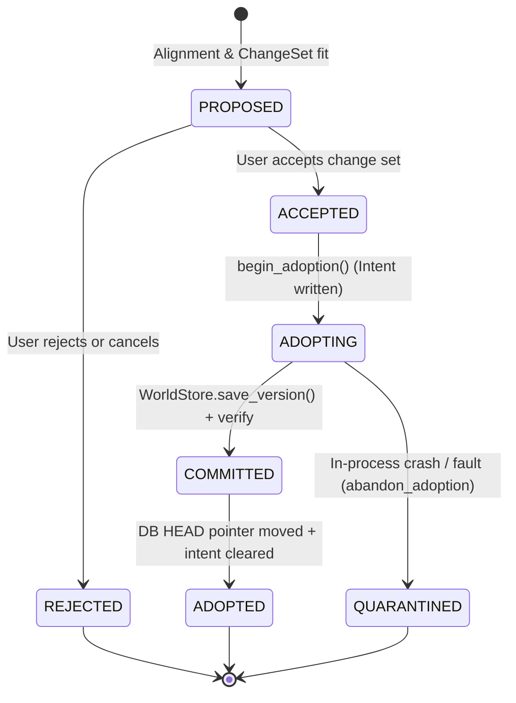

# Engineering Design Decisions

Canonical decision log. Only decisions **already made and enforced in
the codebase** appear here; open questions live in
[`../implementation/PENDING_IMPLEMENTATION.md`](../implementation/PENDING_IMPLEMENTATION.md)
as BLOCKED entries. Format mirrors `docs/DECISIONS.md` (V11 decisions
1–16); numbering continues from there.

Statuses: `ACCEPTED` (enforced), `PROVISIONAL` (reversible; revisit
trigger named).

---

## Decision 017 — Canonical geometry representation

**Status: ACCEPTED**

`MeshData` (`reconstruction/meshing/mesh.py`) is the canonical runtime
mesh representation: vertices, triangle indices, normals, coordinate
frame, metadata. COLMAP/OpenMVS are backend representations; Blender,
glTF, USD are export representations. A bounding box is an approximation
of an object and is labeled `INFERRED` — never presented as mesh
geometry.

## Decision 018 — Canonical world representation

**Status: ACCEPTED**

WorldIR v1 (`world_ir/world_v1.py`) is the canonical semantic world.
The viewer/Studio is a client of WorldIR + ArtifactStore. Compiled
worlds reference geometry through `(data_uri, data_hash)` artifact
pointers rather than embedding payloads.

## Decision 019 — Runtime intelligence

**Status: ACCEPTED**

No LLM dependency in the canonical runtime. Perception comes from real
model backends (Mask R-CNN, MiDaS, SAM when unblocked), geometry, and
numerical methods. Detection/segmentation backends sit behind
interfaces (`IDetectorBackend`, `ISegmentationBackend`) so models are
replaceable without touching the pipeline.

## Decision 020 — First depth sidecar format

**Status: ACCEPTED**

16-bit PNG first; EXR second (floating-point); device-specific raw
formats via explicit adapters later. Canonical representation:
`DepthFrame` with explicit `depth_scale`, `invalid_value`, `units`,
`calibration_ref`. **Raw integer depth must never be interpreted as
meters without an explicit scale factor.** Rationale: lossless,
inspectable, trivially testable, ubiquitous in RGB-D capture; EXR adds
value only when sub-mm float precision matters (rare before P1).

## Decision 021 — Surface reconstruction backend

**Status: PROVISIONAL**

COLMAP `poisson_mesher` (CPU) is the surface-reconstruction backend:
mature, already a repo dependency, accepts a plain oriented point cloud.
The backend adapts Poisson depth to point density and retries with
`trim=0` when the dense-cloud default yields an empty mesh (observed:
COLMAP's trim=10 requires density sparse clouds never reach).
**Revisit trigger:** a CUDA-capable COLMAP (unblocking
`patch_match_stereo` true MVS) or an OpenMVS backend — whichever lands
first changes the dense-geometry path, not the `MeshData` contract.

## Decision 022 — Honest unavailability states

**Status: ACCEPTED**

When a backend/model/dependency is missing, stages report a skip with
the reason (report.json `"status": "skipped"` + note; CLI exit 1 with
diagnostics) — never a placeholder that pretends inference happened.
Corollaries already enforced: `lift_region_to_3d` returns `None` for
non-metric depth instead of guessing scale; the perception stage refuses
without trusted intrinsics; `reality compile` never prints green on
failed stages.

## Decision 023 — Metric scale anchoring

**Status: ACCEPTED**

Metric scale comes only from an explicit operator-measured baseline
(`ScaleReference`) between two registered cameras, or — for mono-depth —
from alignment of relative depth to the SfM sparse cloud, in which case
the world is labeled `metric-by-alignment`. Unanchored worlds stay
`relative` with unit-less distances. There is no code path that invents
a scale factor.

**Amendment 2026-10-31 (user decision, option 2 -- suggest, user accepts; plan item D2b in `docs/superpowers/plans/2026-10-30-room-reconstruction-fidelity.md`).**
Scale is NEVER applied without the user's consent. Besides the camera baseline,
two more `ScaleReference` methods exist, both in model space and both gated:

- `known_length` -- the user states the real length of one edge / two picked
  points. Treated as a measurement (state MEASURED). Several known lengths are
  combined by median and must agree within `RATIO_SPREAD_MAX` (5 %), otherwise
  they are refused. API: `POST /api/worlds/{id}/scale` with
  `{method:"known_length", distance_m, point_a, point_b}` (or `model_length`).
- `prior_accepted_by_user` -- when the world is RELATIVE and a door with a
  measured height was fitted, the engine SUGGESTS a typical size
  (`GET /api/worlds/{id}/scale/suggestion`: door 2.0-2.1 m, midpoint 2.05 m, the
  object it came from, implied m/unit). Nothing changes until the user accepts
  (`POST .../scale` with `method:"prior_accepted_by_user"`, `source_entity_id`).
  Rejecting (`POST .../scale/suggestion/reject`) leaves the world RELATIVE. No
  door => no suggestion; a default is never offered.

A prior-based scale is ALWAYS labelled ESTIMATED (`scale_basis =
"prior_accepted_by_user"`, `dimension_state = "ESTIMATED"` in the world's
`metadata.scale` and the version report `stages.scale`); every dimension of
that world inherits ESTIMATED, never MEASURED (plan D1 reads these keys). Any
real measurement (camera baseline or known length) replaces the prior: trust
order is camera baseline > known length > accepted prior. A model-space length
is tied to the model unit it was measured in by a camera-pair fingerprint; if a
rebuild changes the unit the reference is refused rather than misapplied.

## Decision 024 — Camera-envelope filtering for meshing

**Status: ACCEPTED**

The sparse SfM cloud is triangulated, trustworthy geometry; it defines
the plausible scene envelope (95th-percentile camera-distance). Depth-
derived points beyond it are unprojection artifacts and are removed
before normal estimation/meshing. Observed necessity: without it, depth
outliers (km-scale) overwhelmed global outlier statistics and Poisson
meshed garbage at 400 m+ scale.

## Decision 025 — Deterministic test seam for the CLI pipeline

**Status: ACCEPTED**

`REALITY_TEST_BACKEND=module:Class` (env var, tests only) injects a
synthetic reconstruction backend so `reality compile` is E2E-testable
offline. Production leaves it unset and always uses COLMAP; the CLI
raises a clear error on a malformed spec rather than silently ignoring
it.

## Decision — Candidate selection by world evolution, rollback as a pointer move

**Status: ACCEPTED**

1. Incremental vs full COLMAP candidates are compared as WORLDS against HEAD with the same `world_delta`
   machinery that gates adoption (`engine/pipeline/candidate_selection.py`), by an ordered, recorded
   hierarchy - never by registered-camera count and never by a scalar score. Ties keep the incremental
   candidate (coordinate-frame continuity). If both fail acceptance the adoption gate keeps HEAD.
2. Rollback moves only the HEAD pointer. Versions stay immutable, evidence is never removed, the COLMAP
   base is set aside (renamed) before the pointer moves, and the next version chains onto the rolled-back
   HEAD (its evidence is the union of everything the world holds, so photos later versions used are retried).
3. The COLMAP session is derived state that commits strictly after WorldStore adoption and read-back; a
   crash leaves it at most one version behind, which converges. No cross-store journal is required for that.

## Decision — Adoption protocol (WorldStore <-> DB) and coordinate-frame preservation

**Status: ACCEPTED (2026-10-02, final sprint)**

Found by probing the real code: a crash between `WorldStore.save_version` and the DB commit left an orphan version that
`resync_versions` later mirrored as a PHANTOM version, and a retry then minted a second one; and an in-process fault after
the HEAD `UPDATE` was persisted by the job runner's own failure-bookkeeping commit, leaving HEAD naming a version with no
mirror row.

1. Adoption order is: intent file (`adoption-intents/`) -> WorldStore version -> read-back verification (BEFORE the
   pointer moves; the DB never names a version the store cannot reconstruct) -> DB HEAD + mirror row in ONE transaction
   -> intent cleared. Both writers (`commit_version`, the entity-correction route) use it.
2. A version written but never adopted is QUARANTINED (`quarantine/`; record moved, artifact kept, nothing deleted):
   immediately on an in-process fault, or by `reconcile_adoptions` at startup after a hard kill. `resync_versions` never
   mirrors a version with a pending intent. Versions with no intent (CLI writers) remain legitimate history.
3. A failed adoption undoes its own pending HEAD move/row inside the caller's transaction (no rollback: that would expire
   the caller's loaded objects).
4. Candidate arbitration: with an established HEAD, a candidate that keeps HEAD's coordinate frame beats one that
   re-expresses the world in a new frame unless the latter places >= `FRAME_CHANGE_MIN_EXTRA_PHOTOS` (2) more photographs.
   The frame shift is measured from the similarity `world_delta` already fits (geometry rules are blind to it by design).
   Tolerances are PROVISIONAL.
5. Retention: quarantined versions are kept indefinitely; a pruning policy is not decided.

Supersedes the old expectation (test_commit_failed_db_write_rolls_back) that an orphan is "reconciled into the listing".

## Decision — The working prototype is judged by the core loop; verification has four honest levels

**Status: ACCEPTED (2026-10-03, prototype-completion sprint)**

1. **Prototype scope.** The prototype is judged by `evidence -> world -> more evidence -> same world -> better world ->
   version -> export`, not by an ecosystem-integration checklist. Its export story is glTF, USD(A), IFC, CityGML,
   CityJSON and Blender (P16-01, DONE). The GIS / ROS / Habitat / SUMO / Unreal / Godot writers (P16-02) exist and are
   structure-tested, but are `OPTIONAL_DEFERRED`: no further work until a user of one of those ecosystems needs it, and
   nothing claims they load. Ledger states are exactly DONE / PARTIAL / BLOCKED / OPTIONAL_DEFERRED.
2. **Verification levels** (`engine/core/verification.py`; API `/api/system/verification`; CLI `reality verification`;
   `.agent/CAPABILITIES.yaml` is checked against the registry by a test): IMPLEMENTED < SYNTHETICALLY VERIFIED <
   REAL-WORLD VERIFIED, with EXTERNAL VERIFICATION PENDING items listed beside a capability. A capability below
   REAL-WORLD may not name real data; a synthetic one must be worded as synthetic; every one cites evidence files that
   exist. RGB-D, VIO, indoor architecture and 3DCityDB are synthetically verified with their real counterparts pending.
3. **Synthetic data policy** (`synthetic/`): deterministic, seeded, with the ground truth it was built from, labelled in
   every manifest it writes. It verifies the CONTRACT around a sensor or backend (formats, scales, invalid pixels, clock
   offsets, dropped frames, occlusion) -- never the sensor, never a VIO algorithm, never a real building. The VIO
   "binary" is a stand-in that perturbs ground truth; it exists to run the real subprocess adapters.
4. **Known limits are pinned, not hidden.** Where a synthetic fixture measured the engine WRONG (rooms joined by doorways
   merge; phantom openings under realistic depth noise; stairs not wired into assembly; the stair detector refuses an
   unsegmented flight or one with unobserved treads) the test is a strict `xfail` carrying the measured numbers: it flips
   to a failure the day the engine improves, forcing the pin and the ledger to be updated.
5. **Trajectories reach a world as an observation record**, not a registration: `trajectories.worldir.attach_trajectory`
   keeps the poses, clock/sync state and drift (unknown stays unknown) and records `registered_into_world: False` for a
   gauge-fixed frame. A VIO "world" frame is session-local until registration anchors it.
6. **3DCityDB availability is three-valued** (`probe_citydb`: AVAILABLE / UNAVAILABLE / FAILED) and probe-only: AVAILABLE
   means the `citydb` CLI runs, never that a database was reached. Contract tests against a fake CLI are not real
   3DCityDB verification; that stays external.

## Decision — Axis convention

**Status: ACCEPTED**

Right-handed, Y-up is the canonical world frame (`ARCHITECTURE.md`, `docs/MODULE_OWNERSHIP.md`,
`reconstruction/frame.py`, the viewport's `three-scene.ts`). The procedural grammars
(`procedural/room_grammar.py`, `urban_grammar.py`) author Z-up in grammar-local axes (x east, y north, z up; specs and
`origin` stay local) and convert once, in `_entity`, with the rotation (x, y, z) -> (x, z, -y), so height is world +Y and
local +y is world -Z. **Latent inconsistency, not fixed here:** `exporters/boxes.py` states "WorldIR is Z-up", which
contradicts this decision; reconcile it separately (exporters were deliberately left untouched).

## Decision — Site composer is manual placement, not registration

**Status: PROPOSED (feature at FOUNDATION; recorded 2026-10-31)**

A Site groups several already-reconstructed worlds and records a `SitePlacement` (position/rotation on a metric grid)
that the USER chose. It never infers where a world belongs, and a placement is never presented as registered or
geo-referenced. Automatic cross-source / geo-registration remains the MISSING item in
`docs/future/registration/CROSS_SOURCE_REGISTRATION.md` (it needs a measurable residual and a valid correspondence
set, which manual placement does not provide). Material hypotheses (plan M3) are likewise kept ESTIMATED with
`asserted=False` and are deliberately not mapped to physics materials.


## Quality bands (2026-10-13)

A model score is not a probability (master document 14.2), so the product shows coarse bands.

- **Entity band** (`apps/api/place_summary.py::entity_band`): `unknown` when provenance is UNKNOWN or confidence is missing or not
  a number; `weak` when provenance is CONFLICT or confidence is below 0.5; `fair` from 0.5 up to 0.75; `good` from 0.75.
  A conflict is never good, whatever its score. Not measured is never shown as good or bad.
- **Place band** (`band_and_reason`): `unknown` with no model; `weak` when fewer than half of the photographs are placed or the
  engine fell back below multi-view; `good` when the build was graded SUCCESS and at least 80% of photographs are placed;
  otherwise `fair`. The reason is returned with the band so the UI can say why.
- There is **no per-point band**: the stored point cloud carries no per-point confidence.
- The thresholds (0.5, 0.75, 0.8) are tolerances, not calibrated constants.

## Decision — One Studio UI (the workstation); no Simple/Pro switch (2026-11-07)

Status: accepted by the product owner ("Aa" = option A). Plan task T-1.1 in `docs/blueprint/33_TURNAROUND_PLAN.md`.

- The world page renders `SpatialWorkstation` for everyone. The Simple "place viewer" (`components/simple/*`) and the
  per-viewer Pro-mode preference (`re-pro-mode`, `useProMode`, Settings toggle) are removed.
- Why: the first customer (architecture and interior design firms) needs measuring, the inspector and evidence in the main
  view; two UIs for one world was a third noun beside Session and World (audit `32_FRONTEND_AUDIT.md` D1).
- A simpler presentation for clients comes back later as a **view mode inside the Studio** (plan M4b read-only client link),
  not as a second app.
- Consequence: `lib/copy.ts` and `lib/places.ts` (consumer wording and honest job progress) are no longer used by any screen; they
  stay because contract tests cover them. Delete or reuse when the client view is built.

## Decision — Proxy-only browser transport (2026-11-07, implemented)

Status: accepted and implemented (plan task T-1.2).

- The browser talks only to same-origin Next route handlers. Explicit handlers under `frontend/src/app/api/**` keep priority;
  the new catch-all `frontend/src/app/api/[...path]/route.ts` forwards every other `/api/**` call (any method, streamed
  request and response bodies) to the backend with the server-side token (`lib/api/backend.ts`).
- `apiBaseUrl()` (`lib/api/client.ts`): browser = same origin; Electron = injected `__REALITY_API_BASE__` (direct to the local
  API, unchanged); server-side rendering = `REALITY_BACKEND_URL`, then legacy `NEXT_PUBLIC_API_BASE_URL`, then :8100. The browser
  bundle no longer reads `NEXT_PUBLIC_API_TOKEN`; set `REALITY_API_TOKEN` (server only).
- The catch-all drops client `Authorization`, `Cookie`, hop-by-hop headers and rejects `.`/`..`/encoded-slash path segments.
- Verified 2026-11-07: Playwright suite 51 passed / 1 skipped in dev and in production-build mode; with a token-protected API
  the proxy returned 200 without a client token and with a forged one, passed 404/422 through, rejected an encoded traversal
  with 400, and a real JPEG upload returned 201 and came back byte-identical.
- Known limits: (1) one shared service token means **no per-user identity reaches the backend**. That is fine for the local
  single-user product and is the first thing to change for hosted multi-tenant use (M6: forward the user's credential
  instead of a blanket token). (2) Job-progress SSE has no frontend consumer yet, so streaming of long-lived events through the
  proxy is untested. (3) In `next dev` the first request compiles the route, so the footer health timeout was raised to 15 s.
- The new guard `test_every_proxy_targets_a_path_the_api_serves` skips the catch-all by design.

## Decision — Light theme shares the dark theme's copper accent (2026-11-07)

Status: accepted by the product owner ("copper is fine"). Plan task U.3.

- Light `--accent` is `#8a4f2a` (was legacy cyan `#00708a`); light and dark now share one brand. `--primary`/`--on-primary` are identical in both themes.
- Every colour pair is held to WCAG AA by `frontend/tests/contract/design-tokens.test.mts`; change a token value, then run `npm run test:contract`.
- Components use the token utilities from `globals.css` (`bg-surface`, `text-fg`, `text-success`, ...). The same test fails on any raw palette class (`text-zinc-400`, ...) in `src`.

## Decision — Learned single-image layout and open-vocabulary furniture (2026-11-07, implemented locally)

* **Why:** a real user world (10 AI-generated photos) came out with 5 floors, 1 wall and no furniture because 206 sparse SfM points cannot carry structure. A learned depth + surface-label stage gives every photo thousands of labelled 3D points.
* **Models (loaded from the local Hugging Face cache only, never downloaded at request time):** `depth-anything/Depth-Anything-V2-Metric-Indoor-Small-hf` (Apache-2.0 per the upstream project; its model card has no licence tag, **confirm before a paid release**), `openmmlab/upernet-convnext-tiny` (MIT per its model card), `IDEA-Research/grounding-dino-tiny` (Apache-2.0). Rejected for a paid product: MASt3R/DUSt3R and Depth Anything V2 Base and larger (non-commercial licences). VGGT and Mask2Former were not evaluated.
* **Selection rule:** multi-view is kept when credible (>= 40 sparse points per registered camera and >= 3 cameras). Only when it is not, and only if the layout path actually succeeds, the room shell is built from the best-supported single photograph. The replacement is recorded in `attempts` and the other photos are listed as not fused.
* **Honesty:** scale stays `relative` with an explicit "ESTIMATE" note (monocular metric depth is roughly 10-20 % off, never a measurement); entities are capped at 0.35 confidence (openings 0.3); implausible openings (floating doors, sliver windows) are refused with the reason.
* **Opt-outs:** `REALITY_LAYOUT_MODELS=0`, `REALITY_OPEN_VOCAB=0`; both are skipped under the `REALITY_TEST_BACKEND` seam.
* **Open:** fusing several photographs into one shell; accuracy needs the labelled set (8.6).

## Decision 026 — Production Hosting Architecture & Monthly Cost Model (1 API Box + 1 GPU Worker + S3 Storage) (T-6.1)

**Status: ACCEPTED (ADR 2026-11-07)**

### 1. Context & Objectives
Reality Engine consists of two fundamentally distinct workloads:
1. **Interactive API & Client Viewport**: Lightweight, latency-critical REST endpoints, WebSockets/SSE, Next.js frontend SSR, spatial queries, and persistent per-world undo/redo command logs.
2. **Batch Spatial & ML Perception**: Heavy GPU compute executing COLMAP sparse SfM, OpenMVS/Poisson surface reconstruction, and monocular depth/segmentation models (Depth Anything V2, UPerNet, Grounding DINO).

Running GPU instances 24/7 wastes 85–95% of server expenditure during idle hours. Conversely, routing multi-gigabyte raw photo uploads and GLB assets through a single compute instance saturates network bandwidth and exhausts memory.

### 2. Architecture Decision: 3-Tier Split
We adopt a decoupled cloud-native topology:

```
[ Client Browser / Mobile Capture ]
      |                      \ (Presigned S3 Upload / Download)
      v                       v
[ Tier 1: API / Web Box ]   [ Tier 3: S3 Object Store (Cloudflare R2) ]
      |                       ^
      | (Durable Job Dispatch) | (Fetch Evidence / Write WorldIR & GLB)
      v                       |
[ Tier 2: On-Demand GPU Worker (RunPod Serverless / Modal) ]
```

#### Tier 1 — API & Web Server (1 Box)
- **Role**: Serves Next.js frontend, FastAPI REST endpoints, SQLite / PostgreSQL metadata, and enqueues reconstruction jobs.
- **Specification**: 4 vCPU, 8 GB RAM (e.g. Hetzner Cloud CPX31 or AWS EC2 t4g.xlarge).
- **Network**: Public HTTPS with Let's Encrypt SSL, rate limiting, and CORS restrictions.
- **Storage**: 80 GB NVMe for OS, local DB, and temporary caches.

#### Tier 2 — On-Demand GPU Worker (RunPod Serverless / Modal Labs)
- **Role**: Executes heavyweight perception and 3D reconstruction pipelines on a worker container.
- **Specification**: NVIDIA RTX 4090 (24 GB VRAM) or NVIDIA L4 / A10G (24 GB VRAM) container with CUDA 12.x, PyTorch, COLMAP, and pre-baked model weights.
- **Lifecycle**: Scales to 0 when idle. Cold start < 15 seconds using warm container layers; job execution time typically 2.5 to 5.0 minutes per room reconstruction.
- **Billing**: Per-second execution billing (~$0.44/hour on RunPod Serverless or $0.00022/second).

#### Tier 3 — S3-Compatible Object Store (Cloudflare R2 / AWS S3)
- **Role**: Primary durable repository for session evidence photos, depth sidecars, point clouds, WorldIR JSON snapshots, and GLB / IFC export binaries.
- **Provider**: **Cloudflare R2** chosen for its **$0.00 egress bandwidth fee** guarantee, avoiding surprise egress bills from architectural model downloads and video sweeps.
- **Security**: Tenant-isolated bucket prefixes (`/{tenant_id}/{world_id}/artifacts/{sha256}.bin`). Raw uploads generated via short-lived presigned URLs.

---

### 3. Monthly Cost Estimates & Tier Projections

| Resource | Low / Staging (50 jobs/mo) | Mid / Commercial (500 jobs/mo) | High / Scale (2,500 jobs/mo) |
| :--- | :--- | :--- | :--- |
| **API Box (Hetzner CPX31/CPX41)** | $16.50 / mo | $31.00 / mo | $65.00 / mo |
| **GPU Compute (RTX 4090 @ $0.44/hr)** | $1.47 / mo *(3.3 hrs)* | $14.67 / mo *(33.3 hrs)* | $73.33 / mo *(166.7 hrs)* |
| **Object Storage (Cloudflare R2)** | $0.38 / mo *(25 GB)* | $3.75 / mo *(250 GB)* | $22.50 / mo *(1.5 TB)* |
| **Data Egress Bandwidth** | $0.00 *(R2 Free Egress)* | $0.00 *(R2 Free Egress)* | $0.00 *(R2 Free Egress)* |
| **DNS / SSL / Observability** | $1.50 / mo | $3.00 / mo | $10.00 / mo |
| **Total Monthly Spend** | **$19.85 / mo** | **$52.42 / mo** | **$170.83 / mo** |

*Estimated cost per completed room reconstruction at commercial volume:* **~$0.10 per room**, providing a 98% gross margin on standard architectural subscription tiers ($49–$199/month).

---

### 4. Consequences & Implementation Seams
1. **Local Developer Experience Preserved**: The default local runtime continues to use local filesystem storage (`STORAGE_ROOT`) and in-process background worker execution without requiring cloud credentials.
2. **Adapter Contract (T-6.3)**: `ArtifactStore` interface isolates filesystem vs S3 implementations (`S3ArtifactStore`), validated against MinIO in CI.
3. **Durable Job Queue (T-6.2)**: API box publishes job payloads to queue; GPU worker polls or receives webhook triggers and posts results back directly to object store.

---

## Decision 027 — Multi-Session World Adoption Contract & Progressive Project Evolution

**Status: ACCEPTED (T-4.1, Constitution §3)**

### 1. Context & Motivation
Small-to-mid architectural and interior design firms capture spaces incrementally—often room by room across separate sessions—and frequently perform follow-up site visits to survey additional areas or document structural changes.

In a production SaaS environment:
- Treating every capture session as an isolated, standalone world fragments projects into disconnected files.
- Silently clobbering an existing world model risks obliterating manual user design work, violating **Product Constitution Rule 18** (manual user edits are strictly protected against late reconstruction overwrites).
- A second or subsequent site visit must seamlessly propose an **Adoption**: registering the new session into the existing World coordinate frame, deriving an explicit, categorized change set, and allowing the professional user to review, arbitrate, and approve the evolution of the model.

This ADR establishes the formal adoption contract, data schema, confidence scoring, and state machine governing session-to-world adoption across the reality engine.

---

### 2. Core Entities & Identity Hierarchy

```
+-------------------------------------------------------------+
|                          Project                            |
|  (Tenant-scoped container for an architectural site/client) |
+-------------------------------------------------------------+
                              | 1
                              |
                              * n
+-------------------------------------------------------------+
|                          WorldID                            |
|       (Durable Digital Twin with linear version history)     |
|       v0  -->  v1  -->  v2 (HEAD)                           |
+-------------------------------------------------------------+
      ^                                      ^
      | adopts                               | adopts
+---------------+                      +---------------+
|   Session A   |                      |   Session B   |
| (Site Visit 1)|                      | (Site Visit 2)|
+---------------+                      +---------------+
```

1. **`WorldID`**:
   - The authoritative, long-lived identifier for the digital twin of a building or apartment.
   - Owns a strictly linear, immutable version history (`v0, v1, v2, ...`) managed in `WorldStore`.
   - Contains the canonical semantic `WorldIR` graph (walls, slabs, openings, fixtures, furniture, finishes).

2. **`SessionID`**:
   - An immutable evidence bundle from a single capture event (photos, camera intrinsics/extrinsics, GPS/IMU trajectories, and dense point evidence).
   - Does not have mutable state. Once uploaded and reconstructed into candidate geometry, it can be proposed for adoption into one or more target worlds.

---

### 3. Candidate Matching & Relative Alignment (`CandidateMatch`)

When an incoming session `S` is evaluated against an existing target world `W_HEAD`:

1. **Multi-Cue Registration Ladder**:
   - **Level 1 (Direct Visual Loop Closure)**: 2D feature matching between session photos and world keyframes with RANSAC PnP / Sim(3) Kabsch alignment.
   - **Level 2 (Portal & Opening Matching)**: Shared architectural opening geometry (doorways, pass-throughs) matched across room boundaries within metric tolerances.
   - **Level 3 (Planar Alignment)**: RANSAC alignment of major structural planes (gravity vector / vertical up-axis, coplanar floor slabs, bounding wall segments).

2. **Transform Contract**:
   The registration yields a 7-DOF similarity transformation `T_{S -> W} in Sim(3)`:
   `x_W = s * R * x_S + t`
   where `R in SO(3)`, `t in R^3`, and scale `s > 0`. If scale is already metric from calibrated sensors or known references, `s == 1.0`.

---

### 4. Alignment Confidence Scoring (`alignment_confidence`)

Every candidate match computes a normalized scalar confidence `C_align in [0.0, 1.0]`:
`C_align = 0.45 * w_overlap + 0.35 * w_feature + 0.20 * w_scale`

Where:
- `w_overlap`: Fractional bounding-volume and structural plane inlier overlap.
- `w_feature`: Visual feature inlier ratio and mutual nearest-neighbor correspondence quality.
- `w_scale`: Metric consistency ratio (`|1.0 - s| <= 0.02`).

#### Operational Confidence Tiers:
| Confidence Tier | Score Range | Engine Behavior & UX Policy |
| :--- | :--- | :--- |
| **`HIGH`** | `C_align >= 0.85` | Automatic alignment verified (RMSE <= 0.03 m). Proposed changes presented for one-click adoption approval. |
| **`MODERATE`** | `0.60 <= C_align < 0.85` | Spatial overlap confirmed but partial (e.g. single connecting doorway). UI displays side-by-side 3D overlap preview with registration highlights. |
| **`LOW`** | `C_align < 0.60` | Automatic alignment refused. System offers manual 3-point correspondence alignment or creation of a separate room cluster. |

---

### 5. Change Set Schema (`ChangeSet`)

Comparing the aligned session candidate against `W_HEAD` generates an explicit semantic change set. Every entity in the candidate is deterministically classified into exactly one of five categories:

```json
{
  "adoption_id": "adp_9a7bc412",
  "world_id": "wld_841c36c1",
  "session_id": "ses_e01f29da",
  "alignment_confidence": 0.92,
  "change_set": {
    "matched": ["ent_wall_north_01", "ent_floor_01"],
    "new": ["ent_room_kitchen", "ent_wall_k01", "ent_window_k01"],
    "updated": ["ent_wall_east_01"],
    "uncertain": ["ent_chair_unknown_02"],
    "conflicting": []
  }
}
```

1. **`MATCHED`**:
   - The session observation confirms an existing entity within tolerance (spatial deviation <= 2 cm, surface normal deviation <= 5 degrees).
   - Action: Entity ID is preserved; observation count increments; evidence linkages added; geometric confidence bounds tightened.

2. **`NEW`**:
   - Geometry detected in the session that corresponds to no existing entity in `W_HEAD` (e.g., an adjacent newly surveyed room or newly placed piece of furniture).
   - Action: Entity assigned a stable UUID with `SessionProvenance`, linked into the parent room graph, and added to the world model upon adoption.

3. **`UPDATED`**:
   - Existing unlocked entity whose geometry or boundary is refined by denser observations (e.g. higher-density wall points revealing an exact opening boundary).
   - Action: Entity geometry and bounding metrics updated; previous geometry preserved in version history.

4. **`UNCERTAIN`**:
   - Low-observation count, occluded, or boundary-ambiguous entity (e.g. `coverage_state == "PARTIALLY_OBSERVED"`).
   - Action: Flagged in UI for explicit user toggle (Accept / Drop) before committing.

5. **`CONFLICTING`**:
   - Geometric clash (e.g. wall shifted > 5 cm compared to prior survey).
   - Clashes with an entity carrying `is_manual_edit=True` or `provenance="USER_EDIT"`.
   - Action: **Rule 18 Protection**: Manual edits are never overwritten. The user edit is retained by default; the user is presented an explicit side-by-side resolution choice.

---

### 6. Adoption State Machine & Safety Protocol



1. **`PROPOSED`**: Candidate aligned and `ChangeSet` generated. Read-only review state in UI.
2. **`ACCEPTED`**: User confirms adoption (all non-conflicting + resolved items).
3. **Atomic Transaction Execution**:
   - Calls `worldstore_service.begin_adoption(world_id, parent_version)`.
   - Saves new version `v_{N+1}` to storage root.
   - Reads back and verifies structural integrity of the synthesized `WorldIR`.
   - In a single DB transaction, updates world `head_version_id` and records the mirror version row.
   - Clears adoption intent via `worldstore_service.finish_adoption()`.
4. **Crash Invariance**:
   - If an unhandled failure occurs before HEAD moves, `abandon_adoption()` quarantines the staged directory (`quarantine/`).
   - Startup reconciliation (`reconcile_adoptions`) cleans orphaned intents before workers process incoming tasks.
   - The world model is never left in a corrupted or ambiguous state.

### 7. Evidence World vs Vertical-Slice World (status: DECIDED for the interim, MERGE BLOCKED)

Two WorldIRs exist per job: the **vertical-slice world** (committed through the adoption state machine of section 6; the world the Studio viewer and
exporters read) and the opt-in **evidence world** (`<WORLDSTORE_ROOT>/evidence-world/<team>/<world>/<job>/worldstore`, one verified immutable version
per run, built from the Evidence Matrix by the canonical bridge).

- **Interim rule:** the evidence world is a *candidate*. It is never adopted into the canonical world implicitly and never overwrites it. It is
  inspected through `/api/worlds/{id}/evidence-world/*` and the Evidence runs panel. Section 6 remains the ONLY path by which a world becomes HEAD.
- **Scale rule:** evidence-world positions/dimensions carry `scale_state` / `units` on the entity transform and the box geometry. SfM-gauge values
  are `sfm_units`, `physically_metric: false`; `readiness().metric_export_ready` is true only when every positioned entity is `metric_anchored`.
- **DECIDED and IMPLEMENTED (option a, 2026-11-22):** the evidence world reaches the committed world only as a *proposal* through section 6. `POST /api/worlds/{id}/evidence-world/{run}/propose` builds HEAD plus the evidence entities and returns a pending change proposal; the user accepts it through `/api/worlds/{id}/proposals/{pid}/accept` (a subset by `entity_ids` if wanted). Nothing is committed by proposing; HEAD's own entities are never modified. **Frame/unit gate:** refused (409) unless HEAD is exactly the version the same job committed beside this run (`committed_version.json`, written by the job after read-back verification): one COLMAP model, one canonical frame, one scale state. A world that has evolved since, or a run without the record, is not mixed in. Evidence entities cite their observations (surfaces cite the aligned depth records they were fitted from), so the protocol judges them on evidence: objects `supported`, anything uncited `needs_review`. Verified on a real 12-photograph run (see section 8); not verified: acceptance after the world has evolved through later sessions (refused by design, no re-alignment path yet).


### 8. Spatial intelligence in the production path (PR #361 deliverable; status: IMPLEMENTED + EXECUTED ON REAL DATA, not physically validated)

**Execution trace (upload -> inspected world).** Every row is a call that runs in the real job; verified by the real run below.

| # | Transition | File : function |
|---|---|---|
| 1 | upload | `apps/api/routes_misc.py:create_upload` (`POST /api/uploads`) |
| 2 | start job | `apps/api/routes_sessions.py:reconstruct_session` -> `jobrunner.enqueue_job(RECONSTRUCT_SESSION)` |
| 3 | ingestion / quality | `apps/api/jobs.py:seg_evidence_resolve`, `seg_evidence_quality` |
| 4 | calibration + SfM | `jobs.py:seg_reconstruct` (COLMAP session) -> `_registered_camera_poses`, `_evidence_intrinsics`, `_evidence_observations` |
| 5 | evidence stage | `jobs.py` (after `committing_version`) -> `apps/api/evidence_world_stage.py:run_for_job` |
| 6 | **detector + segmenter + DetectionPipeline** | `run_for_job` -> `adapters/pipeline_detection.install` -> `ExecutionManager.run` -> `PipelineDetectionEngineAdapter.infer` -> `DetectionPipeline.run_pipeline` (tiles, sub-part crops, class filter, duplicate suppression, SAM masks via `AdapterSegmenter`) |
| 7 | raw preservation | executor `_persist_matrix`: `bbox` (+RLE mask), per-image `detection_pipeline_summary` (every raw candidate with disposition), run output artifact, checkpoint sha256 in the run record |
| 8 | depth + scale alignment | `run_for_job._depth_and_lift` -> `_run_depth` (cache) -> `lift_stage.align_depth_record` |
| 9 | spatial lifting + multi-view association | `engine/multiengine/spatial_stage.py:run_spatial_stage` -> `spatial_intelligence.reconstruct_spatial_scene` (masks via `_lift_mask`); identity via `make_scene_pair_scorer` |
| 10 | relationships | `make_scene_relations_fn` (structural kinds only, acyclic) |
| 11 | canonical entities + WorldIR | `evidence_flow.run_evidence_flow` -> `derive_entities` -> `worldir_bridge.convert`; surfaces via `surfaces.build_surface_entities` |
| 12 | validate + persist + reload | `evidence_world_stage.persist_world` (validate -> `WorldStore.save_version` -> verify -> reload-compare) |
| 13 | API inspection | `apps/api/routes_evidence_world.py` (`/readiness`, `/entities`, `/world`, `/rejected`, correct, export, `/manifest`) |
| 14 | frontend | `EvidenceRunPanel.tsx` -> `SpatialWorkstation` viewer (`onViewWorld`) |

NOT INTEGRATED before this change: row 6 (`DetectionPipeline` had no production caller; the job ran whole-image detectors only, with no tiling, no micro crops and no segmentation) and mask use in row 9. Both are now wired. Still not integrated: `SpatialSceneResult.to_metric3d_observations` (its records lack `raw_artifact_ref`, so metric3d.v1 refuses them; the stage writes its own contract-valid records), and the vertical-slice world (section 7).

**Guards.** `RuleBasedDetectorAdapter` / `ThresholdSegmenterAdapter` raise `ProductionAdapterError`; test-double predictions and virtual sources are refused; an unavailable detector makes the engine UNAVAILABLE; a missing or failed segmenter is recorded and the run is `partial` with the reason; if the pipeline cannot be installed the run falls back to the real whole-image detectors and says so (`partial`).

**Shared interface (PROPOSED to Gemini; not yet acknowledged by Gemini).** (1) Scale provenance is per merged entity (`scale_state`, `scale_units`, `is_physically_metric`); one mapper `integration._metric3d_scale` turns it into `ScaleState` (gauge never becomes relative depth or metres). (2) A detection reaches association as `DetectionInput` built from a `bbox` observation (`mask_2d` decoded from its RLE). (3) `to_metric3d_observations` needs a `raw_artifact_ref`. (4) Whole-image labels from `clean_and_split_detection_label` split compound prompts ("electrical socket" -> "electrical", "socket") in the real run: owned by the detector adapter, needs a decision. Gemini's association maths was not changed.

**Real production run (run 13).** 12 original Microsoft 7-Scenes "office" Kinect photographs (640x480, not committed); real COLMAP, depth_anything, OWL-ViT and SAM; `RE_DETECTION_TILE_SIZE=320` so tiling executes on small frames.

| Measure | Observed |
|---|---|
| images / cameras registered | 12 / 12 |
| detector passes / queries / tiles | 96 / 2,352 / 72 (sub-parts detected: 0; no host with taxonomy sub-parts was found) |
| raw candidates -> refined boxes | 121 -> 46 |
| segmentation coverage | 46 of 46 (SAM, 0 failures); masks used by lifting: 46 |
| boxes by class | desk 21, chair 18, workstation 12, switchboard plate 7, wall 5, floor 4, air vent 3, cabinet 3, television 2, shelf 2, others 1-2 |
| bbox evidence by engine | detection_pipeline 46; owlvit 25 and grounding_dino 20 (added by the refinement loop's reprocessing) |
| lifted / rejected | 46 / 0; association: 34 merged, 99 refused |
| entities | 19 (12 object, 7 surface); 8 multi-view, 11 single-view; 19 positioned, 19 with geometry; 0 withheld |
| scale | `sfm_gauge` on all 19; physical accuracy NOT_MEASURED; not metric-exportable (export needs `acknowledge_unscaled`) |
| validation | `valid`; persisted version `v-fcfc027e50294667`; fresh-process reload: 0 integrity problems |
| runtime / peak memory | 462.6 s; peak RSS 4,702 MB, peak CUDA 1,074 MB (this process; COLMAP subprocess excluded) |

Against Kinect ground truth (`validate_office7_world.py`; the ground truth is itself centimetre-level): camera-centre RMSE 5.5 cm; entity centre to nearest Kinect surface median 3.9 cm (84% within 10 cm, 100% within 25 cm); 6 planes with median plane residual 1.8-2.9 cm; lifted/Kinect extent ratio median 0.81, absolute error median 10.7 cm (p90 46 cm).

**Honest reading.** The pipeline keeps far fewer objects than the previous whole-image run (12 object entities against 80): class-aware filtering cut 121 candidates to 46, so recall is lower; precision and class correctness are NOT measured (no class ground truth). The extent ratio fell from 1.02 to 0.81 because lifting now uses the SAM mask (the object) while the validator compares with the Kinect extent of the whole box region: the two numbers are not comparable, so no accuracy claim is made either way. 11 of 19 entities are single-view.

**Found on the real run and fixed.** `refine_flow._consistency` raised `KeyError` once reprocessing ran, because lifted entities carry non-detection members (runs 11 and 12 failed; regression test `test_refinement_consistency_check_tolerates_derived_position_and_dimension_members`).

**Tests.** `python -m pytest tests/test_detection_pipeline_engine.py tests/test_lift_stage_e2e.py tests/test_spatial_stage.py tests/test_run_manifest.py tests/test_depth_cache.py tests/test_surfaces.py tests/test_evidence_world_api.py tests/test_spatial_intelligence.py tests/test_multiengine_evidence_flow.py tests/test_colmap_observations.py tests/test_office7_validation.py -q -p no:cacheprovider` -> 113 passed, 1 skipped. The real run is reproduced by `RE_DETECTION_TILE_SIZE=320 RE_EVIDENCE_WORLD_DEPTH_ENGINES=depth_anything python benchmarks/measured_rooms/run_office7_production.py <frames> <out>` followed by `validate_office7_world.py <out> <frames>`.

**Remaining blockers.** Class and identity accuracy unmeasured (needs labelled ground truth); metric scale needs an anchor; sub-part crops did not fire on this scene; compound-label splitting (above); Gemini acknowledgement of the shared interface; browser verification of the panel; merge of the evidence world into the committed world (section 7); the full test suite was not run.

**Evidence world -> committed world, real run 14 (end to end).** The job wrote `committed_version.json` itself (`v-450b3f79ad1c`); `propose` returned 19 changes, 19 `supported` (the 7 surfaces now cite their aligned depth records), 0 `needs_review`, 0 `conflict`; `accept` adopted them as `v-5346fe783c7a` (19 -> 38 entities; read-back verified, validation clean, the 19 original entities byte-identical). Run 13 before the citation change gave 12 supported and 7 `needs_review`. Scale on all promoted entities remains `sfm_gauge`; this is adoption of evidence-backed entities, not a metric or class-accuracy claim.

### 9. Production lifecycle contract (PR #363 sprint; status: IMPLEMENTED + EXECUTED ON REAL DATA for the gate, not physically validated)

**Per-stage deadlines.** `run_stages(stage_timeouts=...)`, fed by `RE_STAGE_TIMEOUTS_S` (`name=seconds,...`) in the production job. A Python thread cannot be killed, so a timed-out stage is ABANDONED: recorded `failed` (`timed_out` metric), its late result discarded, and it is never retried (the straggler may still be running; a second run would duplicate its effects). Unset means no per-stage deadline; the job-level timeout and lease still apply.

**Stage outputs.** `StageSpec.requires_outputs` / `idempotent` / `retries`: a stage that reports success without a declared output is `failed`; only `idempotent` stages are retried. `compile_validate` stores the validated world content-addressed and publishes its hash (`world_ir`), and requires it; the hash is exposed by `GET /api/jobs/{id}/stages`. A published reference always points at a stored artifact.

**Quality verdict** (`engine/multiengine/quality_gate.py`, served as `readiness().quality`). FAILED (run unreadable/failed, world fails integrity, or source photographs / manifest no longer match what the run recorded), BLOCKED (no persisted world, empty, nothing positioned), PARTIAL (anything else short of READY, including unanchored scale and any gate that could not be measured), READY (every measured gate passes, none unmeasured). No universal numeric thresholds: each gate states the quantity and the structural rule. Multi-view association is reported, not gated (a single-view object is weaker, not invalid). Export is refused for FAILED/BLOCKED; PARTIAL exports carry `X-Quality-Verdict`.

**Corrections are version-aware.** merge / split / reclassify accept `expected_version_id`; if HEAD moved the server answers 409 instead of applying the correction on a version the user never saw. The panel sends the version it last saw and tracks the new head after each correction.

**Topology.** `validate_world_ir` errors on containment cycles and self-relations and WARNS (never errors) on disconnected room groups, since a partial capture may honestly lack the connecting evidence. This exposed that the interior compiler never wrote evidenced room passages into the WorldIR; they are now written as `CONNECTS`. Sub-part detections carry their host box (`parent_pipeline_box_id`); the evidence flow maps it to the host group so the bridge records `PART_OF`. Rooms are never manufactured: the real evidence-world run has surfaces but no closed room, so it has no room entity and no containment.

**Not done.** Per-stage deadlines are not set by default; segment stages other than `compile_validate` publish no output hashes; physical accuracy is not measured (no independent metric ground truth; scale is SfM gauge).

### 10. Perception contract: what production consumes (Phase 1; status: VERIFIED BY READING THE CODE + REAL RUN 18; incompatibilities listed)

Source contract: `docs/engineering/PERCEPTION_OBSERVATION_CONTRACT.md` (Gemini, #365). Production never calls `SpatialSceneResult.to_world_ir()` or `to_metric3d_observations()`: it consumes the package's lifted entities, merged entities and relationships and writes its own `metric3d.v1` records, canonical entities and WorldIR through `canonical` / `worldir_bridge`.

| Contract field | Production handling |
|---|---|
| Detection: `class_name`, `box_2d`, `confidence`, `source_engine`, `source_image_id`, `scale`, `box_id`, `parent_box_id` | persisted on the `bbox` observation (`label`, `score`, `scale_tier`, `pipeline_box_id`, `parent_pipeline_box_id`, `host_class`, `inner_engine`); a missing confidence stays `None` (`confidence_emitted=false`), never a default |
| Detection: `is_truncated`, `occlusion_level`, `mask_area_px`, `child_box_ids` | NOW persisted as given (were dropped before this change) |
| Detection: `mask_2d` | exact run-length encoding incl. holes; lifted to the depth grid and used to constrain surface lifting (`_lift_mask`) |
| Detection: `mask_polygon`, `attributes` (material / finish / colour), `frame_index`, `timestamp_sec`, `shot_id` | NOT persisted on the detection (polygon is derivable from the mask; material/colour reach the world as the package's attribute CLAIMS, never as measured values). Video fields are not used: the production job takes photographs and video frames come from `reconstruction/video_frames.py`, NOT the selectable sampler in `spatial_intelligence/video_ingestion.py` (NOT INTEGRATED) |
| Image / video provenance | source path + sha256 in the run manifest, re-verified on every readiness read |
| Camera intrinsics / extrinsics | COLMAP model -> `PinholeCamera` (`to_working_camera`); intrinsics trust stays `estimated` when they are not EXIF-verified |
| Coordinate frames | job frame (+Y up) <-> package working frame (Z-up) via `R_UP`; the frame of every record is stated; SfM frame mapped into the job frame by a residual-checked similarity |
| Depth, scale state | depth is aligned to the image's own COLMAP keypoints and labelled `SFM_GAUGE`; un-aligned depth stays `RELATIVE_DEPTH`; metres only with `METRIC_ANCHORED` + anchor |
| Confidence | raw model confidence persisted; calibrated confidence `None` (not measured) |
| Uncertainty | position covariance propagated through the frame transform; dimension covariance: NOT PROVIDED by the lift, so dimension uncertainty is unknown (reported 0/15 on the real run) |
| Rejected predictions | evidence matrix keeps them with the reason; the package's `refusal_reasons` are persisted in the spatial report |

**Incompatibilities found (none resolved by changing a meaning).**
1. The contract text lists `dimension_status` as `measured | prior_bounded | unknown`, but the code emits `DIRECT | ESTIMATED | PRIOR | UNKNOWN` (`association.py`). Production does not consume merged-entity dimensions, so no prior can become a measured dimension here; Gemini should align the document.
2. `SpatialRelationship.distance_m` is `None` for gauge / synthetic distances (correct). The relation bridge assumed it was set and crashed the evidence stage on a real run; fixed on the consumer side (it now states the real units).
3. The selectable video sampler is not wired into the production job.

**Minimal interface requirement for Gemini.** `SpatialEntity3D` / `PhysicalMergedEntity` should expose per-axis dimension uncertainty (`dimensions_sigma: tuple[float, float, float] | None`, in `scale_units`, `None` when not derived) so dimension uncertainty can be propagated instead of reported unknown.

### 11. Baseline audit for the unified reconstruction assignment (Phase 0; measured on `main` 91df53d70b7dcc6277d3f310efef19999250899e, 2026-11-22)

**What actually executes** (real run 18, 12 real 7-Scenes office photographs, production job). Default deployment: stage list `interior_survey_standard / p108-ladder`: `evidence_resolve` -> `evidence_quality` -> `reconstruct` (COLMAP) -> `pose` (degraded) -> `scale` -> `depth` -> `layout` -> `perception` -> `mesh` (SKIPPED) -> `dense` (SKIPPED) -> `detail` -> `finalize` -> `quality_report` (SKIPPED) -> `compile_validate` -> `changeset_commit`. `mesh` / `dense` are skipped when the sparse model has too little geometric support (median structure point seen by 1 camera, needs >= 3), so the default path produces sparse points and fitted planes, never a surface. The evidence stage (Gemini's detection / segmentation / spatial lifting / association -> canonical -> WorldIR bridge) runs ONLY when `RE_EVIDENCE_WORLD=1`; it is off by default.

**Geometry producers.** Sparse SfM points (COLMAP); plane fits (`perception/geometry/planes.py`); per-detection lifted point clouds and box geometry (`spatial_stage`); plane-fit surface hulls (`surfaces.py`, observed extent only); NEW: TSDF depth fusion (`depth_fusion.py`, section 12). **Consumers / persistence.** WorldIR (`compile_validate`) -> WorldStore versions; evidence world -> its own WorldStore + evidence matrix (content-addressed artifacts); readiness / quality gate read the persisted snapshot.

**Implemented but not reachable from the API** (`scripts/capability_audit.py`, fresh run): video ingestion (`reconstruction/video_frames.py`, `evidence/video.py`, and Gemini's selectable sampler); object tracking (`perception/tracking`, `perception/instances/track_backend.py`); instance segmentation backends (`sam_backend`, `sam2_backend`, `detection/masks.py` -- the evidence stage reaches SAM through Gemini's adapter instead); `reconstruction/fusion/robust_fusion.py`; `reconstruction/meshing/room_mesh.py`; `engine/multiengine/adapters/metric_3d_lifter.py`; the multi-storey / split-level validators. The Open3D TSDF adapters (`volumetric_open3d.py`, `volumetric_surface.py`) are catalogued as ADAPTER_VERIFIED but NOTHING in production called them before section 12.

**Exact blockers to a complete reconstructed world.** (1) Evidence stage off by default. (2) No surface reconstruction in the default path (mesh / dense skipped). (3) The evidence world has surfaces but no room, door, window or stair entities: those come only from the legacy interior compiler when a closed room is found, and no real closed-room capture exists locally (the office frames have no closed boundary; `datasets/real_room_capture` is a SYNTHETIC set; a user-supplied 10-image apartment set is AI-generated and COLMAP registers 0-5 of its views). (4) Video and tracking are unreachable. (5) No physical scale anchor has ever been applied to a real run, so physical accuracy is NOT_MEASURED everywhere. (6) Dimension uncertainty has no source (needs Gemini's per-axis sigma, section 10).

## 12. Depth-to-geometry fusion (Open3D TSDF) and host-wall relations (2026-11-22, implemented)

**Decision.** Aligned per-image depth (SfM gauge) plus job-frame cameras are fused by `engine/multiengine/depth_fusion.py` into one surface; the result is the world's surface entity (`surf-fused-surface`), replacing the earlier point-cloud ball-pivoting mesh (kept only as a fallback when fusion is unavailable). A depth map being persisted is not evidence it contributed: each view reports `integrated_pixels`, `rejected_as_inconsistent` and `contributed_to_surface`.

**Method.** Cross-view consistency first (a pixel is supported, occluded or in conflict with another view; rejected when conflict outweighs support), then Open3D `UniformTSDFVolume` with data-derived bounds (`ScalableTSDFVolume` returns 0 triangles in the Open3D 0.20 Windows build), marching cubes, cleanup (degenerate, duplicate, zero-area triangles, floating specks), and `trimesh` PLY storage as a content-addressed artifact. Every length is a fraction of the median scene depth. Camera convention: OpenCV (x right, y down, z forward); `CameraExtrinsics.rotation` is camera-to-world, the Open3D extrinsic is its inverse.

**Scale.** Reported `scale_state = SFM_GAUGE`, `physically_metric = false`. Nothing is converted to metres.

**Measured (12 real office photographs, run 20).** 12/12 views fused; 196,547 triangles; 0 degenerate, 0 duplicate, 0 non-manifold edges; 34 components (largest 187,246 triangles), so the surface is fragmented; verdict PARTIAL (scale unanchored; object completeness, physical accuracy and dimension uncertainty not measured; unresolved conflicts).

**Host-wall relations.** `relate_objects_to_surfaces` relates doors/windows (`embedded_in`) and wall fixtures (`mounted_on`) to a wall only when the object's measured box reaches the wall's fitted plane (within half its extent along the normal plus 3x plane RMS) and its centre lies over the wall's observed hull. Otherwise no relation is created. Confidence is recorded as not measured.

**Known limits.** No closed-room multi-view capture exists locally, so rooms/doors/windows/stairs from real evidence are unverified; physical accuracy remains NOT_MEASURED until an independent survey is supplied.
