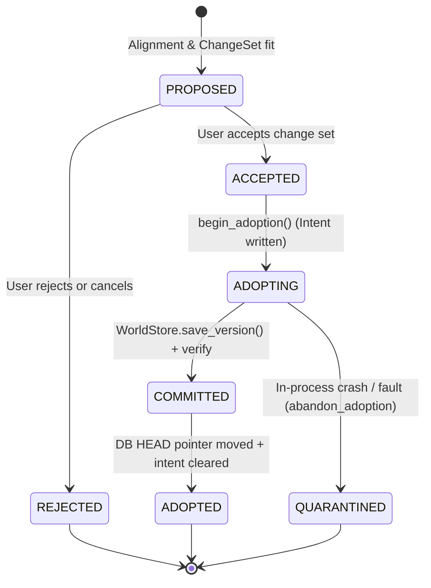

# Engineering Design Decisions

Canonical decision log. Only decisions **already made and enforced in
the codebase** appear here; open questions live in
[`../implementation/PENDING_IMPLEMENTATION.md`](../implementation/PENDING_IMPLEMENTATION.md)
as BLOCKED entries. Format mirrors `docs/DECISIONS.md` (V11 decisions
1–16); numbering continues from there.

Statuses: `ACCEPTED` (enforced), `PROVISIONAL` (reversible; revisit
trigger named).

---

## Decision 017 — Canonical geometry representation

**Status: ACCEPTED**

`MeshData` (`reconstruction/meshing/mesh.py`) is the canonical runtime
mesh representation: vertices, triangle indices, normals, coordinate
frame, metadata. COLMAP/OpenMVS are backend representations; Blender,
glTF, USD are export representations. A bounding box is an approximation
of an object and is labeled `INFERRED` — never presented as mesh
geometry.

## Decision 018 — Canonical world representation

**Status: ACCEPTED**

WorldIR v1 (`world_ir/world_v1.py`) is the canonical semantic world.
The viewer/Studio is a client of WorldIR + ArtifactStore. Compiled
worlds reference geometry through `(data_uri, data_hash)` artifact
pointers rather than embedding payloads.

## Decision 019 — Runtime intelligence

**Status: ACCEPTED**

No LLM dependency in the canonical runtime. Perception comes from real
model backends (Mask R-CNN, MiDaS, SAM when unblocked), geometry, and
numerical methods. Detection/segmentation backends sit behind
interfaces (`IDetectorBackend`, `ISegmentationBackend`) so models are
replaceable without touching the pipeline.

## Decision 020 — First depth sidecar format

**Status: ACCEPTED**

16-bit PNG first; EXR second (floating-point); device-specific raw
formats via explicit adapters later. Canonical representation:
`DepthFrame` with explicit `depth_scale`, `invalid_value`, `units`,
`calibration_ref`. **Raw integer depth must never be interpreted as
meters without an explicit scale factor.** Rationale: lossless,
inspectable, trivially testable, ubiquitous in RGB-D capture; EXR adds
value only when sub-mm float precision matters (rare before P1).

## Decision 021 — Surface reconstruction backend

**Status: PROVISIONAL**

COLMAP `poisson_mesher` (CPU) is the surface-reconstruction backend:
mature, already a repo dependency, accepts a plain oriented point cloud.
The backend adapts Poisson depth to point density and retries with
`trim=0` when the dense-cloud default yields an empty mesh (observed:
COLMAP's trim=10 requires density sparse clouds never reach).
**Revisit trigger:** a CUDA-capable COLMAP (unblocking
`patch_match_stereo` true MVS) or an OpenMVS backend — whichever lands
first changes the dense-geometry path, not the `MeshData` contract.

## Decision 022 — Honest unavailability states

**Status: ACCEPTED**

When a backend/model/dependency is missing, stages report a skip with
the reason (report.json `"status": "skipped"` + note; CLI exit 1 with
diagnostics) — never a placeholder that pretends inference happened.
Corollaries already enforced: `lift_region_to_3d` returns `None` for
non-metric depth instead of guessing scale; the perception stage refuses
without trusted intrinsics; `reality compile` never prints green on
failed stages.

## Decision 023 — Metric scale anchoring

**Status: ACCEPTED**

Metric scale comes only from an explicit operator-measured baseline
(`ScaleReference`) between two registered cameras, or — for mono-depth —
from alignment of relative depth to the SfM sparse cloud, in which case
the world is labeled `metric-by-alignment`. Unanchored worlds stay
`relative` with unit-less distances. There is no code path that invents
a scale factor.

**Amendment 2026-10-31 (user decision, option 2 -- suggest, user accepts; plan item D2b in `docs/superpowers/plans/2026-10-30-room-reconstruction-fidelity.md`).**
Scale is NEVER applied without the user's consent. Besides the camera baseline,
two more `ScaleReference` methods exist, both in model space and both gated:

- `known_length` -- the user states the real length of one edge / two picked
  points. Treated as a measurement (state MEASURED). Several known lengths are
  combined by median and must agree within `RATIO_SPREAD_MAX` (5 %), otherwise
  they are refused. API: `POST /api/worlds/{id}/scale` with
  `{method:"known_length", distance_m, point_a, point_b}` (or `model_length`).
- `prior_accepted_by_user` -- when the world is RELATIVE and a door with a
  measured height was fitted, the engine SUGGESTS a typical size
  (`GET /api/worlds/{id}/scale/suggestion`: door 2.0-2.1 m, midpoint 2.05 m, the
  object it came from, implied m/unit). Nothing changes until the user accepts
  (`POST .../scale` with `method:"prior_accepted_by_user"`, `source_entity_id`).
  Rejecting (`POST .../scale/suggestion/reject`) leaves the world RELATIVE. No
  door => no suggestion; a default is never offered.

A prior-based scale is ALWAYS labelled ESTIMATED (`scale_basis =
"prior_accepted_by_user"`, `dimension_state = "ESTIMATED"` in the world's
`metadata.scale` and the version report `stages.scale`); every dimension of
that world inherits ESTIMATED, never MEASURED (plan D1 reads these keys). Any
real measurement (camera baseline or known length) replaces the prior: trust
order is camera baseline > known length > accepted prior. A model-space length
is tied to the model unit it was measured in by a camera-pair fingerprint; if a
rebuild changes the unit the reference is refused rather than misapplied.

## Decision 024 — Camera-envelope filtering for meshing

**Status: ACCEPTED**

The sparse SfM cloud is triangulated, trustworthy geometry; it defines
the plausible scene envelope (95th-percentile camera-distance). Depth-
derived points beyond it are unprojection artifacts and are removed
before normal estimation/meshing. Observed necessity: without it, depth
outliers (km-scale) overwhelmed global outlier statistics and Poisson
meshed garbage at 400 m+ scale.

## Decision 025 — Deterministic test seam for the CLI pipeline

**Status: ACCEPTED**

`REALITY_TEST_BACKEND=module:Class` (env var, tests only) injects a
synthetic reconstruction backend so `reality compile` is E2E-testable
offline. Production leaves it unset and always uses COLMAP; the CLI
raises a clear error on a malformed spec rather than silently ignoring
it.

## Decision — Candidate selection by world evolution, rollback as a pointer move

**Status: ACCEPTED**

1. Incremental vs full COLMAP candidates are compared as WORLDS against HEAD with the same `world_delta`
   machinery that gates adoption (`engine/pipeline/candidate_selection.py`), by an ordered, recorded
   hierarchy - never by registered-camera count and never by a scalar score. Ties keep the incremental
   candidate (coordinate-frame continuity). If both fail acceptance the adoption gate keeps HEAD.
2. Rollback moves only the HEAD pointer. Versions stay immutable, evidence is never removed, the COLMAP
   base is set aside (renamed) before the pointer moves, and the next version chains onto the rolled-back
   HEAD (its evidence is the union of everything the world holds, so photos later versions used are retried).
3. The COLMAP session is derived state that commits strictly after WorldStore adoption and read-back; a
   crash leaves it at most one version behind, which converges. No cross-store journal is required for that.

## Decision — Adoption protocol (WorldStore <-> DB) and coordinate-frame preservation

**Status: ACCEPTED (2026-10-02, final sprint)**

Found by probing the real code: a crash between `WorldStore.save_version` and the DB commit left an orphan version that
`resync_versions` later mirrored as a PHANTOM version, and a retry then minted a second one; and an in-process fault after
the HEAD `UPDATE` was persisted by the job runner's own failure-bookkeeping commit, leaving HEAD naming a version with no
mirror row.

1. Adoption order is: intent file (`adoption-intents/`) -> WorldStore version -> read-back verification (BEFORE the
   pointer moves; the DB never names a version the store cannot reconstruct) -> DB HEAD + mirror row in ONE transaction
   -> intent cleared. Both writers (`commit_version`, the entity-correction route) use it.
2. A version written but never adopted is QUARANTINED (`quarantine/`; record moved, artifact kept, nothing deleted):
   immediately on an in-process fault, or by `reconcile_adoptions` at startup after a hard kill. `resync_versions` never
   mirrors a version with a pending intent. Versions with no intent (CLI writers) remain legitimate history.
3. A failed adoption undoes its own pending HEAD move/row inside the caller's transaction (no rollback: that would expire
   the caller's loaded objects).
4. Candidate arbitration: with an established HEAD, a candidate that keeps HEAD's coordinate frame beats one that
   re-expresses the world in a new frame unless the latter places >= `FRAME_CHANGE_MIN_EXTRA_PHOTOS` (2) more photographs.
   The frame shift is measured from the similarity `world_delta` already fits (geometry rules are blind to it by design).
   Tolerances are PROVISIONAL.
5. Retention: quarantined versions are kept indefinitely; a pruning policy is not decided.

Supersedes the old expectation (test_commit_failed_db_write_rolls_back) that an orphan is "reconciled into the listing".

## Decision — The working prototype is judged by the core loop; verification has four honest levels

**Status: ACCEPTED (2026-10-03, prototype-completion sprint)**

1. **Prototype scope.** The prototype is judged by `evidence -> world -> more evidence -> same world -> better world ->
   version -> export`, not by an ecosystem-integration checklist. Its export story is glTF, USD(A), IFC, CityGML,
   CityJSON and Blender (P16-01, DONE). The GIS / ROS / Habitat / SUMO / Unreal / Godot writers (P16-02) exist and are
   structure-tested, but are `OPTIONAL_DEFERRED`: no further work until a user of one of those ecosystems needs it, and
   nothing claims they load. Ledger states are exactly DONE / PARTIAL / BLOCKED / OPTIONAL_DEFERRED.
2. **Verification levels** (`engine/core/verification.py`; API `/api/system/verification`; CLI `reality verification`;
   `.agent/CAPABILITIES.yaml` is checked against the registry by a test): IMPLEMENTED < SYNTHETICALLY VERIFIED <
   REAL-WORLD VERIFIED, with EXTERNAL VERIFICATION PENDING items listed beside a capability. A capability below
   REAL-WORLD may not name real data; a synthetic one must be worded as synthetic; every one cites evidence files that
   exist. RGB-D, VIO, indoor architecture and 3DCityDB are synthetically verified with their real counterparts pending.
3. **Synthetic data policy** (`synthetic/`): deterministic, seeded, with the ground truth it was built from, labelled in
   every manifest it writes. It verifies the CONTRACT around a sensor or backend (formats, scales, invalid pixels, clock
   offsets, dropped frames, occlusion) -- never the sensor, never a VIO algorithm, never a real building. The VIO
   "binary" is a stand-in that perturbs ground truth; it exists to run the real subprocess adapters.
4. **Known limits are pinned, not hidden.** Where a synthetic fixture measured the engine WRONG (rooms joined by doorways
   merge; phantom openings under realistic depth noise; stairs not wired into assembly; the stair detector refuses an
   unsegmented flight or one with unobserved treads) the test is a strict `xfail` carrying the measured numbers: it flips
   to a failure the day the engine improves, forcing the pin and the ledger to be updated.
5. **Trajectories reach a world as an observation record**, not a registration: `trajectories.worldir.attach_trajectory`
   keeps the poses, clock/sync state and drift (unknown stays unknown) and records `registered_into_world: False` for a
   gauge-fixed frame. A VIO "world" frame is session-local until registration anchors it.
6. **3DCityDB availability is three-valued** (`probe_citydb`: AVAILABLE / UNAVAILABLE / FAILED) and probe-only: AVAILABLE
   means the `citydb` CLI runs, never that a database was reached. Contract tests against a fake CLI are not real
   3DCityDB verification; that stays external.

## Decision — Axis convention

**Status: ACCEPTED**

Right-handed, Y-up is the canonical world frame (`ARCHITECTURE.md`, `docs/MODULE_OWNERSHIP.md`,
`reconstruction/frame.py`, the viewport's `three-scene.ts`). The procedural grammars
(`procedural/room_grammar.py`, `urban_grammar.py`) author Z-up in grammar-local axes (x east, y north, z up; specs and
`origin` stay local) and convert once, in `_entity`, with the rotation (x, y, z) -> (x, z, -y), so height is world +Y and
local +y is world -Z. **Latent inconsistency, not fixed here:** `exporters/boxes.py` states "WorldIR is Z-up", which
contradicts this decision; reconcile it separately (exporters were deliberately left untouched).

## Decision — Site composer is manual placement, not registration

**Status: PROPOSED (feature at FOUNDATION; recorded 2026-10-31)**

A Site groups several already-reconstructed worlds and records a `SitePlacement` (position/rotation on a metric grid)
that the USER chose. It never infers where a world belongs, and a placement is never presented as registered or
geo-referenced. Automatic cross-source / geo-registration remains the MISSING item in
`docs/future/registration/CROSS_SOURCE_REGISTRATION.md` (it needs a measurable residual and a valid correspondence
set, which manual placement does not provide). Material hypotheses (plan M3) are likewise kept ESTIMATED with
`asserted=False` and are deliberately not mapped to physics materials.


## Quality bands (2026-10-13)

A model score is not a probability (master document 14.2), so the product shows coarse bands.

- **Entity band** (`apps/api/place_summary.py::entity_band`): `unknown` when provenance is UNKNOWN or confidence is missing or not
  a number; `weak` when provenance is CONFLICT or confidence is below 0.5; `fair` from 0.5 up to 0.75; `good` from 0.75.
  A conflict is never good, whatever its score. Not measured is never shown as good or bad.
- **Place band** (`band_and_reason`): `unknown` with no model; `weak` when fewer than half of the photographs are placed or the
  engine fell back below multi-view; `good` when the build was graded SUCCESS and at least 80% of photographs are placed;
  otherwise `fair`. The reason is returned with the band so the UI can say why.
- There is **no per-point band**: the stored point cloud carries no per-point confidence.
- The thresholds (0.5, 0.75, 0.8) are tolerances, not calibrated constants.

## Decision — One Studio UI (the workstation); no Simple/Pro switch (2026-11-07)

Status: accepted by the product owner ("Aa" = option A). Plan task T-1.1 in `docs/blueprint/33_TURNAROUND_PLAN.md`.

- The world page renders `SpatialWorkstation` for everyone. The Simple "place viewer" (`components/simple/*`) and the
  per-viewer Pro-mode preference (`re-pro-mode`, `useProMode`, Settings toggle) are removed.
- Why: the first customer (architecture and interior design firms) needs measuring, the inspector and evidence in the main
  view; two UIs for one world was a third noun beside Session and World (audit `32_FRONTEND_AUDIT.md` D1).
- A simpler presentation for clients comes back later as a **view mode inside the Studio** (plan M4b read-only client link),
  not as a second app.
- Consequence: `lib/copy.ts` and `lib/places.ts` (consumer wording and honest job progress) are no longer used by any screen; they
  stay because contract tests cover them. Delete or reuse when the client view is built.

## Decision — Proxy-only browser transport (2026-11-07, implemented)

Status: accepted and implemented (plan task T-1.2).

- The browser talks only to same-origin Next route handlers. Explicit handlers under `frontend/src/app/api/**` keep priority;
  the new catch-all `frontend/src/app/api/[...path]/route.ts` forwards every other `/api/**` call (any method, streamed
  request and response bodies) to the backend with the server-side token (`lib/api/backend.ts`).
- `apiBaseUrl()` (`lib/api/client.ts`): browser = same origin; Electron = injected `__REALITY_API_BASE__` (direct to the local
  API, unchanged); server-side rendering = `REALITY_BACKEND_URL`, then legacy `NEXT_PUBLIC_API_BASE_URL`, then :8100. The browser
  bundle no longer reads `NEXT_PUBLIC_API_TOKEN`; set `REALITY_API_TOKEN` (server only).
- The catch-all drops client `Authorization`, `Cookie`, hop-by-hop headers and rejects `.`/`..`/encoded-slash path segments.
- Verified 2026-11-07: Playwright suite 51 passed / 1 skipped in dev and in production-build mode; with a token-protected API
  the proxy returned 200 without a client token and with a forged one, passed 404/422 through, rejected an encoded traversal
  with 400, and a real JPEG upload returned 201 and came back byte-identical.
- Known limits: (1) one shared service token means **no per-user identity reaches the backend**. That is fine for the local
  single-user product and is the first thing to change for hosted multi-tenant use (M6: forward the user's credential
  instead of a blanket token). (2) Job-progress SSE has no frontend consumer yet, so streaming of long-lived events through the
  proxy is untested. (3) In `next dev` the first request compiles the route, so the footer health timeout was raised to 15 s.
- The new guard `test_every_proxy_targets_a_path_the_api_serves` skips the catch-all by design.

## Decision — Light theme shares the dark theme's copper accent (2026-11-07)

Status: accepted by the product owner ("copper is fine"). Plan task U.3.

- Light `--accent` is `#8a4f2a` (was legacy cyan `#00708a`); light and dark now share one brand. `--primary`/`--on-primary` are identical in both themes.
- Every colour pair is held to WCAG AA by `frontend/tests/contract/design-tokens.test.mts`; change a token value, then run `npm run test:contract`.
- Components use the token utilities from `globals.css` (`bg-surface`, `text-fg`, `text-success`, ...). The same test fails on any raw palette class (`text-zinc-400`, ...) in `src`.

## Decision — Learned single-image layout and open-vocabulary furniture (2026-11-07, implemented locally)

* **Why:** a real user world (10 AI-generated photos) came out with 5 floors, 1 wall and no furniture because 206 sparse SfM points cannot carry structure. A learned depth + surface-label stage gives every photo thousands of labelled 3D points.
* **Models (loaded from the local Hugging Face cache only, never downloaded at request time):** `depth-anything/Depth-Anything-V2-Metric-Indoor-Small-hf` (Apache-2.0 per the upstream project; its model card has no licence tag, **confirm before a paid release**), `openmmlab/upernet-convnext-tiny` (MIT per its model card), `IDEA-Research/grounding-dino-tiny` (Apache-2.0). Rejected for a paid product: MASt3R/DUSt3R and Depth Anything V2 Base and larger (non-commercial licences). VGGT and Mask2Former were not evaluated.
* **Selection rule:** multi-view is kept when credible (>= 40 sparse points per registered camera and >= 3 cameras). Only when it is not, and only if the layout path actually succeeds, the room shell is built from the best-supported single photograph. The replacement is recorded in `attempts` and the other photos are listed as not fused.
* **Honesty:** scale stays `relative` with an explicit "ESTIMATE" note (monocular metric depth is roughly 10-20 % off, never a measurement); entities are capped at 0.35 confidence (openings 0.3); implausible openings (floating doors, sliver windows) are refused with the reason.
* **Opt-outs:** `REALITY_LAYOUT_MODELS=0`, `REALITY_OPEN_VOCAB=0`; both are skipped under the `REALITY_TEST_BACKEND` seam.
* **Open:** fusing several photographs into one shell; accuracy needs the labelled set (8.6).

## Decision 026 — Production Hosting Architecture & Monthly Cost Model (1 API Box + 1 GPU Worker + S3 Storage) (T-6.1)

**Status: ACCEPTED (ADR 2026-11-07)**

### 1. Context & Objectives
Reality Engine consists of two fundamentally distinct workloads:
1. **Interactive API & Client Viewport**: Lightweight, latency-critical REST endpoints, WebSockets/SSE, Next.js frontend SSR, spatial queries, and persistent per-world undo/redo command logs.
2. **Batch Spatial & ML Perception**: Heavy GPU compute executing COLMAP sparse SfM, OpenMVS/Poisson surface reconstruction, and monocular depth/segmentation models (Depth Anything V2, UPerNet, Grounding DINO).

Running GPU instances 24/7 wastes 85–95% of server expenditure during idle hours. Conversely, routing multi-gigabyte raw photo uploads and GLB assets through a single compute instance saturates network bandwidth and exhausts memory.

### 2. Architecture Decision: 3-Tier Split
We adopt a decoupled cloud-native topology:

```
[ Client Browser / Mobile Capture ]
      |                      \ (Presigned S3 Upload / Download)
      v                       v
[ Tier 1: API / Web Box ]   [ Tier 3: S3 Object Store (Cloudflare R2) ]
      |                       ^
      | (Durable Job Dispatch) | (Fetch Evidence / Write WorldIR & GLB)
      v                       |
[ Tier 2: On-Demand GPU Worker (RunPod Serverless / Modal) ]
```

#### Tier 1 — API & Web Server (1 Box)
- **Role**: Serves Next.js frontend, FastAPI REST endpoints, SQLite / PostgreSQL metadata, and enqueues reconstruction jobs.
- **Specification**: 4 vCPU, 8 GB RAM (e.g. Hetzner Cloud CPX31 or AWS EC2 t4g.xlarge).
- **Network**: Public HTTPS with Let's Encrypt SSL, rate limiting, and CORS restrictions.
- **Storage**: 80 GB NVMe for OS, local DB, and temporary caches.

#### Tier 2 — On-Demand GPU Worker (RunPod Serverless / Modal Labs)
- **Role**: Executes heavyweight perception and 3D reconstruction pipelines on a worker container.
- **Specification**: NVIDIA RTX 4090 (24 GB VRAM) or NVIDIA L4 / A10G (24 GB VRAM) container with CUDA 12.x, PyTorch, COLMAP, and pre-baked model weights.
- **Lifecycle**: Scales to 0 when idle. Cold start < 15 seconds using warm container layers; job execution time typically 2.5 to 5.0 minutes per room reconstruction.
- **Billing**: Per-second execution billing (~$0.44/hour on RunPod Serverless or $0.00022/second).

#### Tier 3 — S3-Compatible Object Store (Cloudflare R2 / AWS S3)
- **Role**: Primary durable repository for session evidence photos, depth sidecars, point clouds, WorldIR JSON snapshots, and GLB / IFC export binaries.
- **Provider**: **Cloudflare R2** chosen for its **$0.00 egress bandwidth fee** guarantee, avoiding surprise egress bills from architectural model downloads and video sweeps.
- **Security**: Tenant-isolated bucket prefixes (`/{tenant_id}/{world_id}/artifacts/{sha256}.bin`). Raw uploads generated via short-lived presigned URLs.

---

### 3. Monthly Cost Estimates & Tier Projections

| Resource | Low / Staging (50 jobs/mo) | Mid / Commercial (500 jobs/mo) | High / Scale (2,500 jobs/mo) |
| :--- | :--- | :--- | :--- |
| **API Box (Hetzner CPX31/CPX41)** | $16.50 / mo | $31.00 / mo | $65.00 / mo |
| **GPU Compute (RTX 4090 @ $0.44/hr)** | $1.47 / mo *(3.3 hrs)* | $14.67 / mo *(33.3 hrs)* | $73.33 / mo *(166.7 hrs)* |
| **Object Storage (Cloudflare R2)** | $0.38 / mo *(25 GB)* | $3.75 / mo *(250 GB)* | $22.50 / mo *(1.5 TB)* |
| **Data Egress Bandwidth** | $0.00 *(R2 Free Egress)* | $0.00 *(R2 Free Egress)* | $0.00 *(R2 Free Egress)* |
| **DNS / SSL / Observability** | $1.50 / mo | $3.00 / mo | $10.00 / mo |
| **Total Monthly Spend** | **$19.85 / mo** | **$52.42 / mo** | **$170.83 / mo** |

*Estimated cost per completed room reconstruction at commercial volume:* **~$0.10 per room**, providing a 98% gross margin on standard architectural subscription tiers ($49–$199/month).

---

### 4. Consequences & Implementation Seams
1. **Local Developer Experience Preserved**: The default local runtime continues to use local filesystem storage (`STORAGE_ROOT`) and in-process background worker execution without requiring cloud credentials.
2. **Adapter Contract (T-6.3)**: `ArtifactStore` interface isolates filesystem vs S3 implementations (`S3ArtifactStore`), validated against MinIO in CI.
3. **Durable Job Queue (T-6.2)**: API box publishes job payloads to queue; GPU worker polls or receives webhook triggers and posts results back directly to object store.

---

## Decision 027 — Multi-Session World Adoption Contract & Progressive Project Evolution

**Status: ACCEPTED (T-4.1, Constitution §3)**

### 1. Context & Motivation
Small-to-mid architectural and interior design firms capture spaces incrementally—often room by room across separate sessions—and frequently perform follow-up site visits to survey additional areas or document structural changes.

In a production SaaS environment:
- Treating every capture session as an isolated, standalone world fragments projects into disconnected files.
- Silently clobbering an existing world model risks obliterating manual user design work, violating **Product Constitution Rule 18** (manual user edits are strictly protected against late reconstruction overwrites).
- A second or subsequent site visit must seamlessly propose an **Adoption**: registering the new session into the existing World coordinate frame, deriving an explicit, categorized change set, and allowing the professional user to review, arbitrate, and approve the evolution of the model.

This ADR establishes the formal adoption contract, data schema, confidence scoring, and state machine governing session-to-world adoption across the reality engine.

---

### 2. Core Entities & Identity Hierarchy

```
+-------------------------------------------------------------+
|                          Project                            |
|  (Tenant-scoped container for an architectural site/client) |
+-------------------------------------------------------------+
                              | 1
                              |
                              * n
+-------------------------------------------------------------+
|                          WorldID                            |
|       (Durable Digital Twin with linear version history)     |
|       v0  -->  v1  -->  v2 (HEAD)                           |
+-------------------------------------------------------------+
      ^                                      ^
      | adopts                               | adopts
+---------------+                      +---------------+
|   Session A   |                      |   Session B   |
| (Site Visit 1)|                      | (Site Visit 2)|
+---------------+                      +---------------+
```

1. **`WorldID`**:
   - The authoritative, long-lived identifier for the digital twin of a building or apartment.
   - Owns a strictly linear, immutable version history (`v0, v1, v2, ...`) managed in `WorldStore`.
   - Contains the canonical semantic `WorldIR` graph (walls, slabs, openings, fixtures, furniture, finishes).

2. **`SessionID`**:
   - An immutable evidence bundle from a single capture event (photos, camera intrinsics/extrinsics, GPS/IMU trajectories, and dense point evidence).
   - Does not have mutable state. Once uploaded and reconstructed into candidate geometry, it can be proposed for adoption into one or more target worlds.

---

### 3. Candidate Matching & Relative Alignment (`CandidateMatch`)

When an incoming session `S` is evaluated against an existing target world `W_HEAD`:

1. **Multi-Cue Registration Ladder**:
   - **Level 1 (Direct Visual Loop Closure)**: 2D feature matching between session photos and world keyframes with RANSAC PnP / Sim(3) Kabsch alignment.
   - **Level 2 (Portal & Opening Matching)**: Shared architectural opening geometry (doorways, pass-throughs) matched across room boundaries within metric tolerances.
   - **Level 3 (Planar Alignment)**: RANSAC alignment of major structural planes (gravity vector / vertical up-axis, coplanar floor slabs, bounding wall segments).

2. **Transform Contract**:
   The registration yields a 7-DOF similarity transformation `T_{S -> W} in Sim(3)`:
   `x_W = s * R * x_S + t`
   where `R in SO(3)`, `t in R^3`, and scale `s > 0`. If scale is already metric from calibrated sensors or known references, `s == 1.0`.

---

### 4. Alignment Confidence Scoring (`alignment_confidence`)

Every candidate match computes a normalized scalar confidence `C_align in [0.0, 1.0]`:
`C_align = 0.45 * w_overlap + 0.35 * w_feature + 0.20 * w_scale`

Where:
- `w_overlap`: Fractional bounding-volume and structural plane inlier overlap.
- `w_feature`: Visual feature inlier ratio and mutual nearest-neighbor correspondence quality.
- `w_scale`: Metric consistency ratio (`|1.0 - s| <= 0.02`).

#### Operational Confidence Tiers:
| Confidence Tier | Score Range | Engine Behavior & UX Policy |
| :--- | :--- | :--- |
| **`HIGH`** | `C_align >= 0.85` | Automatic alignment verified (RMSE <= 0.03 m). Proposed changes presented for one-click adoption approval. |
| **`MODERATE`** | `0.60 <= C_align < 0.85` | Spatial overlap confirmed but partial (e.g. single connecting doorway). UI displays side-by-side 3D overlap preview with registration highlights. |
| **`LOW`** | `C_align < 0.60` | Automatic alignment refused. System offers manual 3-point correspondence alignment or creation of a separate room cluster. |

---

### 5. Change Set Schema (`ChangeSet`)

Comparing the aligned session candidate against `W_HEAD` generates an explicit semantic change set. Every entity in the candidate is deterministically classified into exactly one of five categories:

```json
{
  "adoption_id": "adp_9a7bc412",
  "world_id": "wld_841c36c1",
  "session_id": "ses_e01f29da",
  "alignment_confidence": 0.92,
  "change_set": {
    "matched": ["ent_wall_north_01", "ent_floor_01"],
    "new": ["ent_room_kitchen", "ent_wall_k01", "ent_window_k01"],
    "updated": ["ent_wall_east_01"],
    "uncertain": ["ent_chair_unknown_02"],
    "conflicting": []
  }
}
```

1. **`MATCHED`**:
   - The session observation confirms an existing entity within tolerance (spatial deviation <= 2 cm, surface normal deviation <= 5 degrees).
   - Action: Entity ID is preserved; observation count increments; evidence linkages added; geometric confidence bounds tightened.

2. **`NEW`**:
   - Geometry detected in the session that corresponds to no existing entity in `W_HEAD` (e.g., an adjacent newly surveyed room or newly placed piece of furniture).
   - Action: Entity assigned a stable UUID with `SessionProvenance`, linked into the parent room graph, and added to the world model upon adoption.

3. **`UPDATED`**:
   - Existing unlocked entity whose geometry or boundary is refined by denser observations (e.g. higher-density wall points revealing an exact opening boundary).
   - Action: Entity geometry and bounding metrics updated; previous geometry preserved in version history.

4. **`UNCERTAIN`**:
   - Low-observation count, occluded, or boundary-ambiguous entity (e.g. `coverage_state == "PARTIALLY_OBSERVED"`).
   - Action: Flagged in UI for explicit user toggle (Accept / Drop) before committing.

5. **`CONFLICTING`**:
   - Geometric clash (e.g. wall shifted > 5 cm compared to prior survey).
   - Clashes with an entity carrying `is_manual_edit=True` or `provenance="USER_EDIT"`.
   - Action: **Rule 18 Protection**: Manual edits are never overwritten. The user edit is retained by default; the user is presented an explicit side-by-side resolution choice.

---

### 6. Adoption State Machine & Safety Protocol



1. **`PROPOSED`**: Candidate aligned and `ChangeSet` generated. Read-only review state in UI.
2. **`ACCEPTED`**: User confirms adoption (all non-conflicting + resolved items).
3. **Atomic Transaction Execution**:
   - Calls `worldstore_service.begin_adoption(world_id, parent_version)`.
   - Saves new version `v_{N+1}` to storage root.
   - Reads back and verifies structural integrity of the synthesized `WorldIR`.
   - In a single DB transaction, updates world `head_version_id` and records the mirror version row.
   - Clears adoption intent via `worldstore_service.finish_adoption()`.
4. **Crash Invariance**:
   - If an unhandled failure occurs before HEAD moves, `abandon_adoption()` quarantines the staged directory (`quarantine/`).
   - Startup reconciliation (`reconcile_adoptions`) cleans orphaned intents before workers process incoming tasks.
   - The world model is never left in a corrupted or ambiguous state.

