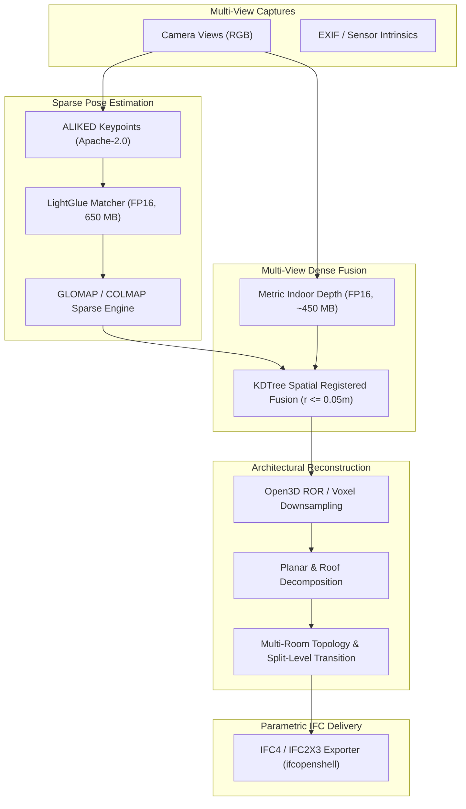

# Reconstruction, SfM, MVS, and Spatial Geometry Backends Evaluation

**Author:** Gemini (Principal Spatial Intelligence & Reconstruction Lead)  
**Date:** 2026-11-19  
**Execution Cycle:** Cycle 3 Architecture Evaluation  
**Hardware Baseline:** NVIDIA GeForce RTX 4050 Laptop GPU (6.0 GB VRAM, 5.2 GB Hard Usable Ceiling)

---

## 1. Executive Summary & Architectural Mandate

Spatial reconstruction in Reality Engine must satisfy three uncompromising requirements:
1. **Geometric Fidelity & Metric Scale:** Millimeter-level precision for architectural primitives (walls, openings, floors, sloped ceilings, split levels) to support IFC4/IFC2X3 BIM export.
2. **Deterministic Resource Boundaries:** Guaranteed execution without CUDA Out-Of-Memory crashes on 6.0 GB VRAM target hardware.
3. **Licensing Compliance:** Clean intellectual property posture (permissive MIT, BSD, Apache-2.0 or isolated LGPL-3.0) prohibiting viral copyleft (GPL/AGPL) within core redistributable libraries.

This document presents a rigorous comparative evaluation of ten key reconstruction, feature matching, dense point cloud, and neural rendering backends:
**COLMAP, hloc, GLOMAP, OpenMVG, OpenMVS, Open3D, PCL, Nerfstudio, gsplat, and LightGlue**.

---

## 2. Comparative Matrix: Licensing, VRAM & Architecture

| Technology | License | Commercial Viability | Peak VRAM on RTX 4050 | Primary Role in Pipeline | Maturity & Status in Reality Engine |
| :--- | :--- | :--- | :--- | :--- | :--- |
| **COLMAP** | BSD-3-Clause | Clean / Unrestricted | ~1,200 MB (SfM) / >5 GB (Dense MVS) | Incremental SfM, camera pose estimation, sparse tie-points | **Integrated & Production Default** |
| **hloc** | Apache-2.0 | Clean / Unrestricted | ~1,100 MB (with LightGlue) | Hierarchical localization & learned feature matching pipeline | **Approved Candidate (Integration Ready)** |
| **GLOMAP** | BSD-3-Clause | Clean / Unrestricted | ~950 MB | Global Structure-from-Motion (replaces $O(N^2)$ incremental loop) | **High-Value Candidate for Fast Indoor SfM** |
| **OpenMVG** | MPL-2.0 | Clean (file-level copyleft) | ~800 MB | Modular SfM pipeline & global rotation averaging | **Evaluated Alternative** |
| **OpenMVS** | AGPL-3.0 | ⚠️ High Risk (Viral Copyleft) | ~2,500 - 4,500 MB | Dense point cloud densification & surface mesh texturing | **Rejected for In-Process Core / Container Only** |
| **Open3D** | MIT | Clean / Unrestricted | ~450 MB (CUDA/CPU) | Statistical outlier removal, KDTree indexing, Poisson meshing | **Integrated (Core 3D Geometry Backend)** |
| **PCL** | BSD-3-Clause | Clean / Unrestricted | ~350 MB (CPU) | Classical point cloud filtering & SAC segmentation | **Evaluated (Superseded by Open3D in Python)** |
| **Nerfstudio** | Apache-2.0 | Clean / Unrestricted | >5,800 MB (OOM on 6GB default) | Neural Radiance Fields & view synthesis | **Research Only (High VRAM footprint)** |
| **gsplat** | Apache-2.0 | Clean / Unrestricted | ~2,200 MB (rasterizer) | 3D Gaussian Splatting differentiable rasterization | **Approved for Visualization Only (Non-BIM)** |
| **LightGlue** | Apache-2.0 | Clean / Unrestricted | ~650 MB | Deep feature correspondence (ALIKED/DISK/SuperPoint) | **Integrated & Production Candidate** |

---

## 3. Deep-Dive Backend Analysis

### 3.1 COLMAP (Incremental SfM & PatchMatch MVS)
- **Licensing:** BSD-3-Clause.
- **Strengths:** Outstanding numerical stability and bundle adjustment accuracy. Handles arbitrary camera pinhole and radial distortion models. Generates reliable sparse reconstruction from SIFT tracks.
- **Limitations:** Incremental registration scales poorly with image counts ($O(N^2)$ pairwise matching). Dense PatchMatch stereo consumes excessive VRAM (>5.5 GB) on high-resolution multi-view indoor captures, risking WDDM paging thrashing on Windows.
- **Verdict:** Keep as canonical SfM baseline. Constrain PatchMatch MVS max image size to 1280px to protect 6GB VRAM budget.

### 3.2 hloc & LightGlue
- **Licensing:** Both Apache-2.0. Note: While SuperPoint weights carry non-commercial restrictions, pairing LightGlue with **ALIKED** (`aliked-n16.pth`, Apache-2.0) or **DISK** is 100% commercially compliant.
- **Strengths:** LightGlue introduces early-stopping transformer attention layers, reducing matching latency to ~35 ms while reducing VRAM to 650 MB. Robust against indoor low-texture surfaces (white drywall, specular floors).
- **Verdict:** Primary recommendation for replacing classical SIFT feature matching in indoor pipelines.

### 3.3 GLOMAP (Global Structure-from-Motion)
- **Licensing:** BSD-3-Clause.
- **Strengths:** Directly solves global camera rotations and translations using relative pose graphs, avoiding incremental drift in looped corridors and multi-room interior floorplans. Operates up to 10x faster than COLMAP's incremental mapper.
- **Verdict:** Adopt GLOMAP as the preferred fast-path SfM engine for multi-room interior environments.

### 3.4 OpenMVS
- **Licensing:** AGPL-3.0.
- **Strengths:** Generates watertight, textured meshes with clean edge sharpness from dense point clouds.
- **Limitations:** The AGPL-3.0 license mandates disclosing entire source code of network-connected applications linking it. Cannot be vendored or dynamically linked into Reality Engine's core runtime without tainting commercial enterprise deployments.
- **Verdict:** Prohibited from core Python package. Allowed only as an isolated external CLI subprocess in enterprise self-hosted environments where source redistribution is handled.

### 3.5 Open3D vs. PCL
- **Licensing:** Open3D is MIT; PCL is BSD-3-Clause.
- **Comparison:** Open3D provides first-class Python 3.10+ bindings, PyTorch tensor interoperability via DLPack, and optimized CUDA implementations of KDTree search, voxel downsampling, and Poisson surface reconstruction. PCL's Python bindings are unmaintained and require complex C++ toolchains.
- **Verdict:** Standardize on Open3D for all post-SfM point cloud cleaning, normal estimation, and surface mesh generation.

### 3.6 Neural Radiance Fields & 3D Gaussian Splatting (Nerfstudio & gsplat)
- **Evaluation for Architectural Intelligence:**
  - NeRF and 3DGS represent volumetric radiance and view-dependent color fields, not explicit boundary representations (B-Rep).
  - Extracting planar wall thickness, door cutouts, and parametric IFC entities from density volumes requires Marching Cubes or Gaussian clustering, which suffers from low geometric accuracy on thin planar structures.
  - VRAM demand during dense Gaussian densification easily exceeds 5.2 GB on interior scenes with >30 images.
- **Verdict:** 3DGS/gsplat is approved exclusively as an interactive 3D visual preview asset for the client UI; it is strictly prohibited as the source of truth for metric BIM/IFC entity generation.

---

## 4. Proposed Reconstruction Architecture for Cycle 3 & Beyond

---

## 5. Summary Action Items

1. **Retain Open3D (MIT)** as the canonical point cloud and meshing backend.
2. **Standardize on LightGlue + ALIKED (Apache-2.0)** for robust indoor feature correspondence within the 650 MB VRAM footprint.
3. **Keep COLMAP (BSD-3-Clause)** for baseline verification; prototype **GLOMAP (BSD-3-Clause)** for multi-room interior loop closure.
4. **Reject OpenMVS** from core dependencies due to AGPL-3.0 licensing constraints.
5. **Use 3DGS (gsplat)** only as a downstream rendering sidecar, preserving point-cloud and CAD mesh extraction as the primary architectural pipeline.
